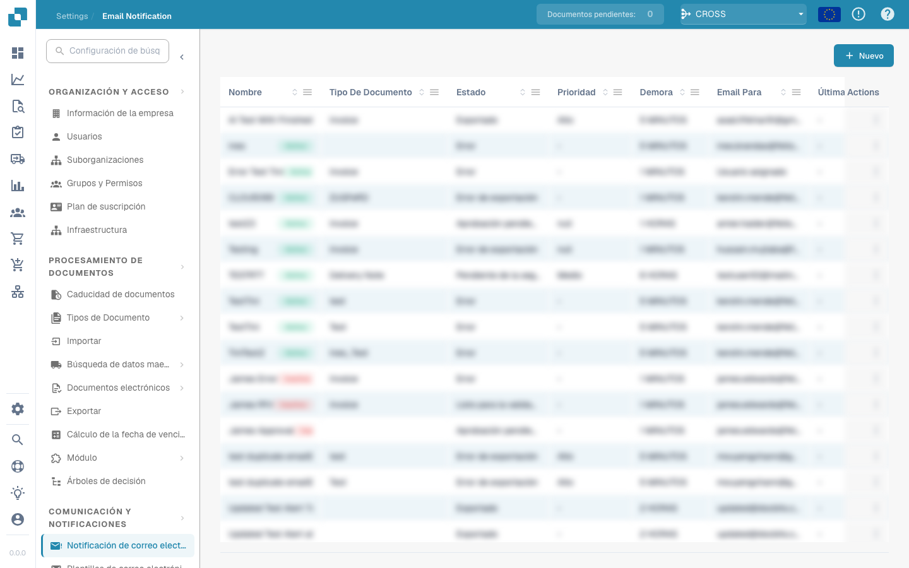

# Notificación por correo electrónico


DocBits Tutorial de tareas y notificaciones: asignar trabajo, realizar un seguimiento del estado y gestionar tareas de flujo de trabajo


<figure><figcaption></figcaption></figure>

Configurar las notificaciones por correo electrónico es fundamental. Las notificaciones por correo electrónico en DocBits se pueden configurar para notificar a los usuarios sobre diversos eventos relacionados con documentos, como: finalización del procesamiento, errores de importación o exportación o solicitudes de intervención del usuario. Esta herramienta es esencial para mantener una comunicación efectiva y una continuidad operativa en entornos de procesamiento de documentos. Aquí hay algunas razones por las que esto es importante:

**Comunicación en tiempo real:**

* Las alertas por correo electrónico permiten a los usuarios recibir notificaciones inmediatas sobre eventos importantes o cambios en su sistema de gestión de documentos. Esto garantiza que todas las partes relevantes sean informadas inmediatamente sobre las actualizaciones importantes.

**Transparencia y trazabilidad:**

* Al configurar notificaciones por correo electrónico, los usuarios pueden rastrear y monitorear el estado de los eventos de procesamiento de documentos. Esto mejora la transparencia y la trazabilidad en el sistema de gestión documental.

**Timely reactions:**

* La notificación automática de eventos como publicaciones, comentarios o aprobaciones de documentos permite a los usuarios responder rápidamente a solicitudes o actualizaciones. Esto ayuda a aumentar la eficiencia y la productividad.

**Automatización de flujos de trabajo:**

* Las notificaciones por correo electrónico se pueden integrar en los flujos de trabajo para enviar automáticamente notificaciones a los usuarios relevantes cuando se realizan determinadas acciones. Esto permite una automatización perfecta de los procesos comerciales.

**Recordatorios y plazos:**

* La configuración de notificación por correo electrónico se puede utilizar para recordar a los usuarios los próximos plazos o las tareas pendientes. Esto ayuda a garantizar que las tareas importantes se completen a tiempo.

En general, la configuración de notificaciones por correo electrónico desempeña un papel importante a la hora de mejorar la comunicación, aumentar la eficiencia y garantizar que los eventos de procesamiento de documentos se gestionen de manera oportuna y eficaz. Al automatizar las notificaciones, las organizaciones pueden garantizar que no se pierda información importante y que todas las partes relevantes se mantengan siempre actualizadas.

Esta configuración es fundamental para garantizar que las partes interesadas se mantengan informadas sobre el estado del procesamiento de documentos importantes, lo que ayuda a tomar decisiones rápidas y a una gestión eficiente de los flujos de trabajo de documentos.
