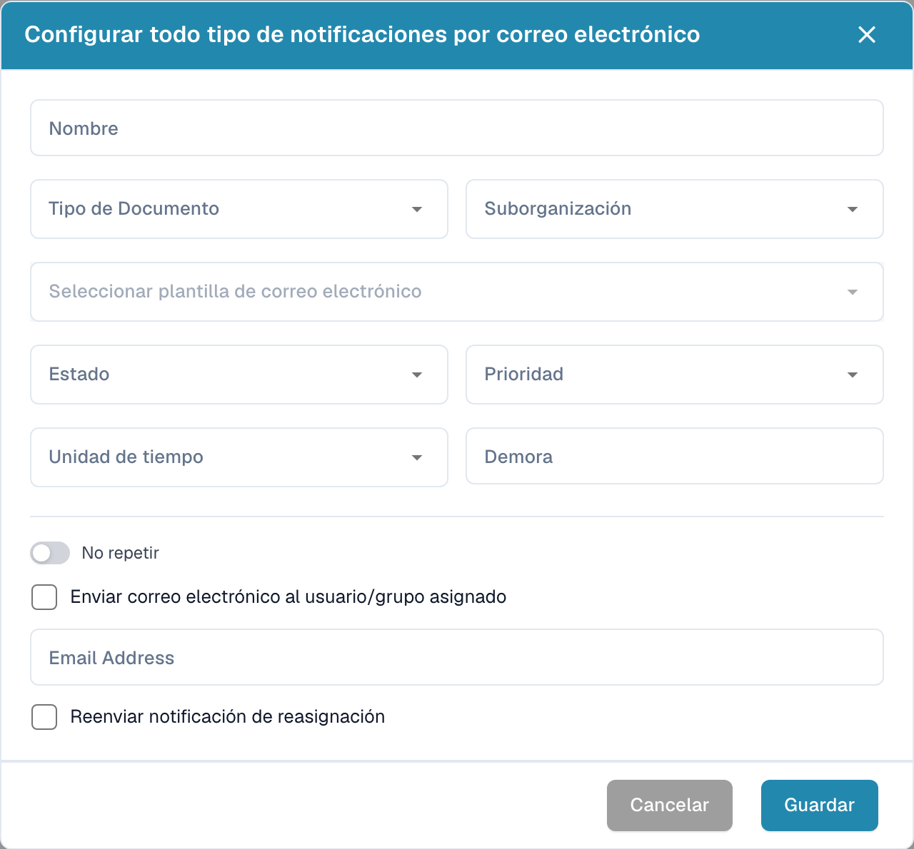

# Configurar notificaciones por correo

Abra **Ajustes → Notificación de correo electrónico** y seleccione **Nuevo**. Configure cuándo se envía el aviso y quién debe recibirlo.

<figure><figcaption>
Diálogo de configuración de una notificación por correo.
</figcaption></figure>

1. Introduzca un nombre y seleccione el tipo de documento y, si corresponde, la suborganización.
2. Seleccione la plantilla de correo y el estado del documento.
3. Defina prioridad, unidad de tiempo y retraso.
4. Revise si el aviso debe repetirse.
5. Seleccione el envío al usuario o grupo asignado, o indique la dirección de correo prevista.
6. Compruebe si debe reenviarse al cambiar la asignación.

Revise destinatarios, plazos y contenido antes de guardar. La imagen muestra una configuración vacía sin guardar; no demuestra el envío de un correo.



