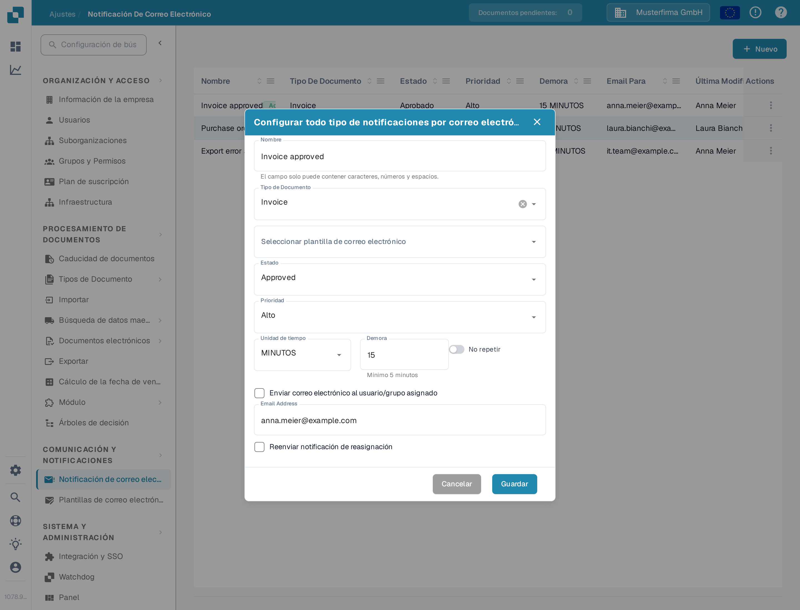
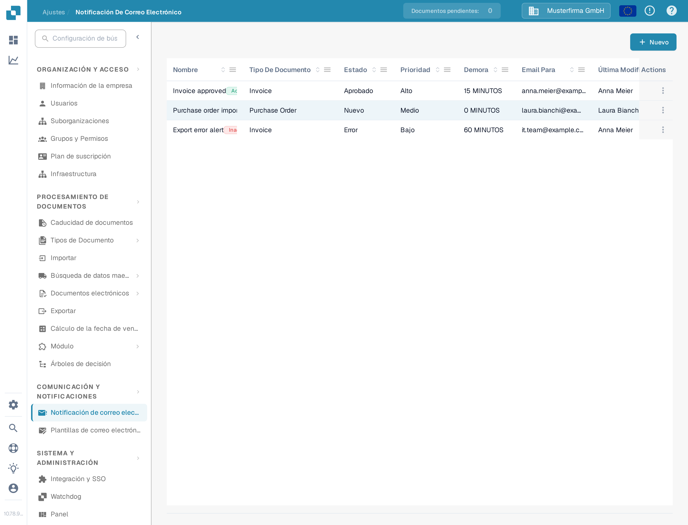
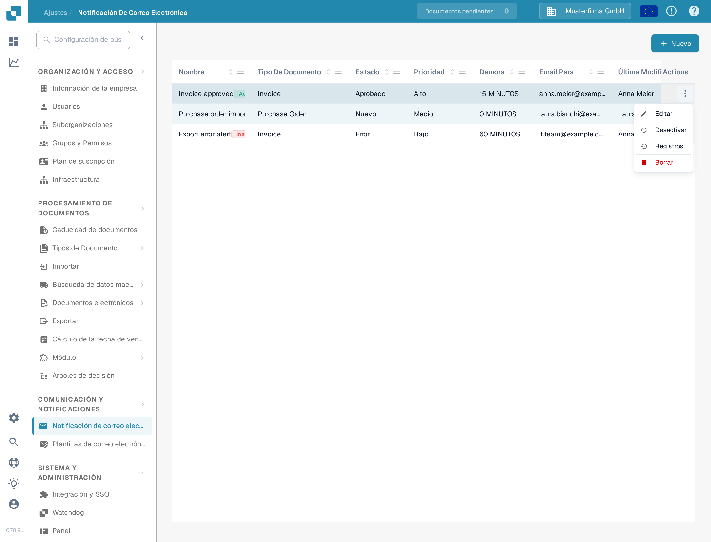
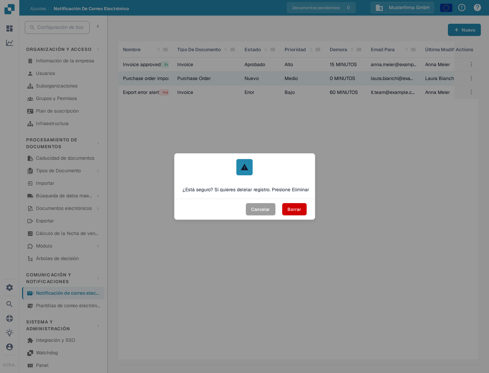
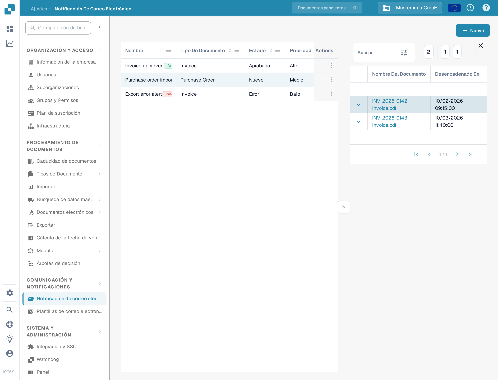

# Gestión de Notificaciones

Abra **Ajustes → Notificación de correo electrónico** para ver las reglas de su organización. Una regla conecta un estado de documento con una plantilla de correo electrónico y un destinatario. El ejemplo siguiente usa una regla de demostración para facturas que permanece **inactiva** en la Sandbox de DocBits.

## Ejemplo: una factura está lista para validación

Antes de crear una regla, prepare una plantilla de correo electrónico para **Invoice** en **Ajustes → Plantillas de correo electrónico**. En este ejemplo, la plantilla se llama **Docs Demo Invoice Validation**. La plantilla aporta el asunto y el mensaje del correo electrónico.

1. Seleccione **Nuevo** en la página **Notificación De Correo Electrónico**.
2. Escriba **Docs Demo Invoice Validation** como nombre, seleccione **Invoice** como tipo de documento y elija la plantilla de correo electrónico preparada.
3. Elija **Ready for validation** como estado y **Medio** como prioridad. Configure **Unidad de tiempo** en **MINUTOS** y **Demora** en **10**. La demora mínima en minutos es de cinco.
4. Seleccione **Enviar correo electrónico al usuario/grupo asignado**. Active **No repetir** si el mensaje debe enviarse solo una vez. Revise el destinatario y el momento de envío y seleccione **Guardar**.

<figure><figcaption>
La regla de ejemplo guardada, abierta para editar. Sus valores muestran cuándo y a quién se enviaría la notificación.
</figcaption></figure>

La regla aparece ahora en la lista. El ejemplo de la documentación se desactivó después, por lo que su menú **Actions** ofrece **Activar**; una regla activa ofrece **Desactivar**. Compruebe el nombre, el tipo de documento, el estado, la demora y el destinatario en su propia lista antes de activar una regla.

<figure><figcaption>
El ejemplo guardado le da una regla que puede encontrar y gestionar en la lista.
</figcaption></figure>

## Editar, activar o eliminar una regla

Abra el menú **Actions** de la fila. **Editar** abre la regla con sus valores actuales. **Activar** habilita este ejemplo inactivo; una regla activa ofrece **Desactivar** en su lugar. **Registros** abre su historial de notificaciones. **Borrar** elimina la regla tras la confirmación en el aviso **¿Está seguro?**. Compruebe los destinatarios y el momento de envío antes de activar o cambiar una regla.

<figure><figcaption>
Las acciones disponibles dependen de si la regla está activa.
</figcaption></figure>

<figure><figcaption>
El borrado pide confirmación y no se puede deshacer después.
</figcaption></figure>

En **Registros** verá por cada envío el **Nombre Del Documento**, la fecha en **Desencadenado En**, el **Destinatario** y el **Estado** de la notificación.

<figure><figcaption>
Los registros le muestran si cada notificación se envió correctamente.
</figcaption></figure>

Si la lista muestra **No Record Found!**, cree primero una regla. Si la lista de **Tipo de Documento** o de plantillas de correo electrónico está vacía, configure un tipo de documento activo y una plantilla que corresponda antes de volver a este formulario.

Para la configuración inicial, consulte [Configuración de Notificaciones](configuracion-de-notificaciones.md). Si los correos electrónicos no llegan como espera, consulte [Solución de problemas](solucion-de-problemas.md).
