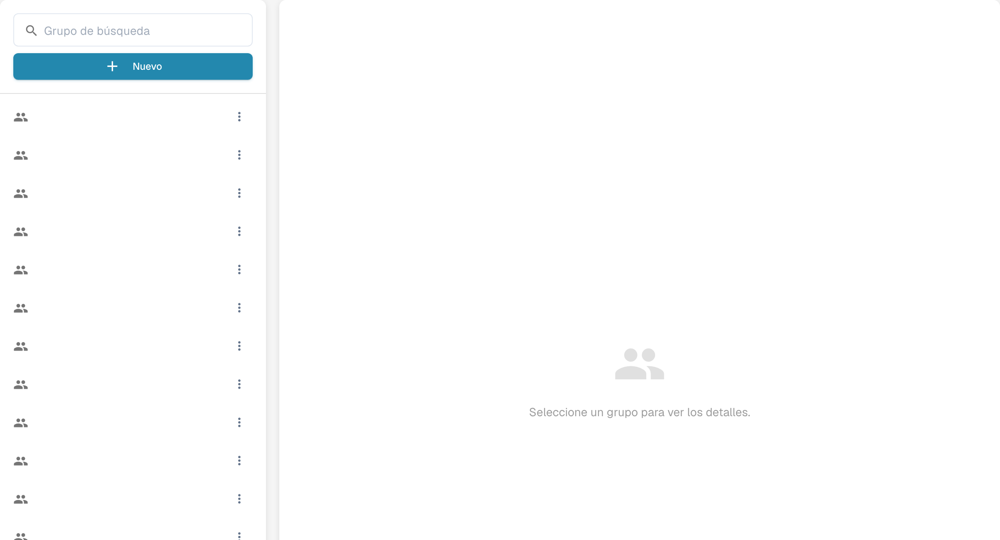

# Groups, Users and Permissions

Estos ajustes responden a tres preguntas distintas: quién puede iniciar sesión, en qué suborganización trabaja y qué puede hacer su grupo.

| Si necesita… | Abra… |
| --- | --- |
| Añadir o editar la cuenta de una persona | **Ajustes** → **Usuarios**; después lea [Users](users/README.md). |
| Organizar el acceso entre unidades de la empresa | **Ajustes** → **Suborganizaciones**; después lea [Sub-Organizations](sub-organizations/README.md). |
| Controlar el acceso por grupo | **Ajustes** → **Grupos y Permisos**; después lea [Groups and Permissions](groups-and-permissions/README.md). |

<figure><figcaption>
Panel de selección de grupos.
</figcaption></figure>

Si un usuario no puede ver un documento o una acción, compruebe primero su cuenta y su organización. Después compruebe los permisos del grupo correspondiente. Utilice una cuenta de prueba sin privilegios de administrador para confirmar el acceso que tendrá realmente un usuario normal antes de modificar una organización en producción.
