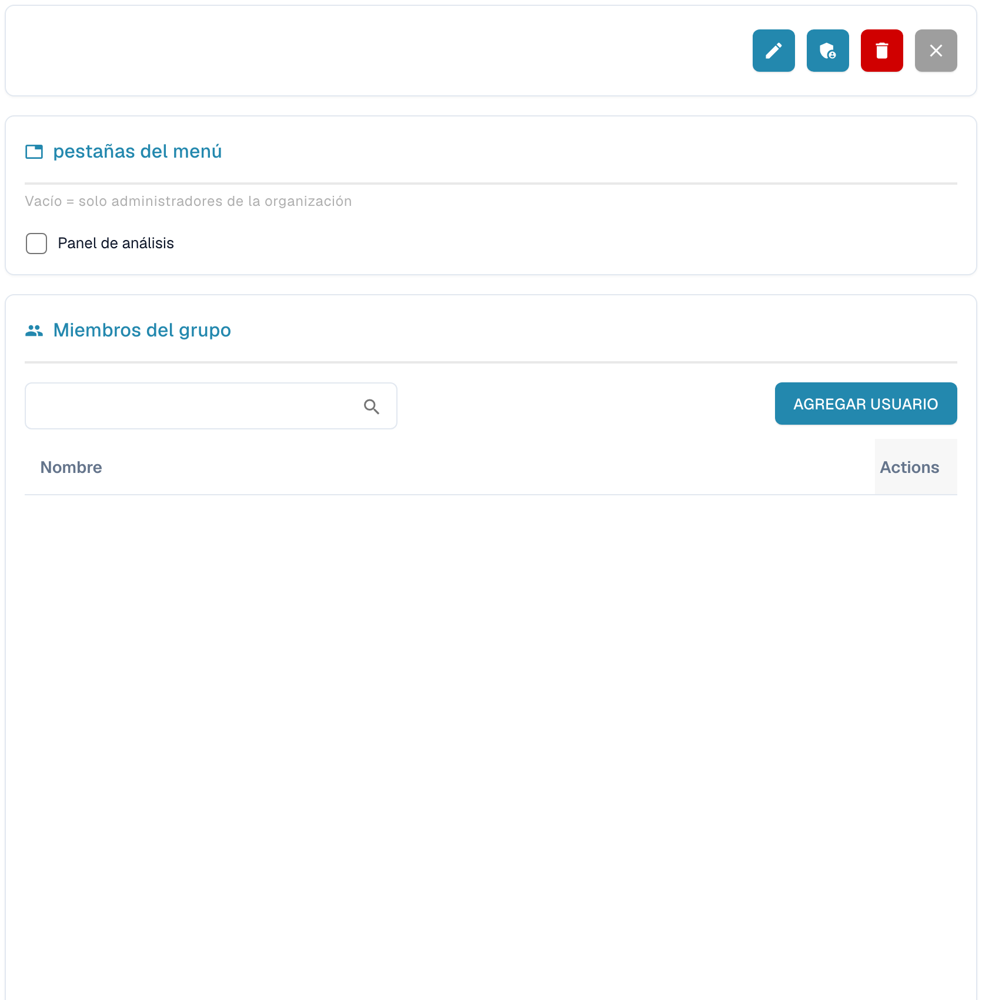

# Groups and Permissions


DocBits Groups & Permissions Tutorial: Set User Roles, Access Rights & Secure Your Workspace


<figure><figcaption>
Detalles del grupo seleccionado con los datos personales ocultos.
</figcaption></figure>

Groups and Permissions le permite controlar qué usuarios pueden acceder a tipos de documento específicos y qué acciones pueden realizar.

## Activar/desactivar Groups & Permissions

Utilice el interruptor de la parte superior de la página para habilitar o deshabilitar el sistema de grupos y permisos. Cuando está deshabilitado, el sistema utiliza un modelo de acceso más sencillo, sin restricciones basadas en grupos.

## Lista de grupos

La tabla muestra todos los grupos configurados con:

| Columna | Descripción |
|--------|-------------|
| **Nombre del grupo** | El nombre del grupo. |
| **Descripción del grupo** | Una breve descripción de la finalidad del grupo. |
| **Acciones** | Menú con opciones para editar o eliminar el grupo. |

Utilice la barra **Buscar** para buscar grupos por nombre. Haga clic en **+ New** para crear un grupo nuevo.

## Configurar los permisos de un grupo

Cuando selecciona un grupo (mediante el menú Actions → Edit), aparece una tabla de permisos donde puede configurar el acceso por tipo de documento:

| Permiso | Descripción |
|------------|-------------|
| **Vista** | Permiso para ver documentos de este tipo. |
| **Actualizar** | Permiso para modificar documentos de este tipo. |
| **Borrar** | Permiso para eliminar documentos de este tipo. |
| **Primera aprobación** | Permiso para realizar la aprobación inicial. |
| **Segunda aprobación** | Permiso para realizar un segundo nivel de aprobación (si procede). |

Cada fila de la tabla de permisos representa un tipo de documento (p. ej., Invoice, Credit Note, Delivery Note). Marque o desmarque las casillas para conceder o revocar permisos a ese grupo.

## Crear un grupo nuevo

1. Haga clic en **+ New** en la esquina superior derecha.
2. Introduzca un **Nombre del grupo** y, opcionalmente, una **Descripción**.
3. Configure los permisos de cada tipo de documento.
4. Asigne usuarios al grupo.
5. Haga clic en **Guardar** para aplicar los cambios.
