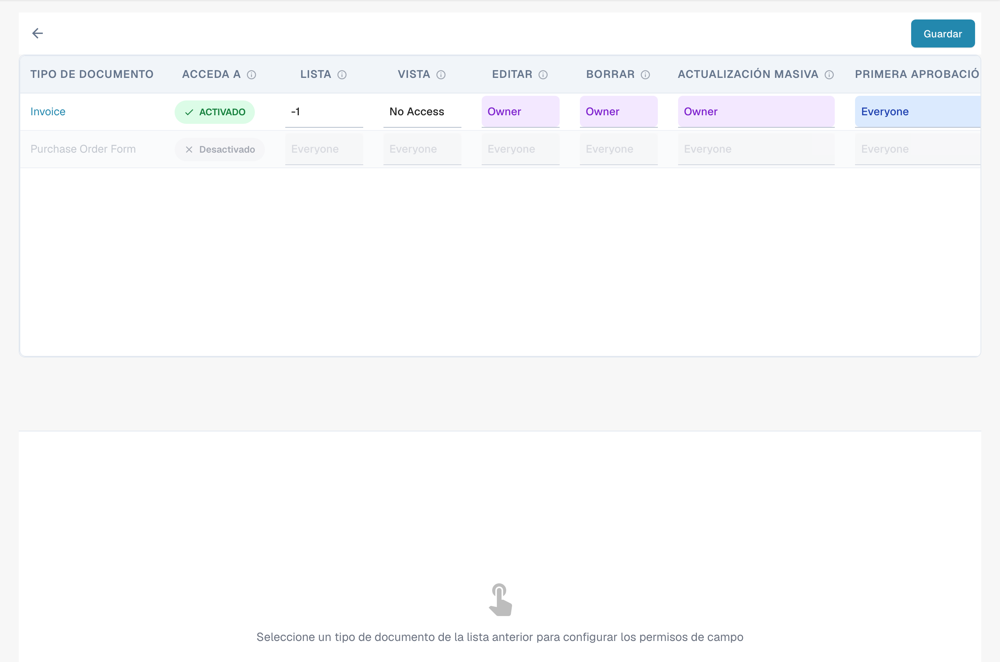
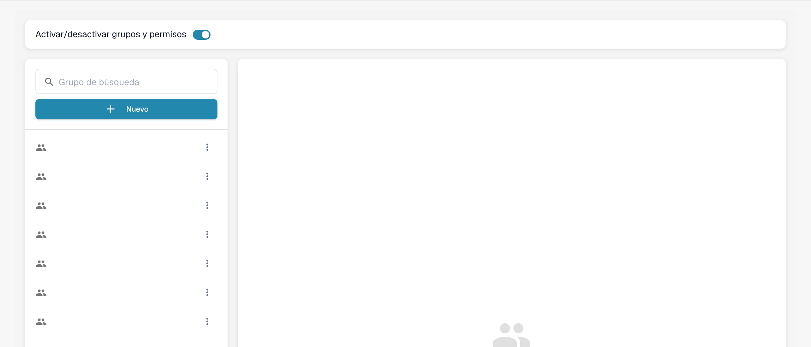

# Activando Permisos

La interfaz actual usa una matriz de permisos por tipo de documento y acción. Los valores **Owner**, **Everyone** y **No Access** todavía se muestran en inglés. Las instrucciones sobre el antiguo interruptor «Only Assigned Documents» solo se aplican a versiones que dispongan de ese interruptor.


DocBits Groups & Permissions Tutorial: Set User Roles, Access Rights & Secure Your Workspace


Habilitar o deshabilitar el sistema de permisos mediante el interruptor tiene varios efectos en la funcionalidad de DocBits.

## **Habilitando el sistema de permisos:**

<figure><figcaption>
Selección de un grupo para consultar sus permisos.
</figcaption></figure>

* Cuando el sistema de permisos está habilitado, se aplican los permisos de acceso de usuarios y grupos.
* A los usuarios solo se les concede acceso a los recursos para los que están explícitamente autorizados según los permisos asignados.
* Los administradores pueden gestionar los permisos de usuarios y grupos individuales y asegurarse de que solo las personas autorizadas puedan ver o editar los datos.

<figure><figcaption>
Matriz de permisos por tipo de documento y acción.
</figcaption></figure>

## Only Assigned Documents

<figure><figcaption>
Opciones de acceso por acción en la matriz de permisos.
</figcaption></figure>

El botón de alternancia **Only Assigned Documents** controla la visibilidad de los documentos para los usuarios en función de sus asignaciones de grupo. Cuando está activado, los usuarios solo pueden ver los documentos que se les han asignado específicamente a ellos o a un grupo al que pertenecen. Cuando está desactivado, los usuarios con el permiso de visualización adecuado pueden ver todos los documentos, independientemente de la asignación.

#### Funcionamiento

* **Estado desactivado (predeterminado)**:
  * Cuando el interruptor está desactivado, los usuarios que forman parte de un grupo pueden ver todos los documentos si tienen el permiso de visualización adecuado. La asignación de documentos no afecta a la visibilidad.
* **Estado activado**:
  * Cuando el interruptor está activado, los usuarios solo pueden ver los documentos que se les han asignado explícitamente a ellos o a un grupo del que forman parte. Esto impone una visibilidad de documentos más estricta basada en las asignaciones de grupo.

#### Escenario de ejemplo

1. **Predeterminado (estado desactivado)**:
   * Un usuario que forma parte del grupo "Sales" puede ver todos los documentos del sistema que tiene permiso para ver, aunque no estén asignados a él.
2. **Activado (estado activado)**:
   * Un usuario del grupo "Sales" solo puede ver los documentos asignados a él o al grupo "Sales", lo que restringe el acceso a los documentos fuera de sus asignaciones.

## Deshabilitando el sistema de permisos:

<figure><figcaption>
Control para activar o desactivar la gestión de permisos.
</figcaption></figure>

* Cuando el sistema de permisos está deshabilitado, se eliminan todos los permisos de acceso y los usuarios suelen tener acceso sin restricciones a todos los recursos.
* Esto puede ser útil cuando se necesita temporalmente una colaboración abierta sin las restricciones del control de acceso.
* Sin embargo, puede haber un mayor riesgo de fuga de datos o de acceso no autorizado, ya que los usuarios podrían acceder a información sensible a la que no están autorizados.

Habilitar o deshabilitar el sistema de permisos es una decisión importante que depende de los requisitos de seguridad y de la forma de operar de la organización. En entornos donde la privacidad y el control de acceso son críticos, es habitual dejar el sistema de permisos habilitado para garantizar la integridad y la confidencialidad de los datos. En otros casos, puede ser necesario deshabilitar temporalmente el sistema de permisos para facilitar la colaboración, pero debe hacerse con precaución para minimizar los posibles riesgos de seguridad.
