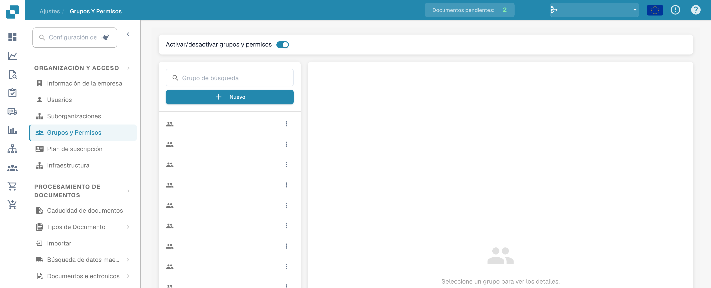
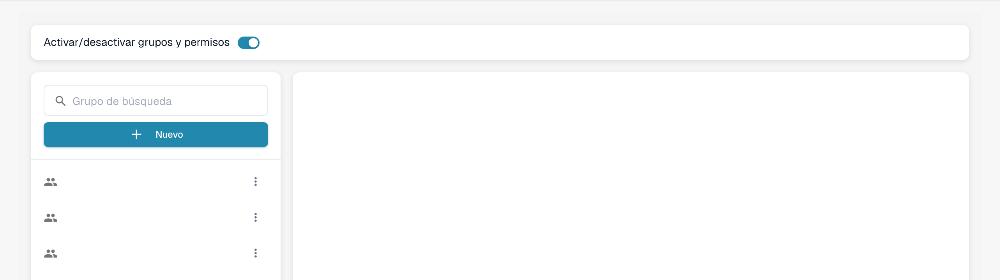
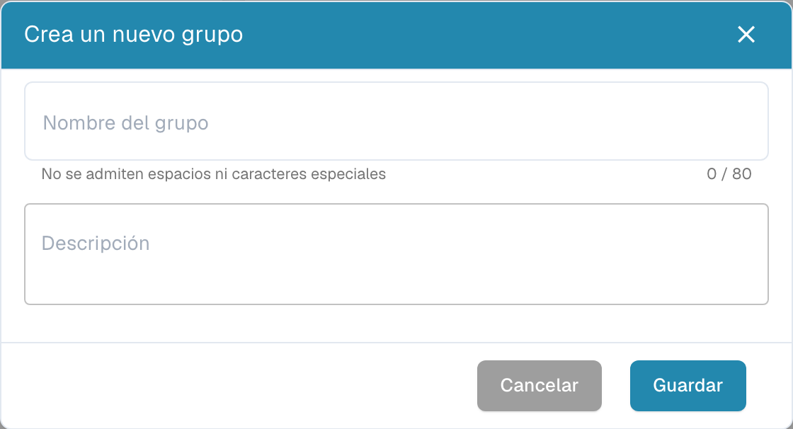

# Agregar/Editar Grupos


DocBits Groups & Permissions Tutorial: Set User Roles, Access Rights & Secure Your Workspace


## Para agregar un nuevo grupo o cambiar los permisos de un grupo existente, puede hacer lo siguiente:

* **Navegar a la Configuración de Grupos:** Inicie sesión en su cuenta de administrador y vaya a Group Settings en el panel de administración.

<figure><figcaption>
Acceso a la configuración de grupos y permisos.
</figcaption></figure>

Se abrirá esta ventana:

<figure><figcaption>
Lista de grupos con los nombres ocultos.
</figcaption></figure>

* **Hacer clic en el botón + New:** Si desea agregar un nuevo grupo, haga clic en el botón + New para iniciar el proceso de creación de un nuevo grupo.

<figure><figcaption>
Diálogo de creación de grupo sin guardar.
</figcaption></figure>

* **Completar la tabla:** Proporcione el nombre del grupo y una descripción del grupo.
* **Guardar los detalles:** Una vez que haya completado el grupo y la descripción, haga clic en el botón "Save".

<figure><figcaption>
Administración de grupos y permisos.
</figcaption></figure>

## Editar Grupos:

* **Editar Grupos:** Para editar grupos, haga clic en "edit"; aquí puede cambiar el nombre del grupo.

<figure><figcaption></figcaption></figure>

<figure><figcaption></figcaption></figure>

* **Habilitar Groups & permissions:** Para que el grupo sea visible, "Groups & permissions" debe estar habilitado.

<figure><figcaption></figcaption></figure>

* **Verificar los resultados:** Después de guardar, revise los resultados para asegurarse de que el grupo se haya agregado, editado o actualizado correctamente.
