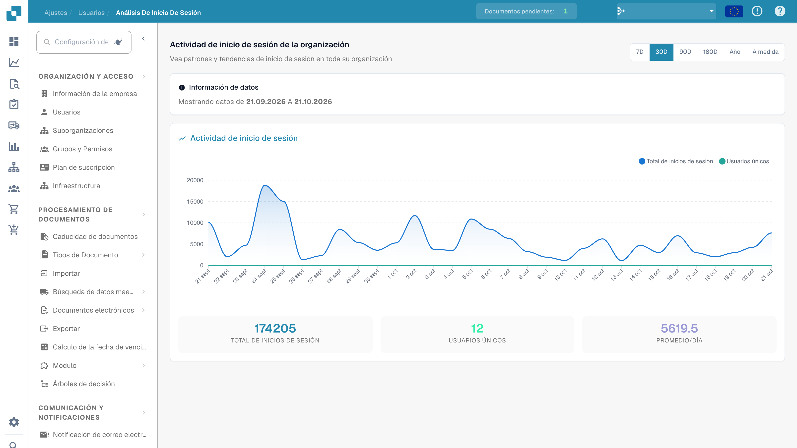

# Análisis de inicios de sesión

## Tutorial en vídeo: Empresa, suscripción y auditoría


Información de la empresa, plan de suscripción y registros de auditoría en DocBits


El vídeo muestra la información y las preferencias de la empresa, el plan de suscripción, la actividad de inicio de sesión y los registros de auditoría.

**Análisis de inicios de sesión** ofrece a los administradores una vista de solo lectura, a nivel de toda la organización, sobre *cuándo* y *con qué frecuencia* las personas inician sesión en DocBits. Responde a preguntas como «¿están aumentando los inicios de sesión?», «¿cuántos usuarios distintos estuvieron activos este mes?» y «¿cuándo se producen los picos de uso?», sin exponer las credenciales ni los datos personales de ningún usuario concreto.

> **Acceso:** Abra **Ajustes → Organización y acceso → Usuarios** y haga clic en el botón **Análisis de inicios de sesión** en la esquina superior derecha (`/settings/login-analytics`).

<figure><figcaption>
Resumen del análisis de inicios de sesión.
</figcaption></figure>

## Rango de tiempo

Elija el periodo que desea analizar con el selector de la esquina superior derecha: **7D**, **30D**, **90D**, **180D**, **Año** o **A medida** para un rango de fechas libre. Todo lo que hay en la página —el gráfico y las tarjetas de resumen— se recalcula para el periodo que elija.

El aviso de **Información de datos** vuelve a indicar la ventana exacta que se está viendo (por ejemplo, *Showing data from 19.05.2026 to 18.06.2026*), de modo que siempre queda claro qué fechas abarcan las cifras.

## Gráfico de actividad de inicios de sesión

El gráfico representa dos series a lo largo del periodo seleccionado:

| Serie | Significado |
|--------|-------------|
| **Total de inicios de sesión** | El número de inicios de sesión por día, incluidos los inicios de sesión repetidos de la misma persona. |
| **Usuarios únicos** | Cuántos usuarios *distintos* iniciaron sesión ese día. |

Pase el cursor sobre cualquier punto para leer el valor exacto de ese día. Los picos muestran sus días de mayor actividad; una línea plana de **Usuarios únicos** bajo una línea irregular de **Total de inicios de sesión** significa que unas pocas personas iniciaron sesión muchas veces.

## Tarjetas de resumen

Debajo del gráfico, tres tarjetas resumen todo el periodo seleccionado:

| Tarjeta | Significado |
|------|-------------|
| **Total de inicios de sesión** | Todos los inicios de sesión a lo largo del periodo. |
| **Usuarios únicos** | Usuarios distintos que iniciaron sesión al menos una vez. |
| **Promedio/día** | Número medio de inicios de sesión por día durante el periodo. |

## Privacidad

El Análisis de inicios de sesión informa únicamente de cifras **agregadas**: recuentos y tendencias de la organización en su conjunto. No enumera usuarios individuales, direcciones de correo electrónico ni direcciones IP. Para ver o editar la cuenta de una persona concreta, utilice en su lugar la página de [Usuarios](README.md).
