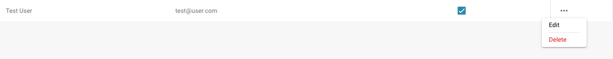

# Modificando Detalles del Usuario

<figure><figcaption>
Configuración de usuarios
</figcaption></figure>

* **Iniciando sesión como administrador:** Inicie sesión con sus privilegios de administrador.
* **Accediendo a la gestión de usuarios:** Navegue a la configuración de usuarios, donde puede editar usuarios existentes.
* **Seleccionando usuarios:** Encuentre y seleccione al usuario cuyos detalles desea cambiar. Esto se puede hacer haciendo clic en el nombre de usuario o en un botón de edición junto al usuario.

<figure><figcaption></figcaption></figure>

*   **Editando detalles del usuario:** Aparecerá un formulario que contiene los detalles actuales del usuario. Edite los campos requeridos de acuerdo con los cambios que desea realizar. Los detalles típicos a editar incluyen:

    * Nombre y apellido
    * Dirección de correo electrónico
    * Rol de usuario o nivel de permiso

    <figure><figcaption></figcaption></figure>
* **Guardando Cambios:** Revise cualquier cambio que haya realizado y haga clic en Save para guardar los nuevos detalles del usuario.

<figure><figcaption></figcaption></figure>

* **Revise el impacto de los cambios de rol:** Si cambió el rol del usuario, revise el impacto de ese cambio en los niveles de acceso de seguridad. Asegúrese de que, después del cambio de rol, el usuario tenga los permisos necesarios para continuar realizando sus funciones.
* **Enviar notificación (opcional):** Puede enviar una notificación al usuario para informarle sobre los cambios realizados.

Después de completar estos pasos, los detalles del usuario se actualizan correctamente y el usuario tiene la nueva información y los permisos de acuerdo con los cambios realizados.

## Eliminando Usuarios:

* **Seleccionando Usuarios:** Encuentre y seleccione al usuario cuyo acceso desea eliminar. Esto se puede hacer haciendo clic en el nombre del usuario o en un botón de edición junto al usuario.

<figure><figcaption></figcaption></figure>

* **Eliminando Acceso:** Haga clic en "delete" para eliminar al usuario.

<figure><figcaption></figcaption></figure>

* **Confirmación:** Se le pide que confirme la eliminación del usuario.

<figure><figcaption></figcaption></figure>

* **Notificación Opcional:** Puede enviar opcionalmente una notificación al usuario para informarle sobre la eliminación de su acceso.
* **Revisar Tareas y Documentos:** Antes de eliminar al usuario, revise qué tareas o documentos están asignados al usuario. Mueva o transfiera la responsabilidad de esas tareas o documentos a otro usuario para asegurarse de que nada se pierda o quede sin terminar.
* **Guardar Cambios:** Confirme la eliminación del usuario y guarde los cambios.

Siguiendo estos pasos, puede asegurarse de que el acceso del usuario se elimine de manera segura mientras gestiona adecuadamente todas las tareas y documentos relevantes.
