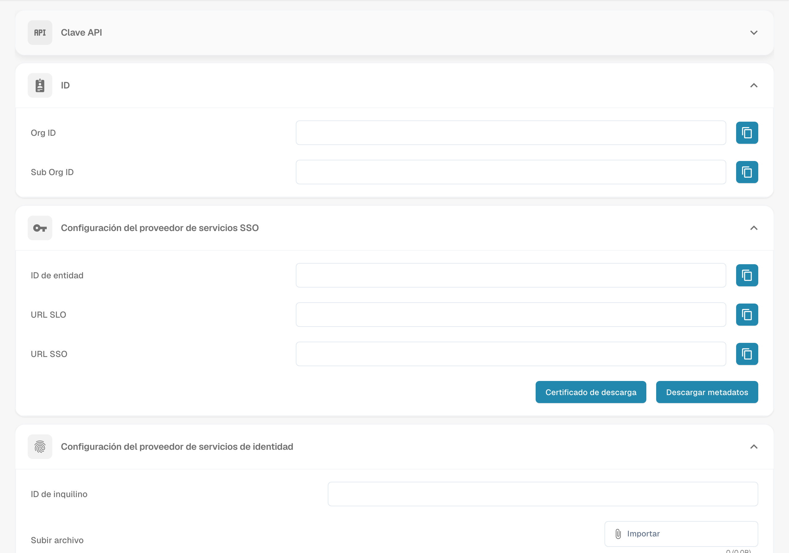

# Integration & SSO

<figure><figcaption>
Configuración de integración y proveedores de SSO.
</figcaption></figure>

La página Integration & SSO gestiona las claves de API para el acceso programático, los ID de organización y la configuración de Single Sign-On (SSO).

## API Key

Gestione las claves de API utilizadas para el acceso programático a DocBits.

| Columna | Descripción |
|--------|-------------|
| **Llave** | El valor enmascarado de la clave de API. Haga clic en el icono de copiar para copiar la clave completa. |
| **Nombre** | Un nombre descriptivo para la clave. |
| **Caduca** | Fecha de caducidad (o "Never"). |
| **Último uso** | Cuándo se utilizó la clave por última vez. |
| **Estado** | Active o Inactive. |
| **Acciones** | Menú de tres puntos para revocar o eliminar. |

Haga clic en **+ Create API Key** para generar una clave nueva.

## ID

Muestra los identificadores de su organización:

| Campo | Descripción |
|-------|-------------|
| **Org ID** | El identificador único de su organización. |
| **Sub Org ID** | El ID de la suborganización seleccionada actualmente. |

## SSO Service Provider Settings

Valores de configuración de SSO de DocBits necesarios al configurar su proveedor de identidad (Identity Provider):

| Campo | Descripción |
|-------|-------------|
| **ID de entidad** | La URL de metadatos SAML de DocBits. |
| **SLO URL** | URL de Single Logout. |
| **SSO URL** | URL del Assertion Consumer Service. |

También puede usar **Certificado de descarga** y **Descargar metadatos** para la configuración de su IdP.

## Identity Service Provider Settings

Configure su proveedor de identidad (IdP) externo:

| Campo | Descripción |
|-------|-------------|
| **ID de inquilino** | El identificador del tenant de su IdP. |
| **Subir archivo** | Cargue el archivo XML de metadatos de su IdP. |

Haga clic en **Configurar** para guardar los ajustes de su IdP.

* **Mayor eficiencia:** La integración con otras herramientas y servicios puede agilizar los flujos de trabajo y aumentar la eficiencia. Por ejemplo, los documentos pueden intercambiarse automáticamente entre Docbits y un sistema CRM, lo que reduce la entrada manual y aumenta la productividad
* **Coherencia de los datos:** La integración permite intercambiar datos sin problemas entre diferentes sistemas, mejorando la coherencia y la precisión de los datos. Esto evita incoherencias o entradas de datos duplicadas que podrían provocar errores.
* **Actualizaciones en tiempo real**: La integración permite actualizaciones en tiempo real entre diferentes plataformas, de modo que los usuarios siempre disponen de la información más reciente. Esto es especialmente importante para los procesos empresariales críticos que requieren información en tiempo real.
* **Automatización de tareas:** La integración permite automatizar tareas rutinarias, lo que ahorra tiempo y recursos. Por ejemplo, las notificaciones pueden activarse automáticamente cuando se produce un determinado evento en otro sistema, sin necesidad de intervención manual.
* **Mejor experiencia de usuario:** Una integración bien configurada garantiza una experiencia de usuario fluida, ya que los usuarios no tienen que cambiar entre diferentes sistemas para acceder a la información relevante. Esto mejora la satisfacción del usuario y contribuye a la eficiencia.

Para configurar correctamente los ajustes de integración, es importante comprender los requisitos de la organización y asegurarse de que la integración se incorpore sin fricciones a los flujos de trabajo y procesos existentes. Esto requiere una planificación, configuración y supervisión minuciosas de la integración para garantizar que funcione sin problemas y aporte el valor deseado.
