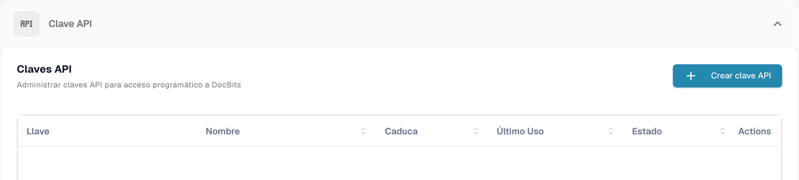
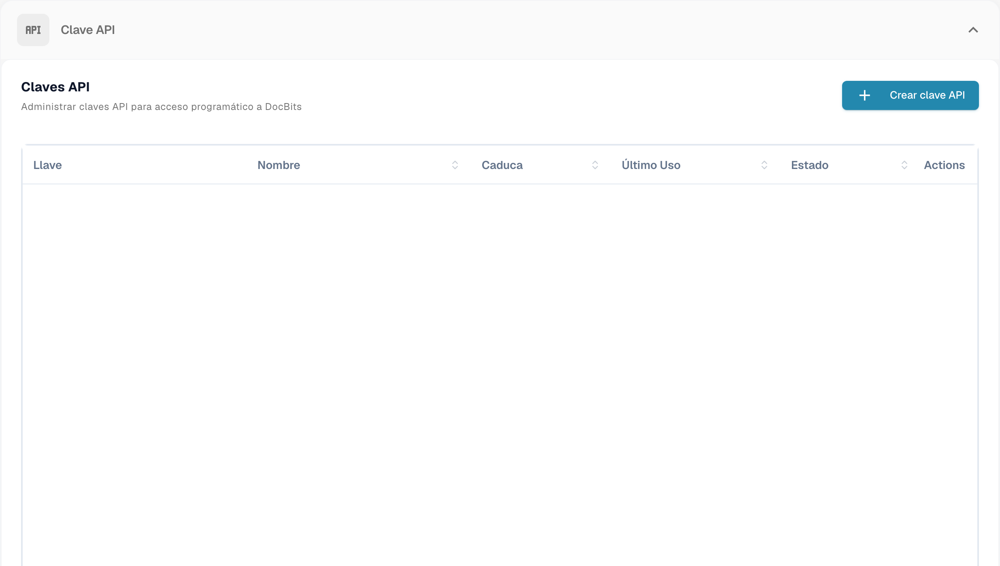
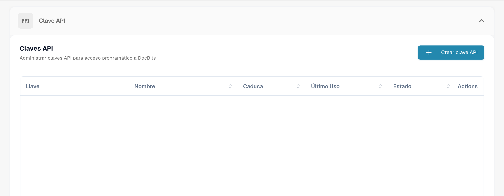
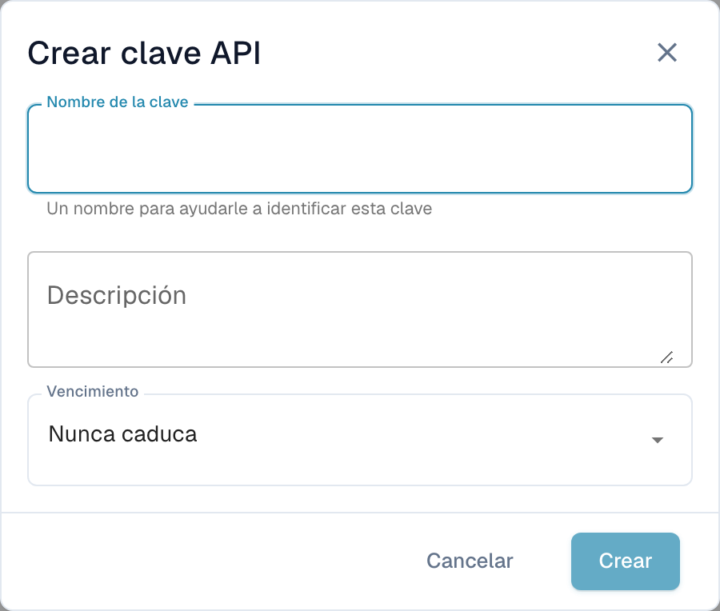

# Administración de claves API

Una API key permite que otro sistema — su ERP, un script o una aplicación de un socio — hable con DocBits sin que inicie sesión ningún usuario. Su organización puede tener tantas claves como necesite, y cada una se gestiona por separado: póngale su propio nombre, decida si caduca y revóquela individualmente si alguna vez queda expuesta.

Como cada integración puede tener su propia clave, puede desactivar una sin molestar a ninguna de las demás.

## Abrir la gestión de claves API

Vaya a **Ajustes** y seleccione **Integración y SSO** bajo **Sistema y Administración**.

<figure><figcaption>
Acceso a la administración de claves API.
</figcaption></figure>

La sección **Clave API** de la parte superior de la página lista todas las claves que tiene su organización.

<figure><figcaption>
Lista de claves API sin mostrar las claves ni sus nombres.
</figcaption></figure>

## Entender la lista

<figure><figcaption>
Lista de claves API con las claves y los datos de la cuenta ocultos.
</figcaption></figure>

| Columna | Qué le indica |
| --- | --- |
| **Llave** | Los primeros caracteres de la clave, seguidos de `****`. El resto no se vuelve a mostrar nunca después de crearla — consulte [Crear una clave API](#crear-una-clave-api). |
| **Nombre** | El nombre que le dio a la clave, con su descripción debajo. |
| **Caduca** | La fecha en la que la clave deja de funcionar, o **Nunca** si no puso ninguna. |
| **Último uso** | Cuándo llegó por última vez una petición con esta clave. **Nunca usado** significa que ningún sistema la ha usado todavía — útil para detectar claves que puede quitar sin riesgo. |
| **Estado** | **Activo** significa que la clave funciona. Una clave revocada queda desactivada de forma permanente. |
| **Acciones** | El menú de tres puntos, donde puede revocar la clave. |

Si tiene más claves de las que caben en una página, use los controles de paginación del final de la lista.


**Último uso** es la forma más rápida de encontrar claves que ya no necesita nadie. Una clave que no se ha usado nunca, o que no se usa desde hace meses, es buena candidata para revocarla.


## Crear una clave API

1. Haga clic en **+ Create API Key** en la parte superior derecha de la sección API Keys.
2. Rellene el diálogo:

<figure><figcaption>
Diálogo para crear una clave API, todavía sin guardar.
</figcaption></figure>

| Campo | Qué introducir |
| --- | --- |
| **Nombre de la clave** | Obligatorio. Póngale el nombre del sistema que la va a usar — `M3 Production`, `Invoice Import Script` — para que luego pueda saber a qué integración pertenece cada clave. |
| **Descripción** | Opcional. Espacio para una nota sobre para qué sirve la clave o quién la configuró. |
| **Vencimiento** | Elija una fecha de caducidad o déjelo en **Nunca caduca**. Una fecha de caducidad es la opción más segura: la clave se retira sola si alguna vez se olvida la integración. |

3. Haga clic en **Crear**. DocBits le muestra la clave nueva:

4. Copie la clave con el icono de copiar y péguela directamente en el sistema que la va a usar, o en su gestor de contraseñas.
5. Marque **He copiado y guardado esta clave** y haga clic en **Done**.


**La clave completa se muestra una sola vez.** DocBits almacena un hash unidireccional de la clave y un prefijo corto para identificarla. Ni sus administradores ni el soporte de DocBits pueden recuperar la clave original completa a partir de ese hash. Si la pierde, revóquela y cree una nueva.


Trate la clave como una contraseña. Cualquiera que la tenga puede actuar sobre los documentos y los datos de su organización.

Consulte [Almacenamiento seguro de credenciales](../../../../security/secure-storage-of-credentials.md).

La clave API completa solo se muestra una vez tras crearla. Cópiela en el almacenamiento seguro aprobado y confirme que la ha guardado antes de cerrar el diálogo. La lista no vuelve a revelar el secreto completo.
