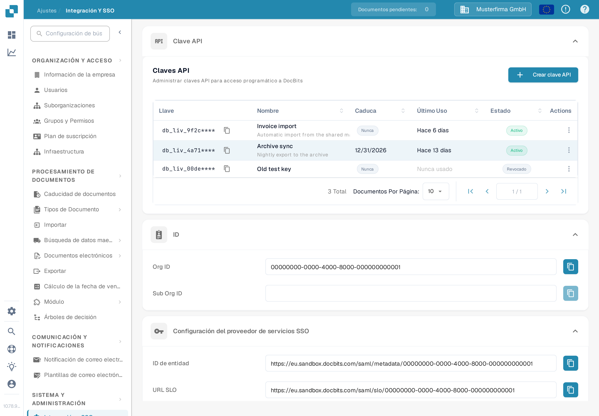

# Clave de API

<figure><figcaption>
Ajustes → Integración y SSO → Clave de API. Las claves de ejemplo muestran un prefijo seguido de caracteres ocultos.
</figcaption></figure>

La sección **Clave API** de la parte superior de la página Integración y SSO lista todas las claves API que ha creado su organización. Una clave API permite que otro sistema — su ERP, un script o una aplicación de un socio — acceda a DocBits sin que inicie sesión ningún usuario. Para instrucciones paso a paso, consulte [Gestión de Claves API](api-key-management.md).

### Lista de claves API

* **Llave:** Los primeros caracteres de la clave, seguidos de `****`. La clave completa se muestra una sola vez, al crearla, por lo que no se puede volver a consultar más tarde. El icono de copiar situado junto a la clave copia el prefijo visible al portapapeles.
* **Nombre / Caduca / Último Uso / Estado:** Cada fila muestra el nombre de la clave, cuándo deja de funcionar (**Caduca**), cuándo llegó por última vez una petición con ella (**Último Uso**) y si sigue activa (**Estado**).
* **Crear clave API:** Abre un diálogo para crear una clave nueva para una integración. Consulte [Gestión de Claves API](api-key-management.md) para ver los campos y la presentación única de la clave completa.
* **Actions (menú de tres puntos):** Abre las acciones de una clave, donde puede editar su nombre, revocarla o eliminar una clave ya revocada. Revocar desactiva la clave de forma permanente.

### Configuración del proveedor de servicios SSO (Single Sign-On)

Estos son los valores que necesita su proveedor de identidad para permitir que los usuarios inicien sesión en DocBits con el inicio de sesión de su empresa. Para ver la guía de configuración completa, consulte [Configuración de inicio de sesión único (SSO)](configuring-single-sign-on-sso/).

* **ID de entidad:** El identificador de DocBits como proveedor de servicios en la configuración de SSO. El icono de copiar copia el valor al portapapeles.
* **URL SLO:** La URL que se usa para cerrar la sesión de un usuario en todas las aplicaciones conectadas a través de SSO (cierre de sesión único) al mismo tiempo. El icono de copiar copia el valor.
* **URL SSO:** La URL que se usa para iniciar el proceso de inicio de sesión único. El icono de copiar copia el valor.
* **Certificado de descarga:** Descarga el certificado de seguridad que su proveedor de identidad necesita para confiar en DocBits.
* **Descargar metadatos:** Descarga el archivo de metadatos SAML que se puede importar directamente en la mayoría de los proveedores de identidad.

### Configuración del proveedor de servicios de identidad

Configure DocBits para que use su proveedor de identidad (IdP) externo para el inicio de sesión. Consulte [Configuración de inicio de sesión único (SSO)](configuring-single-sign-on-sso/) para configurar estos valores. La guía detallada "Identity Service Provider Configuration" está disponible actualmente solo en inglés: [abrir la guía en inglés](https://docs.docbits.com/administration-and-setup/settings/global-settings/integration/identity-service-provider-configuration).

* **ID de inquilino:** El identificador de inquilino de su proveedor de identidad, que se usa cuando DocBits se integra con servicios en la nube que gestionan el acceso por inquilino.
* **Subir archivo:** Seleccione el archivo XML de metadatos proporcionado por su proveedor de identidad.
* **Configurar:** Después de seleccionar el archivo XML, haga clic en Configurar para subirlo y guardar la configuración del proveedor de identidad.
