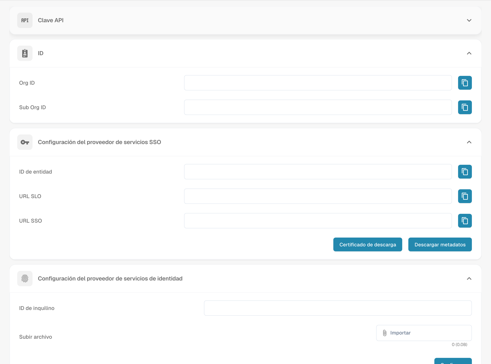

# Configurar el inicio de sesión único (SSO)

Configure DocBits como proveedor de servicios SAML (SP) y conecte su proveedor de identidad (IdP). Necesita acceso de administrador a los ajustes correspondientes de ambos sistemas.

## Abrir los ajustes de SSO

Inicie sesión en DocBits como administrador y abra Inicio de sesión único en los ajustes de integración.

<figure><figcaption>
Configuración de SSO con los valores de la organización ocultos.
</figcaption></figure>

## Consultar los valores del proveedor de servicios de DocBits

DocBits muestra Entity ID, SSO URL y SLO URL como valores de solo lectura. Cópielos o utilice los metadatos del SP para configurar la aplicación DocBits en su IdP; no introduzca valores de sustitución en estos campos de DocBits. Entity ID identifica al proveedor de servicios. Utilice los puntos de conexión mostrados según los requisitos SAML de su IdP.

## Descargar el certificado y los metadatos del SP

Utilice Download Certificate y la descarga de metadatos en los ajustes del proveedor de servicios de DocBits. Estas descargas describen a DocBits como SP. Entregue al IdP los metadatos del SP y, si se requiere, el certificado del SP descargado. Este certificado es distinto de los metadatos del IdP que se cargan en DocBits.

## Configurar el proveedor de identidad

1. En su IdP, configure DocBits con los valores del SP mostrados en DocBits o con los metadatos del SP descargados.
2. Utilice la Tenant ID de DocBits si su proveedor la requiere. Compruebe el contexto del tenant y del proveedor en los ajustes del proveedor de identidad de DocBits.
3. Obtenga del IdP los metadatos SAML XML de la aplicación configurada y cargue esos metadatos XML del IdP en DocBits. No los sustituya por los metadatos del SP de DocBits descargados anteriormente.
4. Guarde la configuración mediante la acción Configure/Save en los ajustes del proveedor de identidad de DocBits.

## Probar el inicio de sesión y el cierre de sesión admitido

Compruebe que un usuario pueda iniciar sesión en DocBits mediante el IdP configurado. Pruebe Single Log-Out solo si tanto DocBits como el IdP lo admiten y está configurado en ambos sistemas. Cerrar la sesión en DocBits no garantiza por sí solo el cierre de sesión en todas las demás aplicaciones conectadas.
