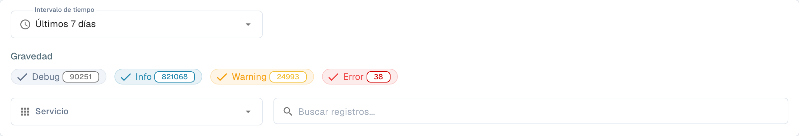

# Registro de actividad

<figure><figcaption>
Filtros del registro de actividad; los registros están ocultos.
</figcaption></figure>

El registro de actividad ofrece una vista en tiempo real de los eventos del sistema en todos los servicios de DocBits. Utilícelo para supervisar la actividad de procesamiento, solucionar errores y auditar el comportamiento del sistema.

## Banner de análisis

En la parte superior de la página, un banner enlaza con el **Panel de análisis** para ver gráficos, métricas y supervisión en tiempo real.

## Filtros

| Filtro | Descripción |
|--------|-------------|
| **Intervalo de tiempo** | Seleccione un intervalo de tiempo (por ejemplo, Hoy, Últimos 7 días, Últimos 30 días). |
| **Gravedad** | Active o desactive los niveles de gravedad que desea incluir o excluir: **Depurar**, **Información**, **Advertencia**, **Error**. Cada chip muestra el recuento actual. |
| **Servicio** | Filtre los registros por servicio (por ejemplo, api, auth, api-service). |
| **Search logs** | Búsqueda de texto libre en los mensajes de registro. |

## Tabla de registros

| Columna | Descripción |
|--------|-------------|
| **Marca de tiempo** | Fecha y hora en que ocurrió el evento. Se puede ordenar. |
| **Gravedad** | Insignia de color: Info (azul), Warning (amarillo), Error (rojo), Debug (gris). |
| **Componente** | El servicio o módulo que generó el registro (por ejemplo, api, auth, api-service). |
| **Mensaje** | El mensaje de registro completo con los detalles del evento. |

Los resultados están paginados: utilice los controles de la parte inferior para navegar por las páginas.

## Acciones del pie de página

| Acción | Descripción |
|--------|-------------|
| **Auto-refresh** | Actívelo para actualizar automáticamente la vista de registros a intervalos regulares. |
| **Refresh Now** | Actualiza manualmente los datos de registro. |
| **Export JSON** | Exporta los registros filtrados actuales como archivo JSON. |
| **Download Logs** | Descarga los datos de registro completos. |
