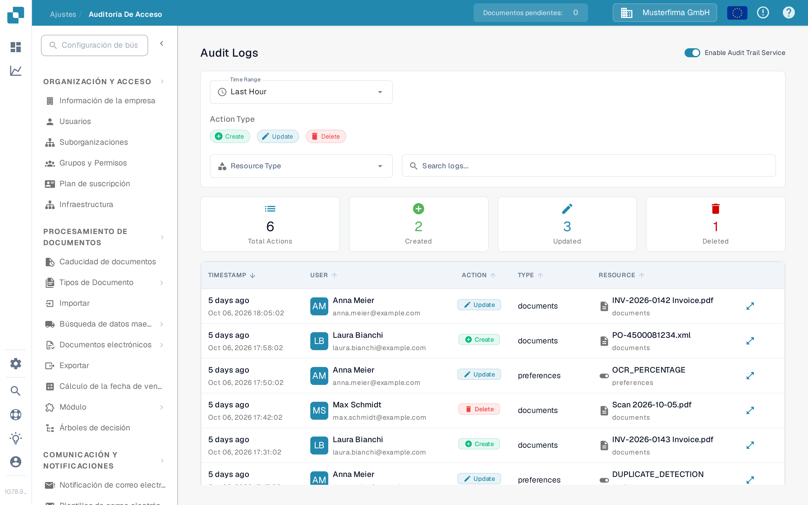
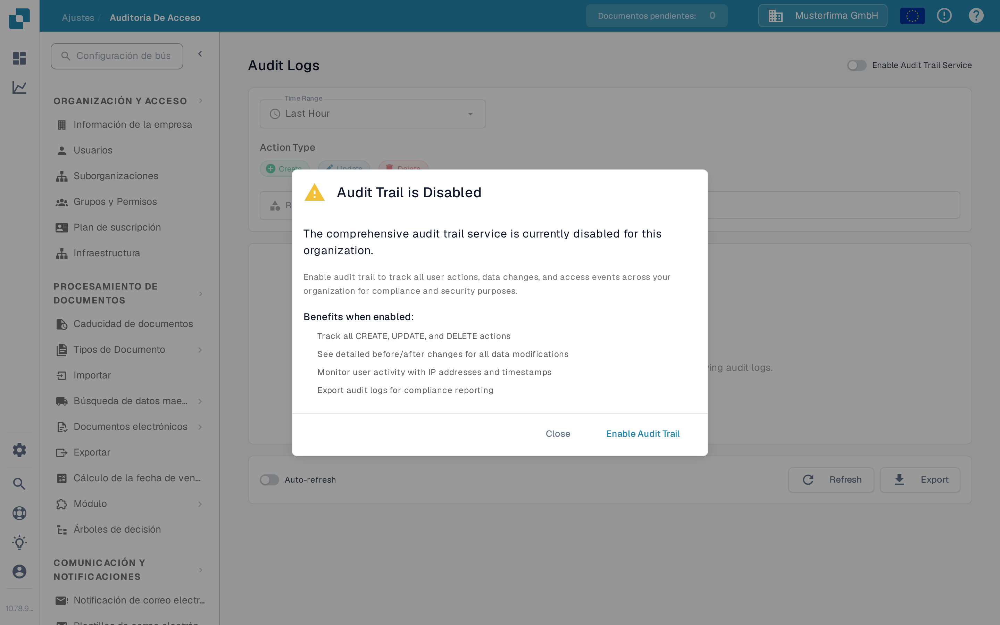

# Auditoría de Acceso

<figure><figcaption>
La página del Sandbox en español con el registro de auditoría activado y eventos recogidos.
</figcaption></figure>

La Auditoría de Acceso registra quién creó, modificó o eliminó un recurso y cuándo. Abra **Ajustes → Registro de Actividad → Auditoría de Acceso** para consultar el registro. Active el servicio para una organización solo cuando tenga previsto recopilar eventos de auditoría.

## Cuando el registro de auditoría está desactivado

<figure><figcaption>
El diálogo explica qué se registrará antes de activar el servicio.
</figcaption></figure>

La primera visita en una sesión de navegador puede mostrar **Audit Trail is Disabled**. **Close** cierra el diálogo y deja el registro de auditoría desactivado. **Enable Audit Trail** lo activa para la organización actual. En la página detrás del diálogo, **Enable Now** y el interruptor **Enable Audit Trail Service** también lo activan. Estos controles cambian la configuración de la organización; no se limitan a previsualizar la función.

Mientras el servicio está desactivado, los filtros y la tabla del registro no pueden mostrar eventos. El estado vacío explica cómo activar el registro. Después de activarlo, utilice el interruptor para volver a desactivarlo si es necesario. Los eventos solo están disponibles cuando el servicio está activado y ha recopilado datos.

## Encontrar un evento

| Control                            | Qué hace                                                                       |
| ---------------------------------- | ------------------------------------------------------------------------------ |
| **Time Range**                     | Limita la lista a un periodo como Last Hour, Today o Last 7 Days.              |
| **Create**, **Update**, **Delete** | Incluye o excluye esos tipos de acción.                                        |
| **Resource Type**                  | Limita los resultados a un tipo de recurso, como documents o settings.         |
| **Search logs**                    | Busca las entradas de auditoría visibles por texto.                            |
| **Refresh**                        | Carga una vez las entradas coincidentes más recientes.                         |
| **Auto-refresh**                   | Mantiene la lista actualizada automáticamente mientras la página está abierta. |
| **Export**                         | Descarga los datos actuales del registro de auditoría como archivo JSON.       |

Las tarjetas de resumen muestran el total de acciones y las creadas, actualizadas y eliminadas para los filtros seleccionados. En la tabla, **Timestamp** indica cuándo ocurrió un evento, **User** identifica al actor, **Action** nombra el cambio y **Resource** identifica el elemento afectado. Abra el control de detalles de una fila para examinar el cambio registrado. Si no aparece ningún evento, compruebe que el servicio está activado y amplíe el rango de tiempo antes de modificar los demás filtros.
