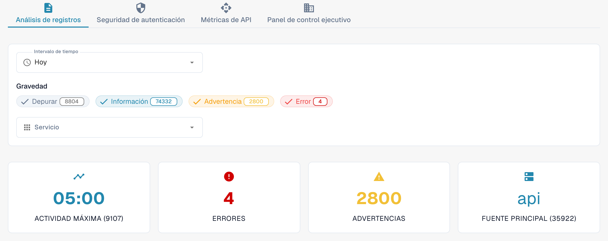

# Analítica

Abra **Ajustes → Registro de Actividad → Analítica** con una cuenta de administrador de la organización. Esta página reúne la actividad de los registros, los eventos de autenticación, el uso de la API y una vista ejecutiva. Empiece por **Análisis de registros**. Seleccione **Ver registros de eventos** para abrir la lista de eventos e investigar una entrada concreta.

<figure><figcaption>
Vista actual de Dev en español. Los contadores pertenecen al entorno de pruebas y serán distintos en su organización.
</figcaption></figure>

## Pestañas

| Pestaña | Descripción |
|---------|-------------|
| **Análisis de registros** | Distribución de la gravedad de los registros, evolución temporal y desglose por servicio. |
| **Seguridad de autenticación** | Eventos de autenticación, intentos de inicio de sesión y métricas de seguridad. |
| **Métricas de API** | Volumen de solicitudes a la API, tiempos de respuesta y tasas de error. |
| **Panel de control ejecutivo** | Vista general para administradores de la organización; su disponibilidad depende del rol. |

Cada pestaña tiene sus propios controles de periodo. Compruebe de nuevo el periodo seleccionado al cambiar de pestaña.

## Filtros de registros

| Filtro | Descripción |
|--------|-------------|
| **Intervalo de tiempo** | Elija **Última hora**, **Hoy**, **Últimos 7 días**, **Últimos 30 días** o **A medida**. La opción personalizada muestra campos de fecha y hora de inicio y fin. |
| **Gravedad** | Pulse **Depurar** (Debug), **Información**, **Advertencia** o **Error** para incluir o excluir ese nivel. El número de cada filtro muestra su recuento actual. |
| **Servicio** | Seleccione uno o varios servicios cuyos eventos quiera consultar. |

## Tarjetas de resumen

Debajo de los filtros aparecen cuatro tarjetas:

| Tarjeta | Descripción |
|---------|-------------|
| **Actividad máxima** | Momento con mayor volumen de registros y su recuento. |
| **Errores** | Número de errores del periodo seleccionado. |
| **Advertencias** | Número de advertencias del periodo seleccionado. |
| **Fuente principal** | Servicio que genera más registros, con su recuento. |

## Supervisión de usuarios reales (RUM)

Cuando hay telemetría del navegador, la sección RUM muestra métricas de rendimiento del frontend. Los datos disponibles dependen del entorno y del periodo. Un gráfico vacío, un mensaje de falta de datos o un indicador de carga no constituye un resultado medido.

## Gráficos de registros y descargas

En **Análisis de registros**, elija una de estas vistas:

| Vista | Descripción |
|-------|-------------|
| **Gravedad** | Gráfico circular con la distribución de los niveles de registro. |
| **Línea de tiempo** | Gráfico de líneas con el volumen de registros a lo largo del tiempo. |
| **Servicio** | Gráfico de barras con el desglose por servicio. |

En el gráfico **Línea de tiempo**, abra el menú de la esquina superior derecha y elija **Download SVG**, **Download PNG** o **Download CSV**. Estas opciones corresponden al gráfico mostrado; otros gráficos pueden no ofrecer la misma barra de herramientas.

Si no hay datos disponibles, pruebe un **Intervalo de tiempo** más amplio o menos filtros de **Gravedad**.

## Errores de JavaScript con rastreos de pila

Cuando esta tarjeta está disponible, su etiqueta de entorno indica el ámbito de los errores, por ejemplo **dev solamente**. La tarjeta enumera excepciones recientes del navegador, con un límite de 24 horas. **Copiar todo el JSON** copia las entradas cargadas actualmente en esta tarjeta, en lugar del registro completo de eventos. El botón está desactivado cuando no hay entradas.

Si hay una entrada, pulse su mensaje para desplegar la traza de pila. Las acciones de la fila copian esa entrada como JSON o copian su traza de pila. El enlace a una traza solo aparece si la entrada tiene un identificador de traza.
