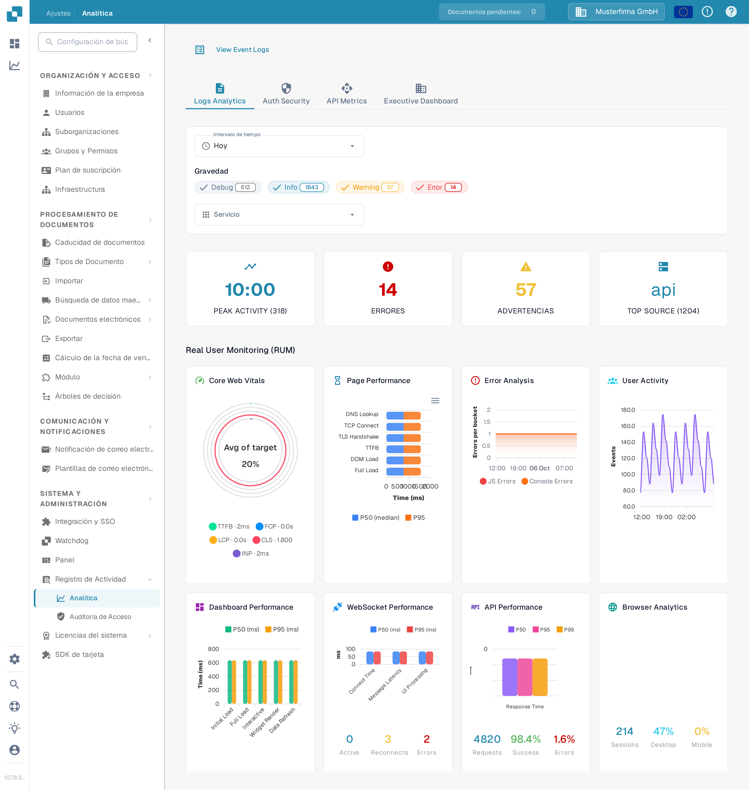

# Analítica

<figure><figcaption>
Utilice las pestañas y los filtros para acotar las métricas que desea consultar.
</figcaption></figure>

La página Analítica le ayuda a examinar patrones de registro, eventos de autenticación, uso de la API y una vista general para la dirección. Empiece por **Logs Analytics**. Seleccione **View Event Logs** para abrir la lista de eventos subyacente cuando necesite investigar una entrada concreta.

## Pestañas

| Pestaña | Descripción |
|---------|-------------|
| **Logs Analytics** | Distribución de la gravedad de los registros, gráficos de evolución temporal y desglose por servicio. |
| **Auth Security** | Eventos de autenticación, intentos de inicio de sesión y métricas de seguridad. |
| **API Metrics** | Volumen de solicitudes a la API, tiempos de respuesta y tasas de error. |
| **Executive Dashboard** | Vista general de alto nivel para administradores de la organización; es posible que otros roles no vean esta pestaña. |

## Filtros

| Filtro | Descripción |
|--------|-------------|
| **Intervalo de tiempo** | Seleccione un periodo (por ejemplo, Hoy o Últimos 7 días) para las métricas mostradas. |
| **Gravedad** | Haga clic en Debug, Info, Warning o Error para incluir o excluir ese nivel. Un número sobre cada chip muestra su recuento actual. |
| **Servicio** | Elija el servicio cuyos eventos desea examinar. |

## Tarjetas de resumen

Debajo de los filtros aparecen cuatro tarjetas de resumen:

| Tarjeta | Descripción |
|---------|-------------|
| **PEAK ACTIVITY** | Momento del día con mayor volumen de registros y su recuento total. |
| **ERRORES** | Número total de errores del periodo seleccionado. |
| **ADVERTENCIAS** | Número total de advertencias del periodo seleccionado. |
| **TOP SOURCE** | El servicio que genera más registros, con su recuento. |

## Supervisión de usuarios reales (RUM)

Debajo de las tarjetas de resumen, las métricas RUM muestran datos de rendimiento del frontend recogidos en sesiones reales de navegador de los usuarios.

## Gráficos de Analytics

En **Logs Analytics**, seleccione uno de los tres botones de gráfico para cambiar cómo se muestran los mismos registros filtrados:

| Vista | Descripción |
|-------|-------------|
| **Severity** | Gráfico circular con la distribución de los niveles de registro (Debug, Info, Warning, Error). |
| **Timeline** | Gráfico de líneas con el volumen de registros a lo largo del tiempo. |
| **Service** | Gráfico de barras que desglosa los registros por servicio. |

Si un gráfico indica que no hay datos disponibles, pruebe un **Intervalo de tiempo** más amplio o menos filtros de **Gravedad**. Las cifras de la imagen pertenecen a la organización sintética de la Sandbox y variarán en su organización.
