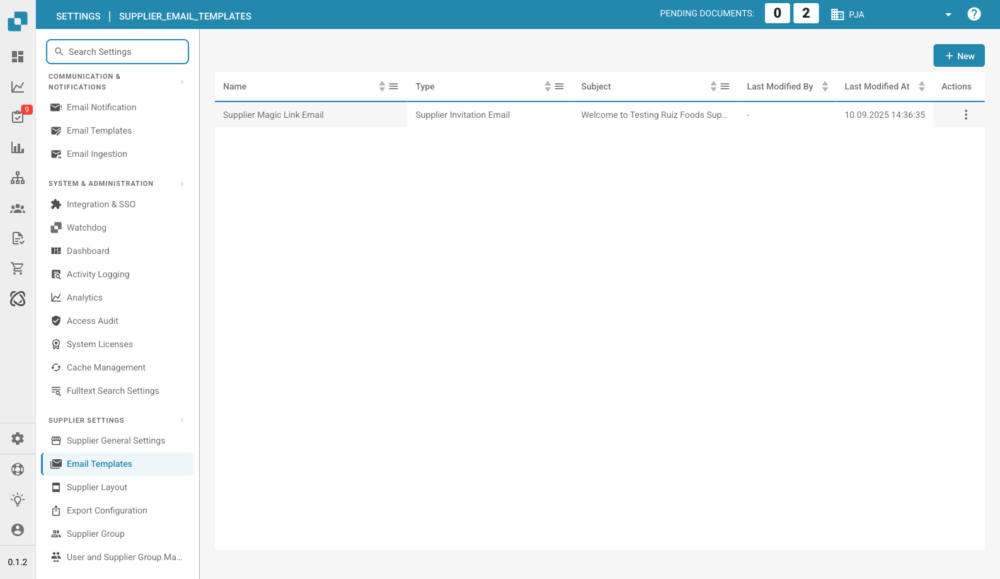

# Edición de plantillas de correo electrónico

<figure><figcaption><p>Página de plantillas de correo electrónico de proveedores</p></figcaption></figure>

### Descripción general

La función de plantillas de correo electrónico permite a los administradores crear y personalizar las comunicaciones por correo electrónico que se envían automáticamente a los proveedores. Uno de los elementos clave de estas plantillas es el `{{magic_link}}`, que proporciona un enlace dinámico adaptado a cada destinatario.

#### ¿Qué es `{{magic_link}}`?

El `{{magic_link}}` es un marcador de posición que se sustituye dinámicamente por una URL única cuando se envía el correo electrónico. Esta URL suele dirigir al destinatario a completar una acción, como el registro, la aprobación o el acceso a una parte concreta del portal de proveedores.

### Edición de plantillas de correo electrónico

<figure><figcaption></figcaption></figure>

#### Acceso al editor de plantillas de correo electrónico

1. **Vaya a Email Templates**:
   * Acceda a la sección **Email Templates** desde el menú principal.
2. **Seleccione una plantilla para editar**:
   * Elija la plantilla de correo electrónico que desea editar haciendo clic en su nombre (por ejemplo, "Supplier Invitation Email").
3. **Edite la plantilla**:
   * El editor permite modificar tanto el código HTML como el diseño visual del correo electrónico.
   * Puede alternar entre la edición visual y la edición de código mediante las pestañas disponibles.

<figure><figcaption></figcaption></figure>

#### Definir `{{magic_link}}` como enlace

Para definir `{{magic_link}}` como un enlace en el que se pueda hacer clic en el correo electrónico, debe asegurarse de que esté correctamente formateado en el código HTML de la plantilla. Siga estos pasos:

1. **Localice la sección del enlace en el código HTML**:
   * En el editor de código, busque la sección donde desea que aparezca el magic link. Normalmente se encuentra dentro de una etiqueta `<a>` (ancla).
2.  **Inserte el marcador de posición `{{magic_link}}`**:

    * Sustituya el atributo `href` de la etiqueta ancla por `{{magic_link}}`.
    * Asegúrese de que el enlace tenga el estilo adecuado para la plantilla de correo electrónico. Este es un ejemplo:

    ```html
    <a href="{{magic_link}}" target="_blank" style="
        background-color: #B7184B;
        border-radius: 25px;
        font-family: 'Montserrat', Arial, sans-serif;
        font-size: 14px;
        font-weight: bold;
        padding: 12px 25px;
        color: #FFFFFF;
        text-decoration: none;
        display: inline-block;
        cursor: pointer;">
        Complete Registration
    </a>
    ```

### 3. Personalice el texto del enlace:

• Modifique el texto entre las etiquetas de apertura \<a> y de cierre \</a> para reflejar la acción que desea que realice el usuario. Por ejemplo, “Complete Registration” o “Access Your Account”.

4\. Guarde y pruebe la plantilla:

• Después de realizar los cambios, haga clic en el botón Guardar.

• Puede usar el botón Send Test para enviar un correo electrónico de prueba y comprobar que el enlace funciona como se espera.

## Buenas prácticas para el uso de \{{magic\_link\}}

• Ubicación del enlace: coloque el \{{magic\_link\}} de forma destacada en el correo electrónico para que los destinatarios puedan acceder a él fácilmente.

• Llamada a la acción clara: el texto del enlace debe ser una llamada a la acción clara, como “Complete Registration” o “Confirm Your Email”.

• Estilo: asegúrese de que el enlace tenga un estilo coherente con el resto de la plantilla de correo electrónico y destaque visualmente.

• Pruebas: envíe siempre un correo electrónico de prueba después de editar la plantilla para verificar que el \{{magic\_link\}} se resuelve correctamente y que el estilo es adecuado.

## Conclusión

Al definir correctamente el \{{magic\_link\}} en sus plantillas de correo electrónico, puede asegurarse de que los destinatarios reciban un correo personalizado y accionable que los guíe a la tarea correspondiente dentro de su portal de proveedores. Esto mejora la experiencia de usuario y garantiza procesos de incorporación y comunicación fluidos.

\


Esta documentación ofrece instrucciones paso a paso para que los administradores definan y utilicen el \{{magic\_link\}} en las plantillas de correo electrónico, de modo que los correos sean funcionales y visualmente atractivos.
