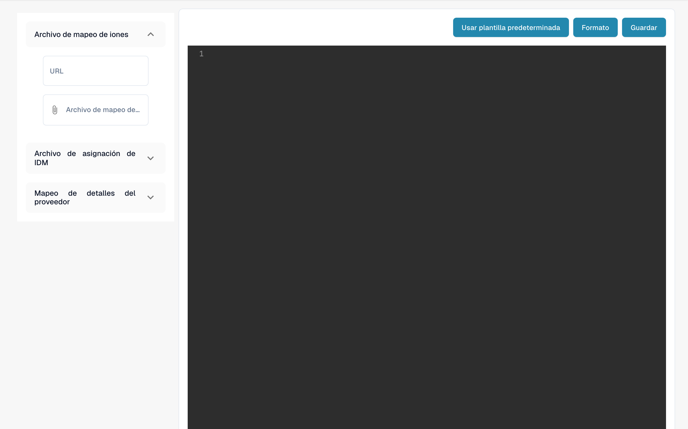

# Configuración de exportación del portal de proveedores

<figure><figcaption><p>Configuración de exportación del portal de proveedores.</p></figcaption></figure>

## Descripción general

El archivo de configuración de exportación es un componente crucial en el portal de proveedores, definiendo cómo se mapea la información entre el portal de proveedores y el sistema ERP. Esta configuración asegura que los datos se transfieran y sincronicen con precisión entre los sistemas, permitiendo operaciones fluidas y eficientes.

## Estructura del archivo de configuración

El archivo de configuración de exportación está estructurado como un objeto JSON que contiene múltiples mapeos. Cada mapeo está asociado con un programa específico en el sistema ERP y define las acciones a realizar, los campos a mapear y cualquier condición que se deba aplicar.

## Componentes clave

### 1. Programa

* **Definición**: Especifica el programa ERP al que se aplica el mapeo.
* **Ejemplo**: `"program": "CRS620MI"`

### 2. Acciones

* **Definición**: Define las acciones que se pueden realizar, como agregar o actualizar registros.
*   **Ejemplo**:

    ```json
    "actions": {
        "add": "AddSupplier",
        "update": "UpdSupplier"
    }
    ```

### 3. Mapeo

• Definición: Especifica el mapeo entre los campos en el sistema ERP y los campos en el portal de proveedores.

• Componentes:

• erp\_field\_name: El nombre del campo en el sistema ERP.

• value\_field\_name: El nombre del campo correspondiente en el portal de proveedores.

• value: Un valor estático que se utilizará si no existe un campo correspondiente en el portal de proveedores.

• if\_conditions: Condiciones opcionales que determinan el valor según ciertos criterios.

• Ejemplo:

```json
{
    "erp_field_name": "SUNO",
    "value_field_name": "supplier_number"
}
```

### 4. Lógica condicional (if\_conditions)

• Definición: Especifica las condiciones que deben cumplirse para que se utilice un valor particular.

• Componentes:

• field\_name: El nombre del campo en el portal de proveedores que se evalúa.

• field\_value: El valor que activa la condición.

• then\_value: El valor a utilizar si se cumple la condición.

• Ejemplo:

```json
{
    "erp_field_name": "SUTY",
    "value": "0",
    "if_conditions": [{
        "field_name": "supplier_group",
        "field_value": "FRT",
        "then_value": "5"
    }]
}
```

### 5. Bucles (loop\_on)

• Definición: Define las secciones donde la configuración debe iterar sobre una lista de elementos, como detalles de dirección o referencia.

• Ejemplo:

```json
"loop_on": "address_details"
```

### 6. Campos calculados (value\_field\_calculated)

• Definición: Especifica campos que deben ser calculados en tiempo de ejecución, como generar la fecha actual.

• Ejemplo:

```json
{
    "erp_field_name": "STDT",
    "value_field_calculated": "now()"
}
```

### 7. Mapeos de campos con listas (mapping\_field\_name y mapping\_list)

• Definición: Mapea valores específicos del portal de proveedores a valores correspondientes en el sistema ERP según una lista predefinida.

• Componentes:

• mapping\_field\_name: El campo que determina el mapeo.

• mapping\_list: Un diccionario que traduce valores del portal de proveedores al sistema ERP.

• Ejemplo:

```json
{
    "erp_field_name": "RFID",
    "mapping_field_name": "reference_type",
    "mapping_list": {
        "10": "PURCHASING",
        "15": "DLVRY PHN#",
        "20": "COA",
        "25": "QA",
        "30": "FINANCE",
        "35": "SALES"
    }
}
```

## Desglose de ejemplo de configuración

### Alta y actualización de proveedores (CRS620MI)

• Programa: CRS620MI

• Acciones:

• Agregar Proveedor: AddSupplier

• Actualizar Proveedor: UpdSupplier

• Campos de Mapeo:

• SUNO → supplier\_number

• SUNM → name

• CSCD → supplier\_country

• TINO → tax\_id

• Campos adicionales incluyen valores estáticos y mapeos condicionales.

### Detalles de dirección (CRS620MI)

• Loop On: _**address\_details**_

• Acciones:

• Agregar Dirección: AddAddress

• Actualizar Dirección: AddAddress

• Campos de Mapeo:

• SUNO → supplier\_number

• ADR1 → address

• TOWN → city

• Campos adicionales incluyen campos calculados como now() para la fecha actual.

### Detalles de referencia (CRS620MI)

• Loop On: _**reference\_details**_

• Acciones:

• Agregar Referencia de Proveedor: AddSupplierRef

• Actualizar Referencia de Proveedor: AddSupplierRef

• Campos de Mapeo:

• SUNO → supplier\_number

• RFTY → reference\_type

• RFID se mapea utilizando una lista para traducir tipos como “PURCHASING”, “QA” y “FINANCE”.

## Uso de la configuración de exportación

### 1. Subir el archivo de configuración

#### 1. Vaya a la configuración de exportación:

• Vaya a la sección de Configuración de Exportación desde el menú principal.

#### 2. Suba el archivo de configuración:

• Haga clic en las secciones de Archivo de Mapeo ION o Archivo de Mapeo IDM para subir el archivo de configuración respectivo.

#### 3. Guarde la configuración:

• Después de subir, haga clic en el botón Guardar para aplicar la configuración.

### 2. Uso de plantillas predeterminadas

• Haga clic en el botón Usar Plantilla Predeterminada si desea volver a la plantilla de configuración predeterminada proporcionada por el sistema.

### 3. Formateo del JSON

• Use el botón Formato para formatear automáticamente el código JSON para una mejor legibilidad.

## Conclusión

Este archivo de configuración es esencial para asegurar que los datos entre el portal de proveedores y el sistema ERP estén correctamente mapeados y sincronizados. Al comprender la estructura y los componentes clave, los administradores pueden gestionar y personalizar eficazmente el proceso de exportación para satisfacer sus requisitos comerciales específicos.

## Ejemplo completo&#x20;

```json
[{
    "program": "CRS620MI",
    "actions": {
        "add": "AddSupplier",
        "update": "UpdSupplier"
    },
    "mapping": [{
        "erp_field_name": "SUNO",
        "value_field_name": "supplier_number"
    }, {
        "erp_field_name": "SUNM",
        "value_field_name": "name"
    }, {
        "erp_field_name": "SUTY",
        "value": "0",
        "if_conditions": [{
            "field_name": "supplier_group",
            "field_value": "FRT",
            "then_value": "5"
        }]
    }, {
        "erp_field_name": "CSCD",
        "value_field_name": "supplier_country"
    }, {
        "erp_field_name": "DTFM",
        "value_field_name": "date_format"
    }, {
        "erp_field_name": "ORTY",
        "value": "F20"
    }, {
        "erp_field_name": "DT4T",
        "value": "1"
    }, {
        "erp_field_name": "DTCD",
        "value": "2"
    }, {
        "erp_field_name": "CUCD",
        "value_field_name": "currency"
    }, {
        "erp_field_name": "TINO",
        "value_field_name": "tax_id"
    }, {
        "erp_field_name": "PHNO",
        "value_field_name": "supplier_phone"
    }, {
        "erp_field_name": "CRTP",
        "value": "1"
    }, {
        "erp_field_name": "ATPR",
        "value": "1"
    }, {
        "erp_field_name": "SUCL",
        "value_field_name": "supplier_group"
    }, {
        "erp_field_name": "LNCD",
        "value_field_name": "language"
    }, {
        "erp_field_name": "CONO",
        "value": "781_DDD"
    }, {
        "erp_field_name": "TEDL",
        "value": "FOB"
    }, {
        "erp_field_name": "TEPY",
        "value_field_name": "payment_term"
    }, {
        "erp_field_name": "TEPA",
        "value": "001"
    }, {
        "erp_field_name": "PYME",
        "value": "CRP"
    }]
}, {
    "program": "CRS620MI",
    "loop_on": "address_details",
    "actions": {
        "add": "AddAddress",
        "update": "AddAddress"
    },
    "mapping": [{
        "erp_field_name": "SUNO",
        "main_value_field": "supplier_number"
    }, {
        "erp_field_name": "ADTE",
        "value_field_name": "address_type"
    }, {
        "erp_field_name": "ADID",
        "value_field_name": "address_type",
        "if_conditions": [{
            "field_name": "address_type",
            "field_value": "10",
            "then_value": ""
        }]
    }, {
        "erp_field_name": "STDT",
        "value_field_calculated": "now()"
    }, {
        "erp_field_name": "ADR1",
        "value_field_name": "address"
    }, {
        "erp_field_name": "TOWN",
        "value_field_name": "city"
    }, {
        "erp_field_name": "ECAR",
        "value_field_name": "state"
    }, {
        "erp_field_name": "PONO",
        "value_field_name": "postal_code"
    }, {
        "erp_field_name": "CSCD",
        "value_field_name": "supplier_country"
    }]
}, {
    "program": "CRS620MI",
    "loop_on": "reference_details",
    "actions": {
        "add": "AddSupplierRef",
        "update": "AddSupplierRef"
    },
    "mapping": [{
        "erp_field_name": "SUNO",
        "main_value_field": "supplier_number"
    }, {
        "erp_field_name": "RFTY",
        "value_field_name": "reference_type"
    }, {
        "erp_field_name": "RFID",
        "mapping_field_name": "reference_type",
        "mapping_list": {
            "10": "PURCHASING",
            "15": "DLVRY PHN#",
            "20": "COA",
            "25": "QA",
            "30": "FINANCE",
            "35": "SALES"
        }
    }, {
        "erp_field_name": "YRE1",
        "value_field_name": "reference_name"
    }, {
        "erp_field_name": "PHNO",
        "value_field_name": "telephone_no"
    }, {
        "erp_field_name": "EMAL",
        "value_field_name": "email_address"
    }]
}]
```
