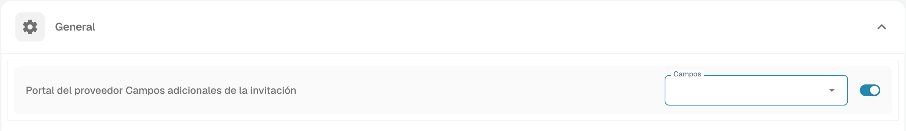

# Ajustes generales de proveedores

<figure><figcaption>
Configuración general del portal de proveedores.
</figcaption></figure>

### Descripción general

La interfaz de **Configuración general del proveedor** ofrece a los administradores herramientas esenciales para personalizar el portal de proveedores. Entre sus funciones principales se encuentran subir el logotipo de la empresa y definir la política y la declaración de privacidad. Estos ajustes son fundamentales para mantener la coherencia de la marca y garantizar el cumplimiento de los requisitos legales.

### Subir logotipo

#### Finalidad

La función **Subir logotipo** permite a los administradores personalizar el portal de proveedores subiendo el logotipo de su empresa. Esto refuerza el reconocimiento de la marca y proporciona una experiencia visual coherente a los usuarios que acceden al portal.

#### Pasos para subir un logotipo

1. **Acceda a Supplier General Settings**:
   * Vaya a la sección **Configuración general del proveedor** desde el menú principal.
2. **Localice la sección Upload Logo**:
   * Desplácese hacia abajo hasta la sección **Subir logotipo** dentro de la página de ajustes.
3. **Suba un nuevo logotipo**:
   * Haga clic en el área **Subir logotipo** para abrir el cuadro de diálogo de selección de archivos.
   * Seleccione el archivo de imagen que desea subir. Los formatos admitidos suelen incluir `.png`, `.jpg` o `.jpeg`.
   * El logotipo subido se mostrará en el área de vista previa.
4. **Guarde el logotipo subido**:
   * Una vez subido el logotipo, haga clic en el botón **Guardar** para aplicar los cambios.
   * El nuevo logotipo se mostrará en todo el portal de proveedores.

#### Buenas prácticas

* **Dimensiones del logotipo**: asegúrese de que las dimensiones del logotipo estén optimizadas tanto para escritorio como para móvil. Es posible que el sistema ofrezca pautas o un redimensionamiento automático.
* **Tamaño del archivo**: utilice un archivo de imagen comprimido para reducir los tiempos de carga y mejorar la experiencia de usuario.
* **Coherencia de marca**: utilice el mismo logotipo en todas las plataformas para mantener una identidad de marca coherente.

### Política y declaración de privacidad

#### Finalidad

La sección **Política de privacidad** permite a los administradores subir o definir los documentos legales que rigen el uso del portal de proveedores. Estos documentos son esenciales para cumplir los requisitos legales y normativos, ya que describen las condiciones de uso, las políticas de protección de datos y otra información fundamental para los usuarios.

#### Pasos para subir la política y la declaración de privacidad

1. **Acceda a Supplier General Settings**:
   * Vaya a la sección **Configuración general del proveedor** desde el menú principal.
2. **Localice la sección Policy and Privacy Statement**:
   * Desplácese hacia abajo hasta la sección **Política de privacidad**.
3. **Suba o actualice los documentos**:
   * Haga clic en el botón **Cargar documento** para seleccionar los archivos correspondientes.
   * Elija el archivo del documento en su almacenamiento local. Los formatos admitidos suelen incluir `.pdf`, `.docx` o `.txt`.
   * Los documentos subidos se mostrarán en esta sección para su revisión.
4. **Guarde los cambios**:
   * Después de subir o actualizar los documentos, haga clic en el botón **Guardar** para que se apliquen las nuevas políticas.

#### Buenas prácticas

* **Actualizaciones periódicas**: revise y actualice con regularidad la política y la declaración de privacidad para garantizar que cumplan los últimos requisitos legales y las políticas de la empresa.
* **Claridad y accesibilidad**: asegúrese de que los documentos subidos sean claros, concisos y accesibles para todos los usuarios. Considere ofrecer traducciones si su base de proveedores es internacional.
* **Revisión legal**: haga que un asesor jurídico revise todos los documentos antes de subirlos para garantizar el cumplimiento de las leyes y normativas pertinentes.
