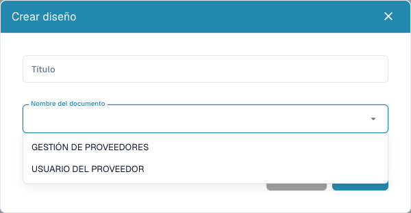

# Configurar formularios de proveedores

<figure><figcaption>
Elegir el destinatario externo o interno antes de guardar un diseño.
</figcaption></figure>

Los diseños de proveedores definen formularios para proveedores y personal interno. No modifican la factura impresa ni entrenan su extracción. Necesita acceso de administrador y requisitos acordados para cada destinatario.

## Elegir el destinatario

1. Abra **Configuración → Configuración de proveedores → Diseño de proveedores**.
2. Revise los diseños existentes y abra el correcto antes de crear otro.
3. Para uno nuevo, seleccione **Nuevo**, un título reconocible y el tipo de documento: usuario proveedor para la vista externa o gestión de proveedores para la interna.
4. Guarde la definición, abra su diseño desde la lista y confirme el destinatario.

## Configurar campos y estructura

1. Abra los campos de proveedores. Revise título, nombre del campo ERP, lista de valores y propiedades obligatorio, solo lectura y oculto.
2. Cree una definición con nombre, título y tipo. Los campos de selección/búsqueda/opciones necesitan la lista pertinente. Los de archivo necesitan su tipo de documento; para los demás, revise el nombre ERP.
3. Guarde los ajustes correctos. Definiciones y distribución del formulario son pasos independientes.
4. Organice grupos y campos mediante **Elementos** y **Campos** en el diseño correcto. Seleccione un elemento y revise sus propiedades disponibles.
5. Proporcione nombres y títulos válidos a los grupos. No deje un campo obligatorio oculto o bloqueado sin un valor existente o proceso adecuado.
6. Guarde y reabra el diseño para comprobarlo. **Cancelar** sale del editor. La plantilla predeterminada puede sustituir la estructura actual; úsela deliberadamente.

## Probar ambas vistas

Con un proveedor ficticio y una cuenta de prueba, compruebe por separado registro y detalles internos: avisos obligatorios, opciones, archivos y campos ocultos/de solo lectura. Guardar en el editor no demuestra registro, aprobación o exportación correctos.

Si faltan campos, revise definición, visibilidad, diseño y destinatario. Para valores ausentes en el ERP, compruebe también la asignación de exportación.

Consulte [Portal de proveedores](../../setup/supplier-portal/README.md), [Configuración general](supplier-general-settings.md) y [Permisos](supplier-permissions.md).
