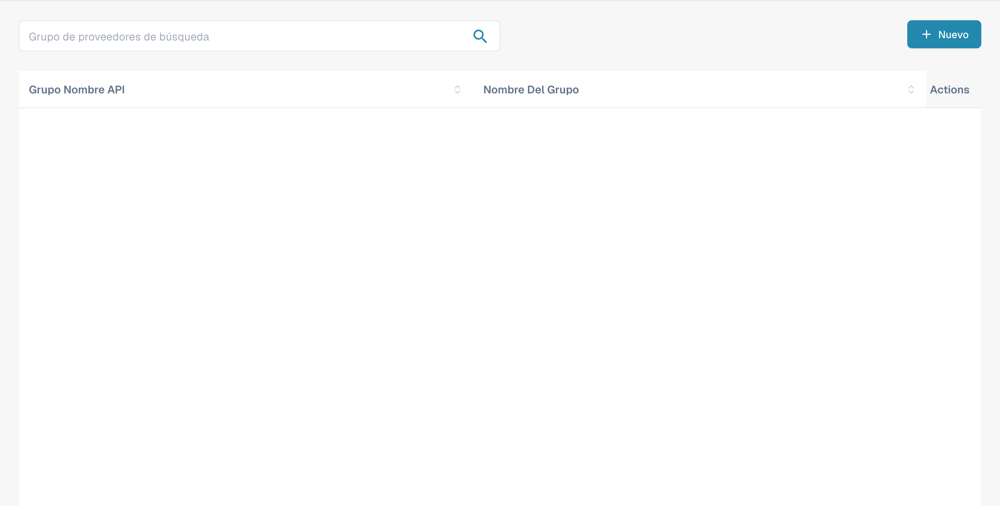
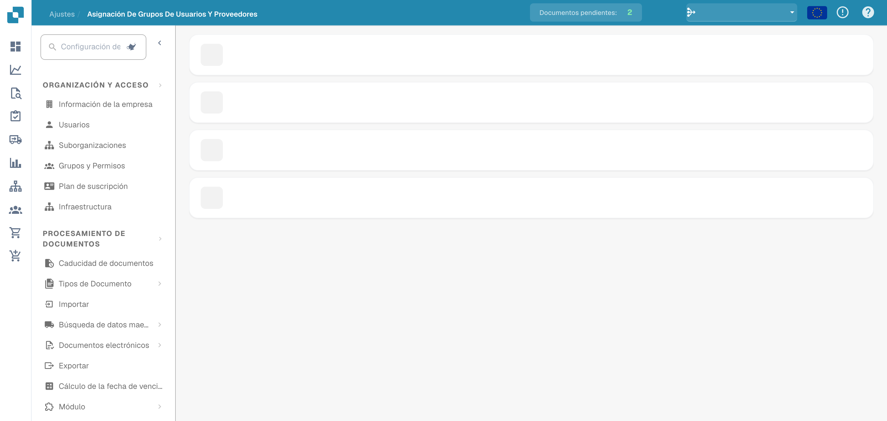

# Permisos de proveedores

### Grupo de proveedores

<figure><figcaption>
Lista de grupos de proveedores con los nombres ocultos.
</figcaption></figure>

Gestione los grupos de proveedores para clasificar a los proveedores por tipo, región o función. Cada grupo tiene un **Grupo Nombre API** (utilizado para integraciones) y un **Nombre del grupo** (nombre visible).

Haga clic en **+ New** para crear un grupo. Utilice el menú de tres puntos de cada fila para editarlo o eliminarlo.

### Asignación de usuarios a grupos de proveedores

<figure><figcaption>
Asignación de usuarios a grupos de proveedores.
</figcaption></figure>

Asigne usuarios a grupos de proveedores para controlar qué empleados pueden acceder a conjuntos concretos de proveedores y gestionarlos. Cada grupo se muestra como una sección desplegable que enumera a sus usuarios asignados con un recuento de miembros.

Haga clic en **+ New** dentro de un grupo para añadir una asignación de usuario. Utilice el menú de tres puntos para eliminar una asignación.
