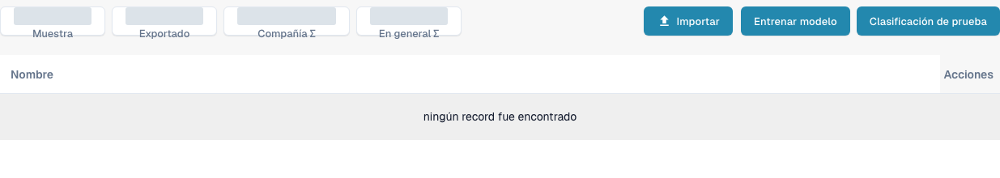

# Entrenamiento de documentos

El entrenamiento de documentos enseña a DocBits dónde encontrar valores en documentos que todavía no lee correctamente. Entrene por separado los campos de cabecera y los campos de línea.

Para revisar el entrenamiento de clasificación de un tipo de documento, abra **Ajustes** → **Tipos de Documento** y seleccione **Entrenamiento modelo** en una tarjeta de tipo de documento existente. La vista muestra los ejemplos de entrenamiento y los controles **Importar**, **Entrenar modelo** y **Clasificación de prueba**. Revise los ejemplos existentes antes de hacer cambios y utilice archivos de prueba autorizados para cualquier entrenamiento o prueba de clasificación posterior.

<figure><figcaption>
Vista en español del entrenamiento de modelos de un tipo de factura existente. No hay documentos de ejemplo en la lista; los contadores agregados están cubiertos. No se ejecutaron importaciones, entrenamientos ni pruebas de clasificación. El aviso de lista vacía conserva la redacción actual de la interfaz.
</figcaption></figure>

* [Entrenar campos de cabecera](training-header-fields.md): marque dónde aparece en el documento un valor de cabecera, como una fecha o un importe total.
* [Entrenar campos de línea y tablas](training-line-fields-table-training/README.md): defina la estructura de la tabla de líneas para un proveedor concreto.

Los resultados del entrenamiento dependen de los documentos utilizados. Compruebe los valores extraídos en otro documento de prueba antes de confiar en ellos.
