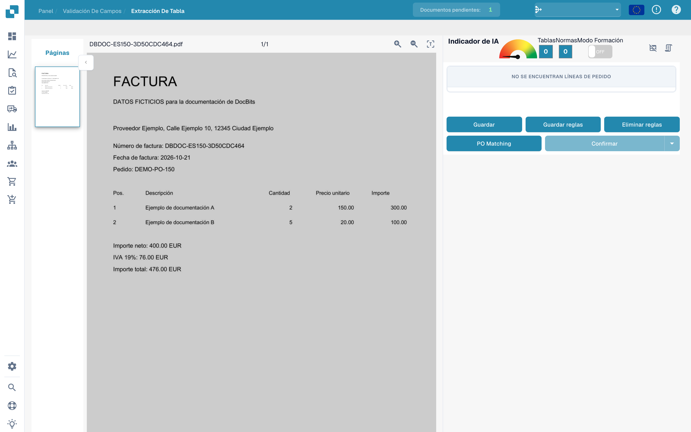
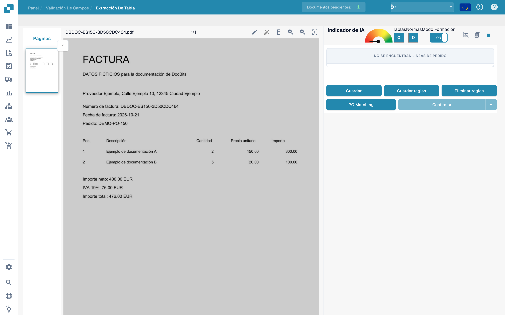
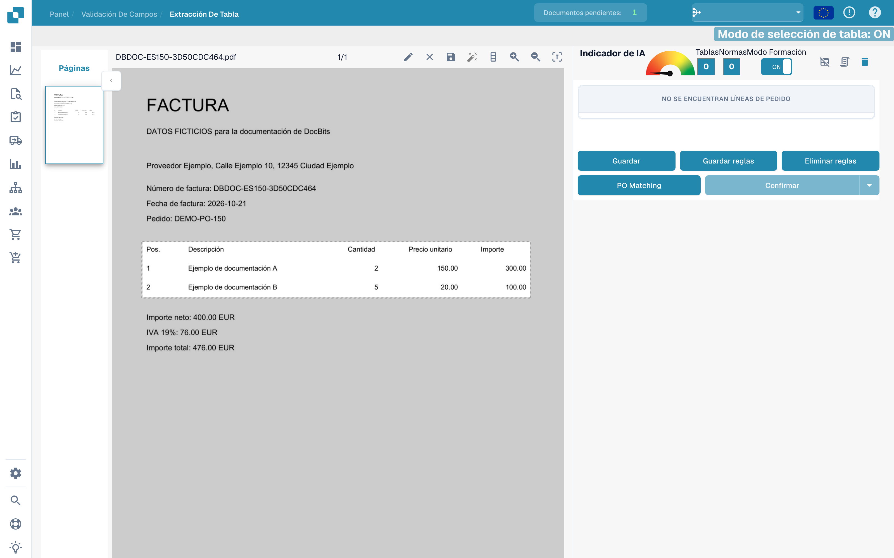
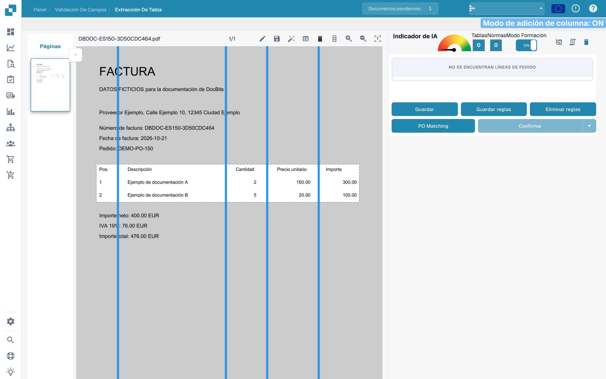
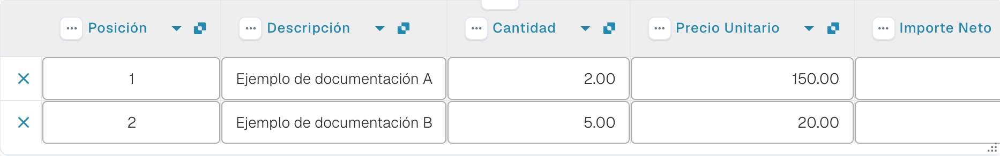

# Definir tablas y columnas

Si una tabla no se reconoce completamente, abra su entrenamiento desde la validación del documento. Los ejemplos muestran una factura ficticia y un borrador sin guardar.

## Abrir y activar el entrenamiento

Abra la factura en **Validación de campos** y seleccione **Extracción de tabla**.

<figure><figcaption>
Interfaz para definir tablas y columnas.
</figcaption></figure>

Active **Modo Formación** para mostrar las herramientas de selección y columnas.

<figure><figcaption>
Entrenamiento de tablas con el modo de entrenamiento activado.
</figcaption></figure>

La barra incluye detección automática de tablas. Compruebe el resultado contra el documento; esta imagen muestra las herramientas disponibles y no demuestra una detección completada.

<figure><figcaption>
Herramientas de entrenamiento de tablas, incluida la detección automática.
</figcaption></figure>

## Seleccionar el área

Con el lápiz, dibuje un rectángulo alrededor de las cabeceras y las posiciones. Excluya los totales situados debajo.

<figure><figcaption>
Área de tabla sin guardar alrededor de las posiciones de la factura.
</figcaption></figure>

## Separar las columnas

Seleccione la herramienta de columnas y coloque los separadores verticales entre las columnas reales.

<figure><figcaption>
Área de tabla en edición con separadores verticales.
</figcaption></figure>

Compruebe posición, descripción, cantidad, precio unitario e importe.

<figure><figcaption>
Separadores colocados entre las columnas de la factura.
</figcaption></figure>

Revise el área y los separadores antes de usar **Guardar** o **Guardar reglas**.

<figure><figcaption>
Área y separadores de columnas de un borrador sin guardar.
</figcaption></figure>

## Comprobar la extracción

Compare cada posición con la factura. La imagen siguiente muestra las filas ya extraídas automáticamente en la validación; no son el resultado del borrador de entrenamiento anterior.

<figure><figcaption>
Posiciones extraídas automáticamente de la factura ficticia.
</figcaption></figure>

Cuando guarde un entrenamiento previsto, pruébelo con otros documentos del mismo proveedor. Una factura no demuestra una extracción fiable para todos los diseños.
