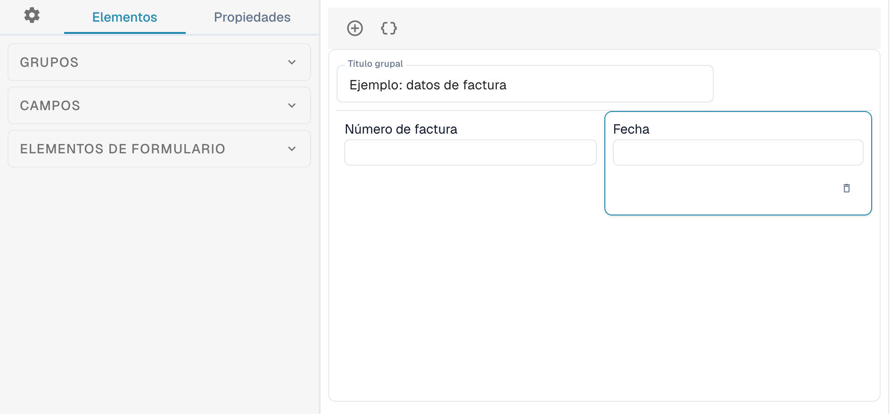
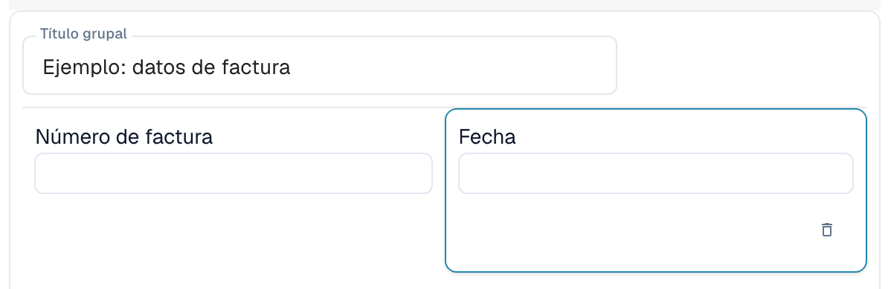
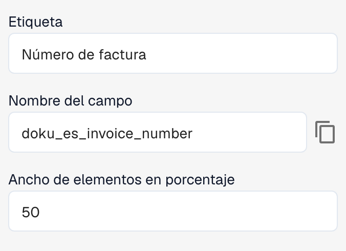

# Editor de diseños

Utilice el editor de diseños para organizar los campos y los controles que las personas ven al validar o aprobar un documento. Cada diseño está asociado a un tipo de documento, un origen y un tipo de diseño. Antes de guardar cambios, compruebe qué diseño está abierto.

## Abrir el diseño

1. Abra **Configuración → Tipos de Documento**.
2. Abra el editor de diseños del tipo o subtipo de documento que necesite. Si no está disponible, puede que un administrador deba activar el módulo para su organización.
3. Compruebe el origen seleccionado en la barra de acciones y el tipo de editor indicado junto a él.

<figure><figcaption>
Vista parcial del editor: las secciones Grupos, Campos y Elementos de formulario a la izquierda y un ejemplo simplificado de diseño de factura en el centro.
</figcaption></figure>

Al cambiar **Origen**, DocBits puede crear un diseño independiente para ese origen. Confirme el origen antes de editar.

## Conocer las áreas del editor

A la izquierda puede alternar entre **Elementos**, **Propiedades** y la configuración general, representada por un engranaje.

* La pestaña **Elementos** contiene las secciones **Grupos**, **Campos** y **Elementos de formulario**. Abra cada sección para consultar los grupos, campos y controles disponibles.
* La zona central muestra los grupos y campos del diseño. Los grupos permiten organizar campos relacionados.
* A la derecha se encuentra la vista del documento de ejemplo, donde puede consultar el documento y ajustar el zoom.

Arrastre un elemento desde la sección correspondiente de la izquierda hasta la zona del diseño para añadir un grupo, un campo o un control de formulario.

<figure><figcaption>
Los campos Número de factura y Fecha del grupo de ejemplo. En este diseño, cada campo ocupa el 50 % del ancho del grupo.
</figcaption></figure>

Configure los campos reutilizables en [Tipos de Documento](README.md). Los campos disponibles dependen del tipo de documento seleccionado y de su configuración.

## Cambiar las propiedades de un elemento

Seleccione un grupo o campo en la zona del diseño y abra **Propiedades** a la izquierda. Las opciones dependen del elemento seleccionado e incluyen, por ejemplo, la etiqueta, el nombre técnico, el ancho y el comportamiento.

<figure><figcaption>
Propiedades del campo seleccionado: su etiqueta, su nombre técnico y el ancho del elemento en porcentaje.
</figcaption></figure>

En los campos predefinidos, la etiqueta y el nombre técnico pueden no ser editables. Según el tipo de elemento, también puede configurar el modo de solo lectura, la visibilidad, el orden de tabulación, listas de valores y la ejecución de un flujo de trabajo o un script cuando cambie el valor. Las opciones de grupos y campos no son iguales.

Compruebe el resultado en la zona del diseño después de modificar las propiedades. El ancho se introduce como porcentaje mediante un control numérico; los grupos y sus campos pueden tener anchos distintos. Consulte [Configurar las propiedades de los campos](../../settings/global-settings/document-types/layout-manager/configuring-field-properties.md).

## Plantillas y JSON

Además de guardar el diseño, la barra de acciones ofrece funciones para generar una plantilla, aplicar el diseño predeterminado a los diseños por origen, usar la plantilla predeterminada y editar JSON. Su disponibilidad depende del editor abierto.

Generar o aplicar una plantilla puede sustituir el diseño personalizado. Compruebe antes el tipo de documento, el origen y el diseño actual. **Editar json** se utiliza para la configuración avanzada y requiere conocer el formato de la plantilla. La copia de la configuración está disponible dentro del diálogo JSON.

## Revisar y guardar

Organice los grupos y los campos y compruebe el resultado en la zona del diseño. Cuando sea correcto, utilice **Guardar** en la barra de acciones. Para diseños específicos de un origen, consulte [Diseños por origen](origin-layouts.md).


Las ilustraciones utilizan un ejemplo simplificado de diseño de factura. Los nombres de campo y las opciones disponibles dependen de su configuración.

