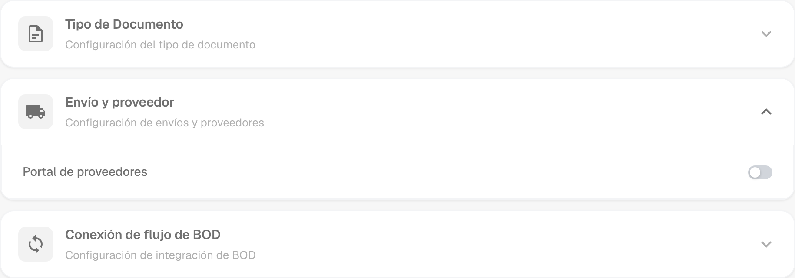
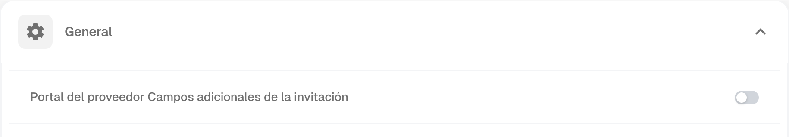
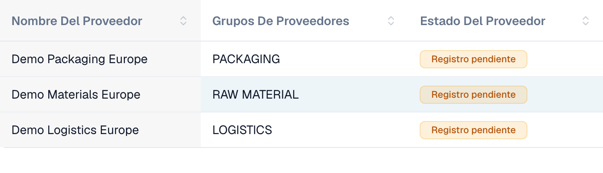
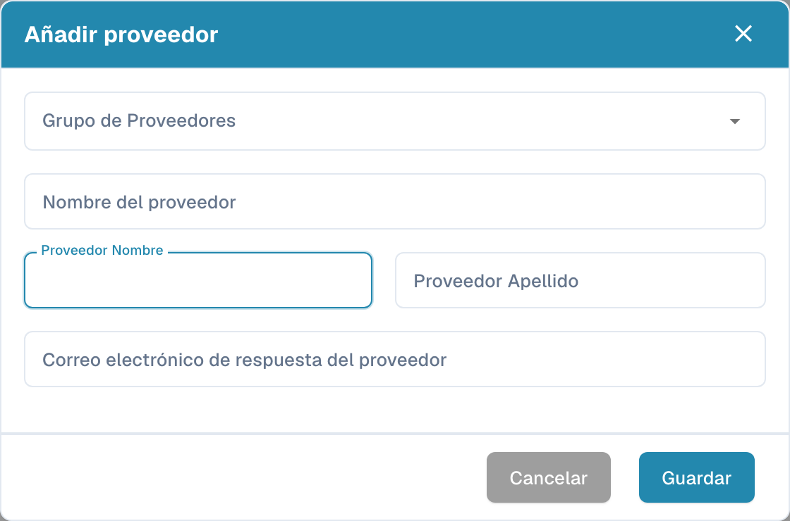

# Portal de proveedores

El **portal de proveedores** permite que un administrador dé a los proveedores de su empresa acceso a **DocBits**. El administrador activa el portal y configura qué proveedores pueden utilizarlo y qué información pueden consultar.

Un proveedor invitado se registra e inicia sesión con su propia cuenta. Allí puede consultar la información que se le haya habilitado, por ejemplo el estado de sus pedidos de compra y facturas. Las funciones disponibles dependen de la configuración de la organización.

## Vídeo: preparar el portal de proveedores y el acceso

Un administrador ficticio explica la opción del portal y la selección del plan, la preparación de una invitación y el inicio del registro. La activación, el envío, el registro y la aprobación se explican como pasos separados.



[Abrir el vídeo con subtítulos en español y selección de capítulos](https://docbits-videos.fra1.cdn.digitaloceanspaces.com/settings-assistant/supplier-portal-access-admin/v1/es.html)

*El personaje y la voz son sintéticos. La interfaz pertenece a una organización de demostración de DocBits.*

## Admin: activar el portal

1. En Configuración, abra los módulos y seleccione **Integración de documentos**.
2. Despliegue **Envío y proveedor** y active **Portal de proveedores**.
3. Si aparece un diálogo de activación, revise el plan mostrado y confirme la activación que necesita.

<figure><figcaption>
Opción del portal en el módulo de envíos y proveedores. Este interruptor activa la función para la organización.
</figcaption></figure>

## Admin: configurar el portal

Configure el portal de su organización antes de enviar las primeras invitaciones:

- [Configuración general de proveedores](../../settings/supplier-setting/supplier-general-settings.md): Campos adicionales de invitación, estados, logotipo e información de privacidad.
- [Plantillas de correo](../../settings/supplier-setting/editing-email-templates.md): Contenido y presentación de los mensajes de invitación.
- [Diseño de proveedor](../../settings/supplier-setting/supplier-layout.md): Campos para el registro de proveedores y la administración interna. Seleccione el tipo de diseño adecuado.
- [Permisos de proveedores](../../settings/supplier-setting/supplier-permissions.md): Asignación de empleados internos a grupos de proveedores. Estas responsabilidades internas son independientes del acceso propio de cada proveedor al portal.

<figure><figcaption>
Configuración general de proveedores con la opción de campos adicionales de invitación.
</figcaption></figure>

## Admin: invitar a proveedores

Abra la administración de proveedores. Antes de invitar, revise la empresa, el grupo, la persona de contacto y el correo. Al crear un proveedor, guardar solicita el envío de la invitación de registro; no se limita a conservar un borrador. Para un proveedor existente, utilice la acción de invitación correspondiente. La confirmación de envío no demuestra que el correo se haya entregado ni que el registro haya finalizado.

<figure><figcaption>
Administración interna de tres empresas ficticias. Los tres estados muestran aquí un registro pendiente.
</figcaption></figure>

<figure><figcaption>
Formulario para crear e invitar a un proveedor. Revise la empresa, el contacto y el correo antes de guardar.
</figcaption></figure>

## Proveedor: registrarse y acceder a DocBits

El proveedor abre su invitación, crea o utiliza la cuenta propia prevista y sigue los pasos de registro configurados. Después puede consultar la información que la organización pone a su disposición en DocBits. El proceso exacto y las funciones disponibles dependen de la organización.

[Guía de registro para proveedores](supplier-registration.md).

## Entender el acceso y los estados

Portal activado, invitación enviada, registro completado y aprobación concedida son estados distintos. Una ficha de proveedor o datos maestros guardados no demuestran que el acceso al portal esté listo. La vista del proveedor depende de los permisos asignados y difiere de la vista interna del administrador.
