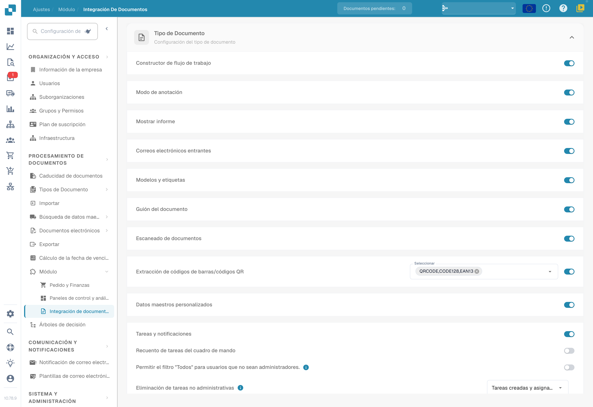
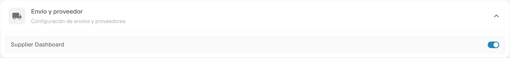
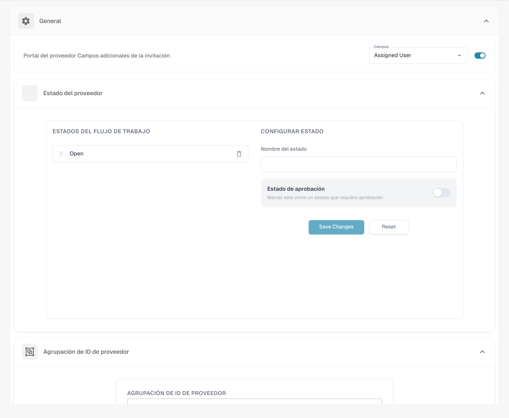
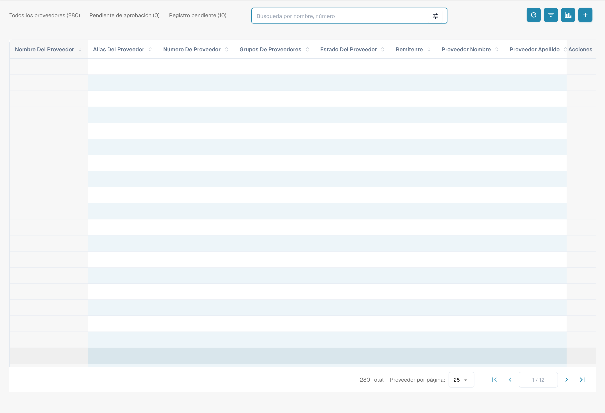
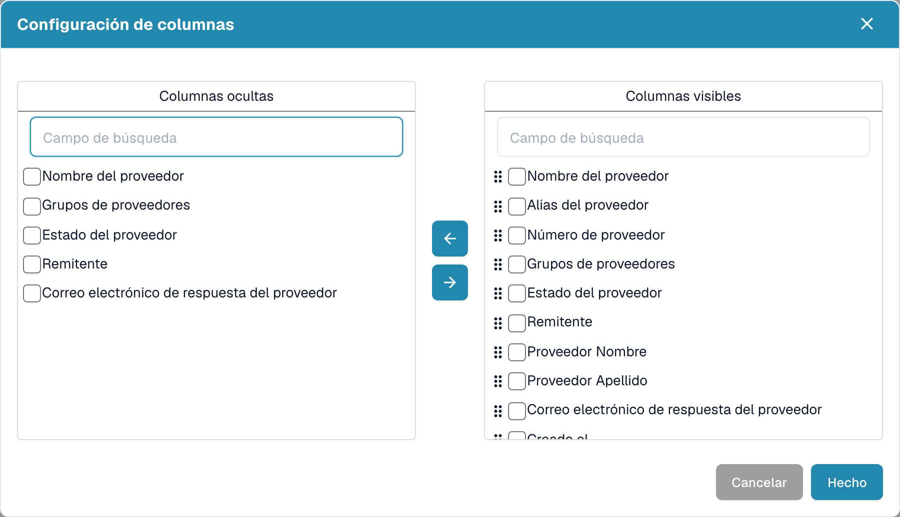

# Panel de proveedores

## Descripción general

El **Panel de proveedores** permite gestionar el registro y el acceso de proveedores. La información y las acciones disponibles para cada proveedor dependen de los permisos, el diseño del portal y la integración de su organización. Dar de alta un registro no concede por sí solo acceso a todos los documentos de DocBits.

## Cómo activar el Panel de proveedores

1. Abra **Ajustes → Procesamiento de documentos → Módulos → Integración de documentos**.
2. En **Envío y proveedor**, revise el interruptor **Supplier Dashboard**. Este nombre aún aparece en inglés en la interfaz española.
3. Si debe cambiar la opción, compruebe antes que su organización está autorizada a usarla. Las imágenes muestran el estado existente; no representan una activación realizada durante la documentación.

<figure><figcaption>
Módulos de integración de documentos en español. Abra Envío y proveedor para revisar la opción del portal; esta imagen no acredita una activación o un cambio de suscripción.
</figcaption></figure>

<figure><figcaption>
Envío y proveedor muestra el interruptor Supplier Dashboard, cuyo nombre aún aparece en inglés. La opción ya estaba activa en este entorno; no se cambió su estado.
</figcaption></figure>

## Configuración del proveedor

Abra el área de proveedores de **Ajustes**. En **General** puede revisar los campos adicionales de la invitación, el estado del proveedor y la agrupación de identificadores. Los nombres de estados configurados, como **Open**, pueden pertenecer al flujo de su organización.

<figure><figcaption>
Ajustes generales del proveedor: campos adicionales de invitación, Estado del proveedor y agrupación de identificadores. Assigned User, Save Changes y Reset son las etiquetas inglesas que todavía muestra el producto. No se cambiaron ajustes ni se envió una invitación.
</figcaption></figure>

Use las guías específicas para cada área:

* [Configuración general del proveedor](../../settings/supplier-setting/supplier-general-settings.md): ajustes del portal y referencias a los documentos legales y a la identidad visual.
* [Plantillas de correo electrónico](../../settings/supplier-setting/editing-email-templates.md): contenido de los mensajes de invitación.
* [Diseño del proveedor](../../settings/supplier-setting/supplier-layout.md): campos que debe aportar el proveedor al registrarse.
* [Configuración de exportación](../../settings/supplier-setting/export-configuration-for-supplier-portal-for-m3.md): integración y mapeo del portal con Infor M3.
* [Permisos para proveedores](../../settings/supplier-setting/supplier-permissions.md): alcance de acceso y grupos de proveedores.

El [índice de ajustes del proveedor](../../settings/supplier-setting/) reúne estas guías. La captura de General no muestra una exportación, el envío de un correo ni el acceso de un proveedor.

## Vídeo: buscar proveedores y mantener sus datos

Este tutorial de administración en español muestra cómo buscar un proveedor, modificar la ciudad y el código postal, guardar y comprobar los valores después de volver a cargar la página. Utiliza tres empresas ficticias y un formulario configurado con nombre, ciudad y código postal. Los campos disponibles dependen del diseño de proveedores de su organización. La ciudad del ejemplo es Colonia y aparece en pantalla con su nombre alemán, **Köln**.


Buscar un proveedor, actualizar sus datos y comprobar que los cambios se han guardado.


[Ver el vídeo con subtítulos opcionales en español y transcripción](https://docbits-videos.fra1.cdn.digitaloceanspaces.com/settings-assistant/supplier-management-admin/v1/es.html).

La confirmación de guardado todavía muestra **Supplier is saved successfully** en inglés; el vídeo conserva la interfaz real. Guardar los datos maestros no modifica el estado **Registro pendiente** ni equivale a aprobar al proveedor. Este vídeo no envía invitaciones ni aprueba proveedores.

## Panel de proveedores 

Abra el panel desde la navegación de proveedores. La tabla muestra los registros accesibles para su usuario. Los recuentos, las columnas y los estados de la imagen corresponden al entorno mostrado; no son valores predeterminados.

<figure><figcaption>
Panel actual con Todos los proveedores, Pendiente de aprobación, Registro pendiente y búsqueda por nombre o número. La tabla contiene registros con sus datos ocultos; los recuentos pertenecen al entorno de prueba.
</figcaption></figure>

## Filtrar por proveedores

Utilice **Búsqueda por nombre, número** para localizar un proveedor. El control de filtros junto a la búsqueda permite revisar las opciones de su entorno. Las categorías **Todos los proveedores**, **Pendiente de aprobación** y **Registro pendiente** permiten acotar la lista. La paginación controla cuántos registros se muestran por página.

## Estado del proveedor

Revise el estado y el flujo configurados en su organización. Un registro pendiente de inscripción indica una fase distinta de una aprobación pendiente; no deduzca de un único estado que el proveedor ya tiene acceso o que se han cumplido todos los controles internos. Los nombres y pasos pueden variar según la configuración.

## Herramientas en el Panel de proveedores

### Refrescar tabla 

El botón con la flecha circular vuelve a cargar la lista. Actualizar la tabla no envía una invitación ni modifica el estado de un proveedor.

### Establecer columnas de tabla para la organización 

Abra el botón de configuración de columnas junto a la búsqueda. Este diálogo corresponde a la **tabla de proveedores**. Seleccione campos y use las flechas para moverlos entre **Columnas ocultas** y **Columnas visibles**; arrastre los campos visibles para cambiar su orden. **Hecho** confirma los cambios y **Cancelar** permite salir sin confirmarlos. Revise el alcance de la configuración de su organización antes de guardarla.

<figure><figcaption>
Configuración de columnas de la tabla de proveedores, con Columnas ocultas y Columnas visibles. Las casillas y flechas permiten cambiar la visibilidad, y Hecho confirma los cambios. En esta captura no se modificó ni guardó la selección.
</figcaption></figure>

### Analítica 

El botón con el gráfico abre el resumen de vencimientos disponible para los proveedores. Los períodos y recuentos dependen de los datos de su organización; no representan necesariamente una fecha de caducidad del acceso a DocBits. Compruebe el filtro aplicado antes de interpretar la lista resultante.

## Crear proveedor y enviar correo electrónico de registro

### Para crear un nuevo proveedor

1. Pulse **+** en la barra de herramientas para abrir **Añadir proveedor**.
2. Revise el grupo, el nombre del proveedor y los datos de la persona de contacto. Los campos adicionales dependen de la configuración.
3. Antes de pulsar **Guardar**, compruebe el destinatario y la autorización para enviar la invitación. Esta acción puede iniciar el envío del enlace de registro; no debe tratarse como un borrador sin comunicación externa.
4. Compruebe el resultado de la operación. Una confirmación de la solicitud no garantiza que el mensaje haya llegado al buzón; revise la entrega si el proveedor no lo recibe.

<figure><figcaption>
Formulario inicial Añadir proveedor, vacío y sin guardar. Guardar puede iniciar el envío del enlace de registro; compruebe los destinatarios y la autorización antes de usarlo. En esta captura no se creó un proveedor ni se envió correo.
</figcaption></figure>

La imagen muestra únicamente el formulario inicial, sin datos ni envío.

### Para enviar un correo electrónico de registro a un proveedor existente

Localice el registro correcto y revise la acción **Magic Link** cuando esté disponible para su rol y el estado del proveedor. Compruebe los datos de contacto antes de confirmar **Enviar**. Esta operación solicita el correo de registro; no se ejecutó durante la preparación de esta guía. No use una cuenta real para probar un envío sin autorización.

## ¿Cómo funciona el proceso de registro para el proveedor?

Tras recibir una invitación válida, el proveedor sigue el enlace y completa los datos y pasos requeridos por su organización. Consulte la [guía del proceso de registro](supplier-registration.md). El acceso final depende de los permisos y de las aprobaciones configuradas.
