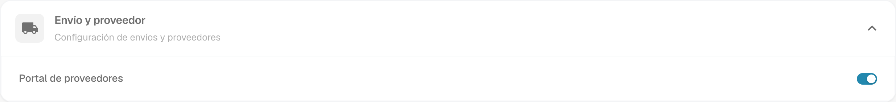
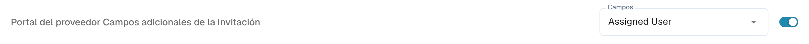
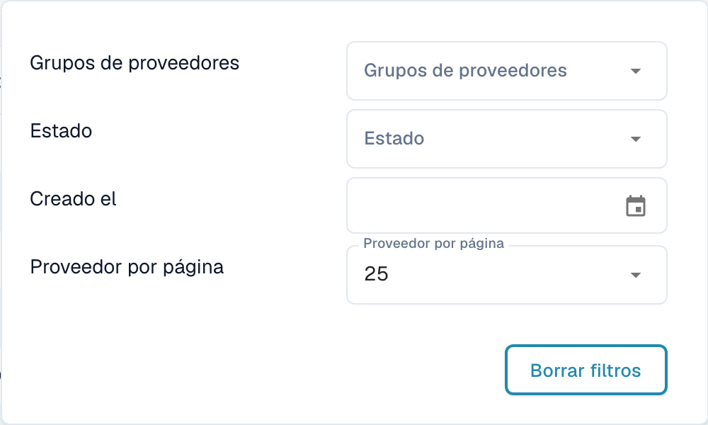
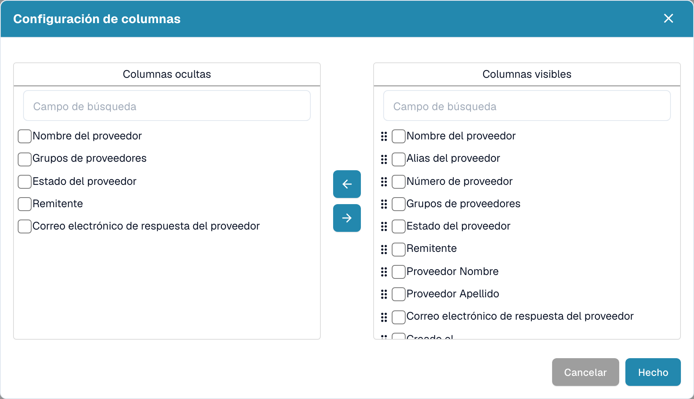
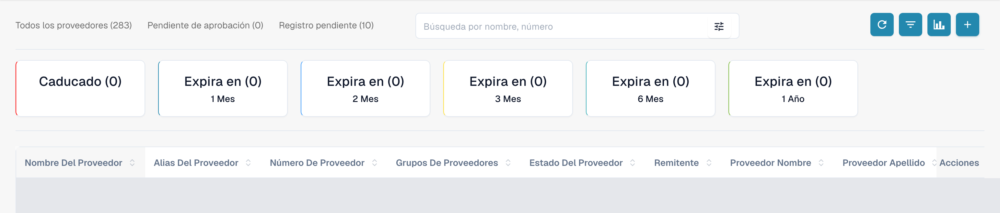
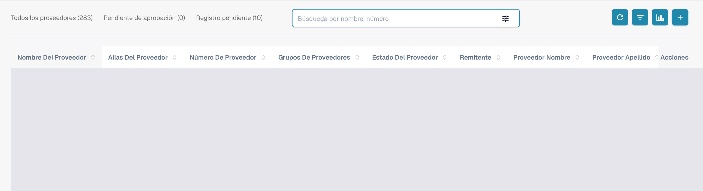
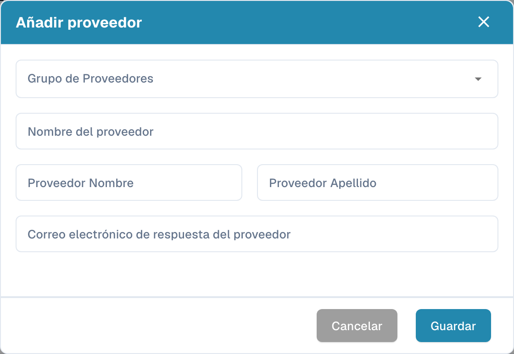

# Portal de proveedores

El **portal de proveedores** permite que un administrador dé a los proveedores de su empresa acceso a **DocBits**. El administrador activa el portal y configura qué proveedores pueden utilizarlo y qué información pueden consultar.

Un proveedor invitado se registra e inicia sesión con su propia cuenta. Allí puede consultar la información que se le haya habilitado, por ejemplo el estado de sus pedidos de compra y facturas. Las funciones disponibles dependen de la configuración de la organización.

## Vídeo: preparar el portal de proveedores y el acceso

Un administrador explica la opción del portal y la selección del plan, la preparación de una invitación y el inicio del registro. La activación, el envío, el registro y la aprobación se explican como pasos separados.



[Abrir el vídeo con subtítulos en español y selección de capítulos](https://docbits-videos.fra1.cdn.digitaloceanspaces.com/settings-assistant/supplier-portal-access-admin/v1/es.html)

## Admin: activar el portal

1. En Configuración, abra los módulos y seleccione **Integración de documentos**.
2. Despliegue **Envío y proveedor** y active **Portal de proveedores**.
3. Si aparece un diálogo de activación, revise el plan mostrado y confirme la activación que necesita.

<figure><figcaption>
Vista real de Dev en español, Envío y proveedor: Portal de proveedores ya está activado en esta organización de prueba. El interruptor no se cambió para la captura.
</figcaption></figure>

## Admin: configurar el portal

Configure el portal de su organización antes de enviar las primeras invitaciones:

- [Configuración general de proveedores](../../settings/supplier-setting/supplier-general-settings.md): Campos adicionales de invitación, estados, logotipo e información de privacidad.
- [Plantillas de correo](../../settings/supplier-setting/editing-email-templates.md): Contenido y presentación de los mensajes de invitación.
- [Diseño de proveedor](../../settings/supplier-setting/supplier-layout.md): Campos para el registro de proveedores y la administración interna. Seleccione el tipo de diseño adecuado.
- [Permisos de proveedores](../../settings/supplier-setting/supplier-permissions.md): Asignación de empleados internos a grupos de proveedores. Estas responsabilidades internas son independientes del acceso propio de cada proveedor al portal.

<figure><figcaption>
Vista real de los campos adicionales de invitación: la opción ya está activada y Campos mantiene la selección configurada Assigned User. No se guardó ningún cambio.
</figcaption></figure>

## Admin: buscar y filtrar proveedores

Abra el **panel de proveedores** para la administración interna. Los totales **Todos los proveedores**, **Pendiente de aprobación** y **Registro pendiente** permiten limitar la lista mostrada. El campo **Búsqueda por nombre, número** sirve para buscar por nombre o número del proveedor.

Abra el control de filtros dentro del campo de búsqueda para utilizar **Grupos de proveedores**, **Estado** y **Creado el**. **Proveedor por página** controla el tamaño de página; **Borrar filtros** elimina los filtros de búsqueda activos. Estos controles corresponden a la lista de proveedores.

<figure><figcaption>
Menú de filtros con Grupos de proveedores, Estado, Creado el, Proveedor por página y Borrar filtros. La captura muestra los controles disponibles sin acreditar una prueba del resultado del filtrado.
</figcaption></figure>

## Admin: elegir las columnas visibles

Junto a Actualizar, abra la configuración de columnas. Su descripción emergente es **Establecer columnas de tabla para la organización**. Seleccione campos en **Columnas ocultas** o **Columnas visibles** y muévalos entre las listas con las flechas. Ordene los campos visibles con sus controles de arrastre. **Hecho** aplica la selección para la organización; **Cancelar** cierra el diálogo sin aplicarla. Utilice el desplazamiento horizontal para acceder a las columnas de una tabla más ancha que la pantalla.

<figure><figcaption>
Configuración de columnas con Columnas ocultas, Columnas visibles, flechas, Cancelar y Hecho. El diálogo se cerró con Cancelar sin modificar la selección.
</figcaption></figure>

## Admin: ver la analítica de vencimientos

Utilice **Analítica**, el icono de gráfico junto a la configuración de columnas, para mostrar u ocultar el resumen de vencimientos. Las tarjetas muestran **Caducado** y **Expira en** con los periodos **1 Mes**, **2 Mes**, **3 Mes**, **6 Mes** y **1 Año**, tal como se indican en la interfaz. Seleccionar una tarjeta limita la lista al periodo de vencimiento correspondiente. Los contadores se refieren a las fechas de vencimiento de los proveedores.

<figure><figcaption>
Analítica muestra Caducado y Expira en para uno, dos, tres o seis meses y un año. Las filas están cubiertas y no se seleccionó ninguna tarjeta.
</figcaption></figure>

## Admin: invitar a proveedores

Abra la administración de proveedores. Antes de invitar, revise la empresa, el grupo, la persona de contacto y el correo. Al crear un proveedor, guardar solicita el envío de la invitación de registro; no se limita a conservar un borrador. Para un proveedor existente, utilice la acción de invitación correspondiente. La confirmación de envío no demuestra que el correo se haya entregado ni que el registro haya finalizado.

<figure><figcaption>
Panel interno con Todos los proveedores, Pendiente de aprobación, Registro pendiente, búsqueda y barra de herramientas. Las filas de proveedores existentes están cubiertas.
</figcaption></figure>

<figure><figcaption>
Formulario vacío Añadir proveedor con Grupo de Proveedores, Nombre del proveedor, datos de contacto, Cancelar y Guardar. Guardar solicita una invitación de registro; en esta captura solo se usó Cancelar.
</figcaption></figure>

## Admin: abrir los detalles desde el panel de proveedores

El personal interno abre **Detalles del proveedor** mediante la fila de un proveedor en el panel. Esta vista contiene las mismas seis secciones que completa el proveedor y muestra su estado. Permite revisar y mantener la información presentada y efectuar la aprobación correspondiente. Para estas capturas no se abrió ninguna fila de un proveedor existente.

## Proveedor: registrarse y acceder a DocBits

El proveedor abre su invitación, crea o utiliza la cuenta propia prevista y sigue los pasos de registro configurados. Después puede consultar la información que la organización pone a su disposición en DocBits. El proceso exacto y las funciones disponibles dependen de la organización.

[Guía de registro para proveedores](supplier-registration.md).

## Entender el acceso y los estados

Portal activado, invitación enviada, registro completado y aprobación concedida son estados distintos. Una ficha de proveedor o datos maestros guardados no demuestran que el acceso al portal esté listo. La vista del proveedor depende de los permisos asignados y difiere de la vista interna del administrador.

Las capturas se realizaron con la cuenta de prueba Dev autorizada y la interfaz en español. Se comprobaron las consultas de lectura de la interfaz y de las listas, los controles visibles y los formularios cancelados sin cambios. No se guardaron ajustes ni selecciones de columnas, no se crearon o modificaron proveedores y no se ejecutaron invitaciones, registros ni aprobaciones. Los resultados de búsqueda y filtrado y la entrega de correo no quedan acreditados como probados funcionalmente. El vídeo existente se conserva; no se realizó una nueva revisión de audio, idioma o sincronización.
