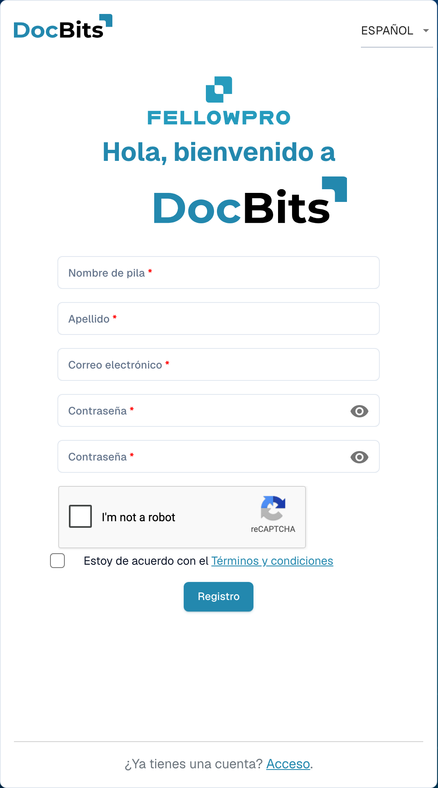

# Registro de proveedores

Esta guía está dirigida a proveedores invitados al portal DocBits de una organización. Utilice el enlace de su invitación. Dispone de una cuenta propia de proveedor; la organización que le invita determina la información disponible y los pasos de registro necesarios.

## 1. Abrir la invitación

Compruebe qué organización ha enviado la invitación y a qué dirección de correo va dirigida. Abra el enlace de registro de esa invitación. Si ha caducado o corresponde a otra persona, solicite una nueva invitación a la organización.

## 2. Configurar su propia cuenta

Revise el nombre y el correo rellenados previamente. Introduzca los datos solicitados y siga las reglas de contraseña mostradas. Introduzca la contraseña y repítala en el segundo campo de contraseña. Lea las condiciones y la información de privacidad. Complete la creación de la cuenta mediante la función de registro. Una cuenta existente y un registro nuevo son casos distintos; siga el proceso previsto para su invitación.

<figure><figcaption>
Formulario de registro de la cuenta de proveedor. Se muestra un formulario vacío; una invitación puede rellenar algunos datos previamente.
</figcaption></figure>

## 3. Completar los datos del proveedor

Complete los datos y, cuando corresponda, los documentos solicitados. Los campos y apartados dependen del diseño de proveedor configurado por la organización. Los indicadores y mensajes de validación señalan la información obligatoria. Guarde el progreso si la pantalla ofrece esa opción; guardar no equivale automáticamente al envío final.

## 4. Comprobar el registro y la aprobación

Envíe la información mediante la acción de finalización correspondiente. Si hay una revisión o aprobación configurada, espere el resultado. A continuación, inicie sesión con su propia cuenta. La organización determina qué pedidos, facturas y otra información puede consultar.

## Si no puede acceder al portal

Póngase en contacto con la organización que le invita si el enlace no es válido, faltan permisos o no están claros los datos obligatorios. Una ficha de proveedor interna no sustituye su registro ni la aprobación de acceso necesaria.

[Configuración del portal de proveedores](README.md).
