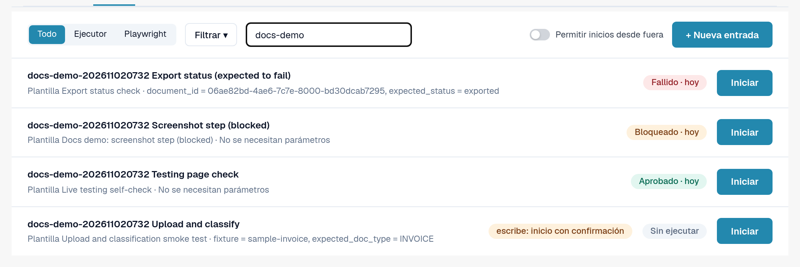
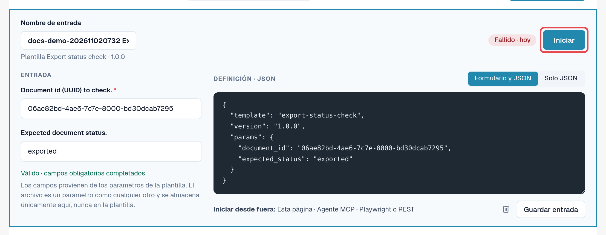
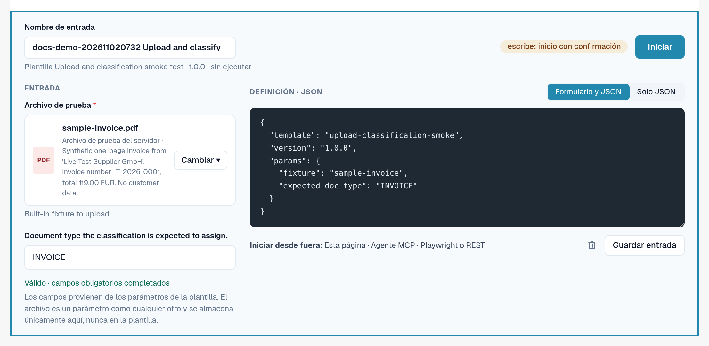

# Entradas

Una entrada almacena **los valores de su organización** para los parámetros de una plantilla, con el nombre que usted elija.
Una plantilla más una entrada es una prueba que puede iniciar una y otra vez, de forma manual o automática.

Ejemplo: la plantilla predeterminada *Default smoke: validation contract* abre un documento y comprueba su estado y su
tipo de documento. Necesita un ID de documento. Su entrada *Factura LT-2026-0001 lista para validación* almacena el ID de un
documento de su organización y el estado que espera.

Abra **Configuración → Testing**, pestaña **Entradas**.

<figure><figcaption>
Pestaña Entradas con entradas guardadas y sus últimos resultados.
</figcaption></figure>

Cada fila muestra el nombre de la entrada, su plantilla y versión, el último resultado e **Iniciar**. **Actualización disponible**
significa que la plantilla tiene una versión más reciente que aquella para la que se guardó esta entrada. Un indicador
**escribe: inicio con confirmación** marca las entradas cuya plantilla modifica datos.

## Crear una entrada

1. En la pestaña **Plantillas**, seleccione **Crear entrada** en la plantilla. (O bien, en la pestaña **Entradas**, seleccione
   **+ Nueva entrada** y elija la plantilla.)
2. Introduzca un **Nombre de entrada**, por ejemplo la finalidad y la organización.
3. Rellene los parámetros. Los campos obligatorios se marcan con un asterisco. Puede alternar entre **Formulario y JSON**
   y **Solo JSON**; ambos se mantienen sincronizados.
4. Compruebe la línea situada bajo el formulario: *Válido · campos obligatorios completados* significa que la entrada se puede iniciar.
5. Seleccione **Guardar entrada**.

<figure><figcaption>
Editor de entradas con nombre, parámetros y línea de validez.
</figcaption></figure>

### Archivos como parámetros

Algunas plantillas suben un documento. Su parámetro de archivo ofrece **Archivos de la organización** (PDF, PNG o JPEG de hasta 10 MB
que su organización ha subido para las pruebas) y **Archivos de prueba del servidor** (archivos de prueba sintéticos proporcionados por DocBits).
El archivo se almacena en su organización, nunca en la plantilla.

<figure><figcaption>
Parámetro de archivo con archivos de la organización y archivos de prueba del servidor.
</figcaption></figure>

### Valores que nunca se guardan

Los parámetros marcados como confidenciales (por ejemplo, una contraseña de un sistema externo) nunca se almacenan. La entrada
solo recuerda que el valor es necesario; usted lo introduce en cada inicio (*Solo se envía al inicio; nunca se guarda.*).
Los registros muestran estos valores como *Proporcionado al inicio*.

## Modificar o eliminar una entrada

Abra la entrada desde la lista, modifíquela y seleccione **Guardar entrada**. Para eliminarla, seleccione el icono de papelera (**Eliminar entrada**) en el
editor y confirme. Eliminar una entrada no elimina sus registros.


Si su organización mantiene **casos de prueba**, el enlace **Casos de prueba** del menú de filtros de la pestaña Entradas muestra sus
casos e indica cuáles tienen una plantilla. Una persona autorizada puede confirmar manualmente un caso sin plantilla.

