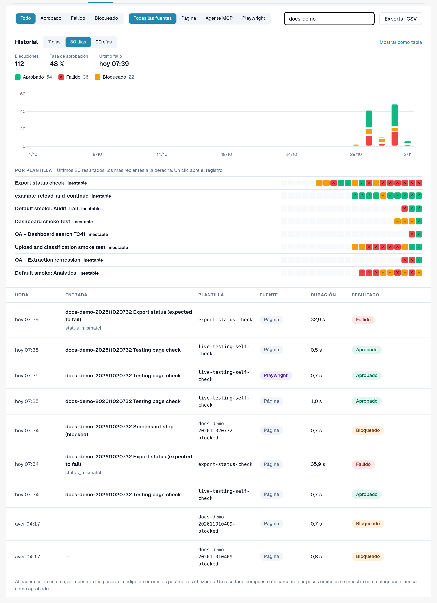
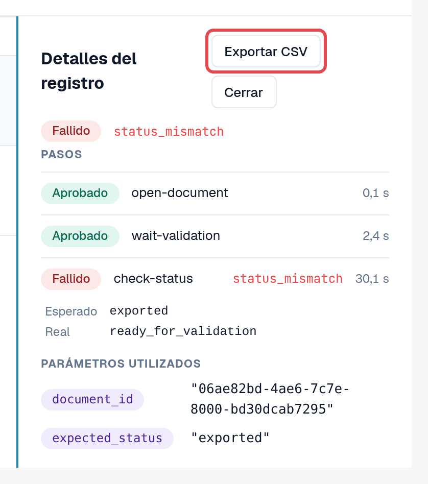
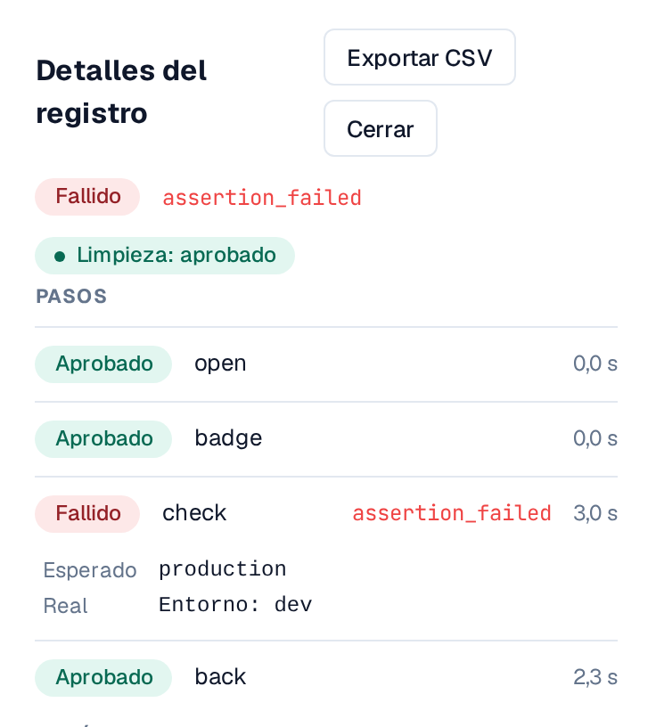
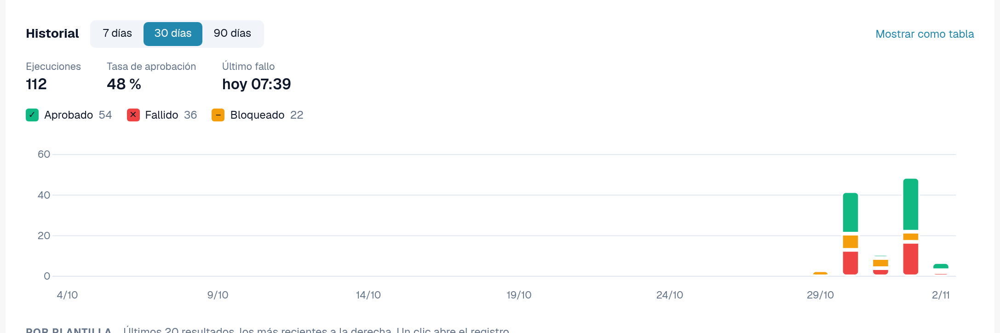
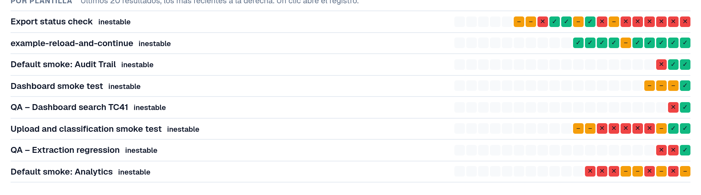

# Registros e historial

Cada ejecución, sea cual sea la forma en que se inició, termina en la pestaña **Registros**: el resultado, los pasos, el código de error de un paso
fallido y los parámetros utilizados. Los registros no almacenan contenido de las páginas ni capturas de pantalla.

Abra **Configuración → Testing**, pestaña **Registros**.

<figure><figcaption>
Pestaña Registros con resultados y fuentes diversos.
</figcaption></figure>

## Leer la lista

| Columna | Significado |
|---|---|
| **Hora** | Cuándo se inició la ejecución. |
| **Entrada** | La entrada que se inició (o el caso del plan de pruebas). |
| **Plantilla** | El ID de la plantilla. |
| **Fuente** | **Página** (iniciada en el navegador), **Agente MCP**, **Playwright**, **Manual** (un caso confirmado a mano). |
| **Duración** | Cuánto duró la ejecución. |
| **Resultado** | **Aprobado**: todos los pasos se aprobaron. **Fallido**: un paso falló. **Bloqueado**: la ejecución no pudo evaluarse, por ejemplo porque se omitieron pasos; una ejecución compuesta solo por pasos omitidos nunca se muestra como aprobada. |

Filtre con **Todo / Aprobado / Fallido / Bloqueado**, con **Todas las fuentes / Página / Agente MCP / Playwright**, o con
**Buscar registros**.

## Abrir un registro

Seleccione una fila. **Detalles del registro** muestra cada paso con su resultado, el código de error de un paso fallido y los
**Parámetros utilizados** (los valores confidenciales solo como *Proporcionado al inicio*). **Abrir caso** salta al caso del plan de pruebas, si
existe.

<figure><figcaption>
Detalles del registro de una ejecución fallida.
</figcaption></figure>

### Valor esperado y valor real

Bajo una comprobación fallida, **Detalles del registro** muestra lo que la comprobación esperaba y lo que encontró:

* **Esperado**: el valor que solicita la plantilla.
* **Real**: el valor que había en la página.

Ambos aparecen **solo en entornos de desarrollo y de prueba**, se acortan a 120 caracteres y se omiten cuando el
paso utiliza un valor confidencial. En un entorno de cliente (sandbox, producción), el registro conserva únicamente el código de error.

### Limpieza

Si la plantilla tiene [pasos de limpieza](steps-and-blocks.md), el indicador situado junto al resultado muestra cómo terminaron:
**Limpieza: aprobado**, **Limpieza: fallido** o **Limpieza: omitido** (por ejemplo, porque la ejecución se detuvo). Los pasos de limpieza
se ejecutan incluso después de una comprobación fallida. Una limpieza fallida no cambia el resultado de la ejecución, pero pueden quedar datos de prueba, por ejemplo un
documento subido. Abra el registro para ver qué paso de limpieza falló.

<figure><figcaption>
Detalles del registro: la comprobación fallida con Esperado y Real, y el indicador Limpieza: aprobado.
</figcaption></figure>

## Gráfico de historial

Sobre la lista, **Historial** muestra cómo se ejecutaron las pruebas a lo largo del tiempo. Alterne entre **Mostrar como gráfico** y **Mostrar como tabla**.

* **Resultados por día**: cuántas ejecuciones fueron aprobadas, fallidas o bloqueadas cada día, en su zona horaria. Elija el
  **Intervalo de tiempo** (de 7 a 90 días, 30 por defecto). Seleccione un día para filtrar la lista por él; **Mostrar todos los días de nuevo** elimina el filtro.
* **Tasa de aprobación** y **Último fallo** resumen el intervalo. Las ejecuciones que todavía están en curso cuentan como *aún sin resultado*.
* **Por plantilla**: los últimos 20 resultados de cada plantilla, con el más reciente a la derecha, con una etiqueta: **estable** (solo
  aprobados), **inestable** (resultados mixtos) o **no aprobado** (solo fallidos o bloqueados). Seleccione un resultado para abrir su registro.
  Las plantillas inestables aparecen primero.

<figure><figcaption>
Historial: resultados por día.
</figcaption></figure>

<figure><figcaption>
Por plantilla: últimos 20 resultados y estabilidad.
</figcaption></figure>

## Exportar como CSV

Seleccione **Exportar CSV** en la barra de herramientas para descargar los registros que coincidan con el resultado y la fuente seleccionados (hasta 5.000;
no se aplica el texto de búsqueda). En **Detalles del registro**, **Exportar CSV** descarga un único registro con todos sus pasos.

El archivo se abre directamente en Excel (UTF-8). Las horas están en UTC. Contiene la misma información que la página: sin
valores confidenciales ni contenido de páginas.

<figure><figcaption>
Exportar CSV en la barra de herramientas de Registros.
</figcaption></figure>
