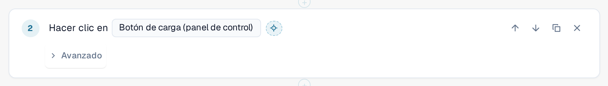
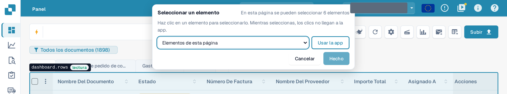
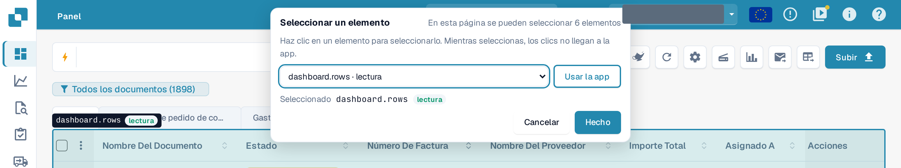
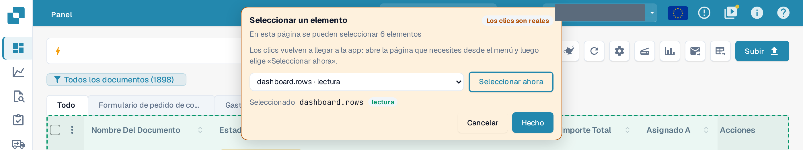

# Seleccionar un elemento en la app

Cada paso necesita saber **sobre qué elemento** de la página actúa: un botón, un campo, una tabla. En lugar de buscarlo
en una lista larga, puede señalarlo en la aplicación real.

## Seleccionar un elemento

1. En el editor de plantillas, seleccione el botón de mira **Seleccionar en la app** situado junto al elemento de un paso.

<figure><figcaption>
El botón Seleccionar en la app junto al elemento de un paso Hacer clic
</figcaption></figure>

2. DocBits abre la página en la que se encuentra la prueba en este paso: la página del paso **Abrir página** anterior más cercano.
   Si ese paso utiliza un valor de entrada, DocBits pregunta qué página abrir (**¿Qué página abrir?**). Su borrador se conserva, sin guardar, y la
   aplicación permanece en esta pestaña del navegador.
3. Aparece una barra **Seleccionar un elemento** en la parte superior. Indica cuántos elementos se pueden seleccionar en esta página. Mueva el
   ratón por la página: DocBits resalta el elemento situado bajo el puntero y lo nombra, junto con su clase:
   **lectura** (solo lee), **modifica datos**, **irreversible** o **desconocido**.

<figure><figcaption>
Al pasar el cursor sobre la lista de documentos: el contorno nombra el elemento dashboard.rows y su clase lectura
</figcaption></figure>

4. Haga clic en el elemento. La barra lo muestra en **Seleccionado**. También puede elegir un elemento de la lista
   **Elementos de esta página** de la barra, lo que funciona con el teclado y con un lector de pantalla.

<figure><figcaption>
La barra tras un clic: dashboard.rows está seleccionado, Hecho está activado
</figcaption></figure>

5. Seleccione **Hecho**. El editor se abre de nuevo con su borrador y el elemento en el paso. Seleccione **Cancelar** para volver
   sin cambios. En ambos casos el borrador queda sin guardar: seleccione **Guardar** en el editor cuando esté conforme.

Mientras selecciona, **la aplicación no recibe sus clics.** Seleccionar un botón **Borrar** no borra nada. Salga del
selector con **Hecho** o **Cancelar**; ninguna tecla (ni siquiera Esc) lo cierra. El botón está desactivado mientras una prueba
se ejecuta en esta pestaña.

## Seleccionar una tabla, una columna o una acción de fila

Los pasos del grupo **Tabla** (**Verificar fila de la tabla**, **Hacer clic en la fila de la tabla**, **Memorizar valor** desde una celda de tabla) aceptan
solo tablas. Haga clic en una celda de la tabla: DocBits toma la tabla y propone la columna de esa celda y las demás
columnas de la fila como sugerencias para los campos de columna del paso. En **Hacer clic en la fila de la tabla**, haga clic en el botón
de la fila para tomar esa acción de fila. **Verificar cantidad** acepta cualquier elemento, incluida una tabla.

## Usar la app mientras selecciona

El elemento que necesita puede estar en otra página. Seleccione **Usar la app**. La barra se vuelve naranja y muestra **Los clics son
reales**: a partir de ese momento sus clics vuelven a llegar a la aplicación, de modo que puede abrir la otra página mediante su menú normal.
La barra permanece y su lista sigue a la página. Seleccione **Seleccionar ahora** para volver a seleccionar.

<figure><figcaption>
Modo Usar la app: los clics son reales, Seleccionar ahora vuelve a la selección
</figcaption></figure>


En el modo **Usar la app**, un clic es un clic real: puede guardar, borrar o enviar datos en su organización.
Vuelva a **Seleccionar ahora** antes de hacer clic en algo que no desea hacer.

