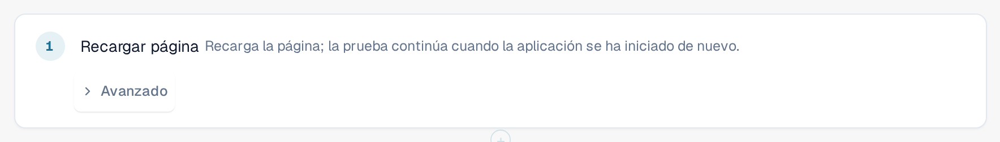
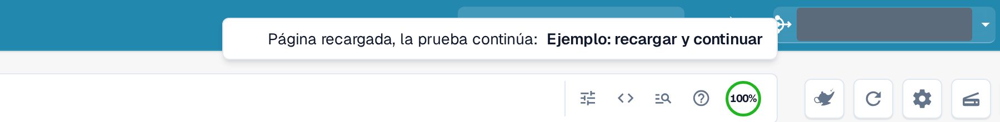

# Recargar y reanudar

Algunas cosas solo se pueden comprobar después de volver a cargar la página, por ejemplo que un ajuste sigue ahí tras una
recarga. El paso **Recargar página** recarga la página del navegador en mitad de una prueba, y la prueba continúa
después.

## Agregar un paso de recarga

1. En el editor de plantillas, seleccione **+ Agregar paso**, luego el grupo **Página** y después **Recargar página**.
2. Coloque el paso donde deba producirse la recarga. Los pasos posteriores se ejecutan en la página recargada.

<figure><figcaption>
El paso Recargar página en el editor de plantillas
</figcaption></figure>

## Qué ocurre durante una ejecución

1. La pestaña guarda el progreso de la prueba y, a continuación, recarga la página.
2. Mientras la aplicación se inicia de nuevo, un aviso en la parte superior indica **Página recargada, la prueba continúa:**, seguido del
   nombre de la prueba. No cierre la pestaña.
3. La página recargada retoma la ejecución y continúa con el paso siguiente. Los pasos anteriores a la recarga conservan sus
   resultados, el paso **Recargar página** se muestra como aprobado y el reloj de la prueba sigue contando durante la recarga.

<figure><figcaption>
Aviso tras una recarga: Página recargada, la prueba continúa
</figcaption></figure>

Los valores memorizados se conservan tras la recarga, excepto los que haya marcado como secretos (consulte
[Pasos y bloques prefabricados](steps-and-blocks.md)). Asegúrese de que ningún paso posterior a la recarga necesite un valor secreto.

## Conviene saber

* Solo este paso recarga la página sin finalizar la prueba. Si recarga o cierra usted mismo la pestaña, la ejecución termina
  como **Cancelado**.
* La página debe volver en unos dos minutos. De lo contrario, la ejecución termina como **Cancelado** o **No entregable**.
* Una prueba puede contener hasta cinco pasos de recarga.
* La prueba continúa en la misma pestaña del navegador y con el mismo usuario. Si el navegador no permite que la pestaña guarde el
  progreso (por ejemplo, porque el almacenamiento está bloqueado), el paso de recarga falla antes de recargar la página.
* La prueba requiere el schema 1.3 de plantilla, que el editor establece al agregar el paso.
