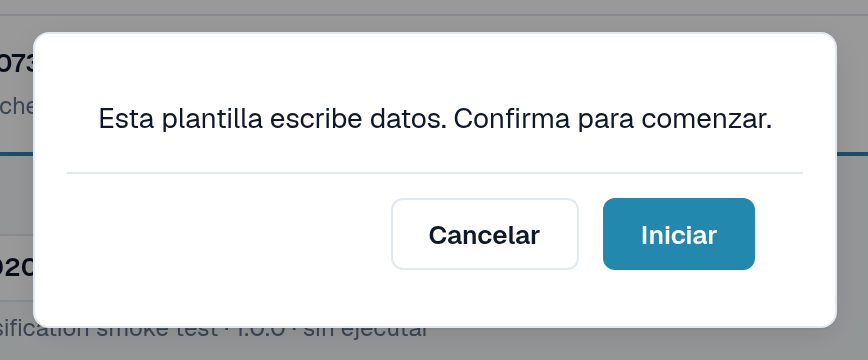
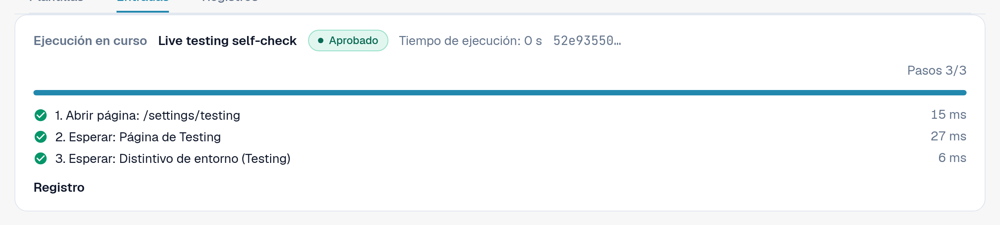
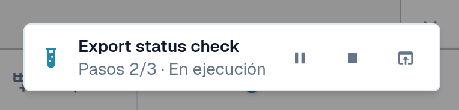
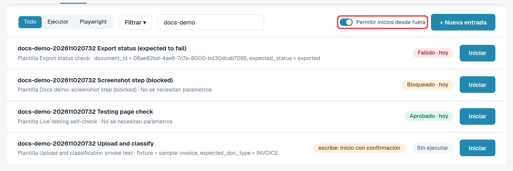
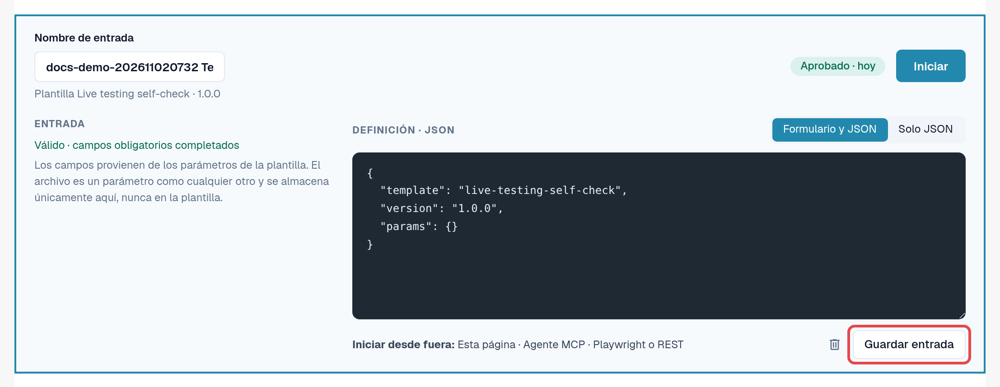

# Iniciar una prueba

Una prueba es una plantilla más una entrada. El módulo Testing la ejecuta y la dirige; usted elige cómo iniciarla. Las tres
formas son equivalentes y cada ejecución termina en los [Registros](logs.md).

| Forma | Cuándo utilizarla | Se muestra en los registros como |
|---|---|---|
| **En el navegador** | Quiere ejecutar una comprobación ahora y verla. | **Página** |
| **Asistente de IA (MCP)** | Trabaja con un asistente de IA conectado a DocBits y quiere que ejecute y evalúe comprobaciones. | **Agente MCP** |
| **Desde fuera (Playwright o REST)** | Su automatización de pruebas o su pipeline de CI inicia comprobaciones, por ejemplo después de un despliegue. | **Playwright** |

En todos los casos, los clics se realizan en una **pestaña de DocBits de un administrador de la organización**, con los permisos
de esa persona. La pestaña debe permanecer abierta; recargarla o cerrarla finaliza la ejecución. La única excepción es un paso **Recargar página** de
la propia prueba (consulte [Recargar y reanudar](reload-and-resume.md)).

## Iniciar en el navegador

1. Abra **Configuración → Testing**, pestaña **Entradas**.
2. Seleccione **Iniciar** en la entrada (o abra la entrada y seleccione **Iniciar**).
3. Si la plantilla modifica datos, DocBits pregunta: *Esta plantilla escribe datos. Confirma para comenzar.* Seleccione **Iniciar** para continuar.
4. La prueba se ejecuta en esta pestaña. En la página Testing, el panel **Ejecución en curso** muestra el estado, la **Acción actual**,
   el progreso de los pasos y **Pausa**, **Reanudar** y **Detener**. Cuando la prueba abre otra página, un pequeño indicador en la
   esquina inferior derecha muestra allí el progreso. Cuando la prueba termina, el indicador muestra el resultado con
   **Abrir registro** y **Cerrar**.
5. Cuando la prueba termina, abra la pestaña **Registros** para leer el resultado.

<figure><figcaption>
Confirmación antes de una prueba que escribe datos.
</figcaption></figure>

<figure><figcaption>
Panel Ejecución en curso tras aprobarse la prueba.
</figcaption></figure>

<figure><figcaption>
Indicador de ejecución en la esquina inferior derecha de otra página.
</figcaption></figure>


**Cargas durante una prueba:** si su organización tiene suborganizaciones y el panel las muestra todas, el cuadro de diálogo
de carga suele preguntar a qué suborganización pertenece el documento. Mientras una prueba se ejecuta, la carga se dirige a la
**primera suborganización que ofrece el cuadro de diálogo**, sin preguntar. Para subir a una suborganización concreta, inicie la
prueba desde la vista de esa suborganización.


## Permitir inicios desde fuera

Un asistente de IA o un script de Playwright no puede hacer clic por sí mismo; solicita a DocBits que ejecute una prueba **en una pestaña del navegador que
usted haya registrado**:

1. Abra **Configuración → Testing**, pestaña **Entradas**, en la pestaña del navegador que deba ejecutar las pruebas.
2. Active **Permitir inicios desde fuera**. La pestaña acepta ahora inicios y muestra su ID de sesión.
3. Deje la pestaña abierta. El registro de la pestaña finaliza cuando esta se recarga o se cierra.

<figure><figcaption>
Permitir inicios desde fuera activado, con el ID de sesión.
</figcaption></figure>

El editor de entradas le recuerda las tres formas en **Iniciar desde fuera:** **Esta página**, **Agente MCP**,
**Playwright o REST**.

<figure><figcaption>
Línea Iniciar desde fuera en el editor de entradas.
</figcaption></figure>

## Iniciar desde un asistente de IA (MCP)

Si su asistente de IA está conectado a DocBits (consulte [DocBits MCP](../../../../advanced-functions-and-tools/docbits-mcp/README.md)
y [Configurar DocBits con Claude o Codex](../../../../advanced-functions-and-tools/docbits-mcp/configuration-with-claude-or-codex.md)):

1. Permita los inicios desde fuera en una pestaña del navegador (véase más arriba).
2. Pida al asistente, por ejemplo: *«Muestra mis entradas de prueba de DocBits e inicia "Factura LT-2026-0001 lista para validación"
   en mi pestaña de navegador registrada. Después dime el resultado.»*
3. El asistente le pregunta qué pestaña utilizar si hay más de una registrada, y le consulta antes de iniciar una prueba que
   modifique datos. A continuación lee el registro e informa del resultado.

## Iniciar desde Playwright u otra herramienta (REST)

Su automatización de pruebas inicia una entrada con una única llamada a la API y después lee su registro. Necesita:

* un token de un administrador de la organización (consulte [Clave de API](../../../settings/global-settings/integration/api-key.md));
* el ID de la entrada;
* el ID de sesión de una pestaña del navegador con **Permitir inicios desde fuera** activado.

La llamada y un ejemplo están en [Para desarrolladores](for-developers.md).

## Entornos de cliente

En sandbox y producción, el distintivo **Entorno** es rojo. Las pruebas que modifican datos requieren una confirmación explícita en
cada inicio, y los pasos de exportar, eliminar o aprobar se bloquean a menos que la plantilla declare que escribe datos. Ejecute
las pruebas que escriben en un entorno de pruebas siempre que sea posible.
