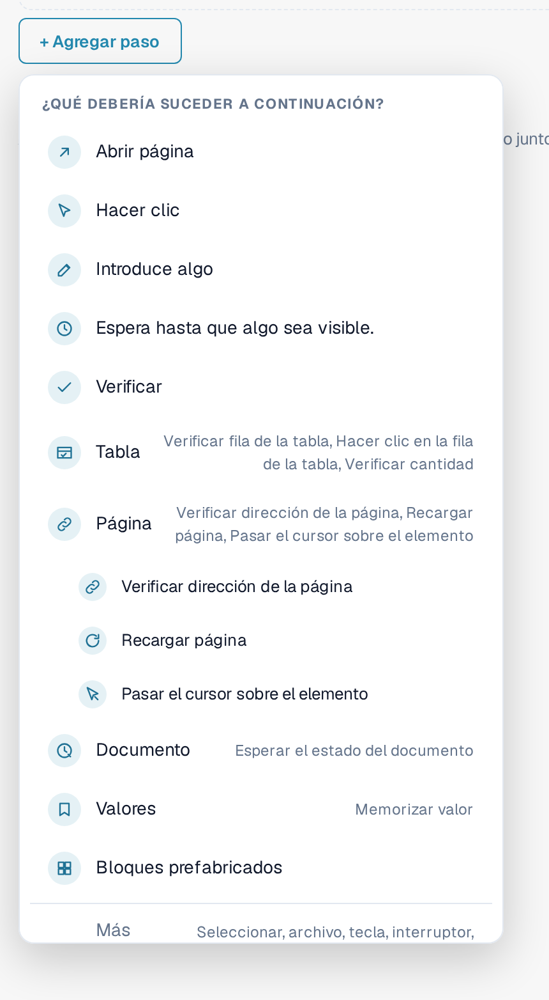
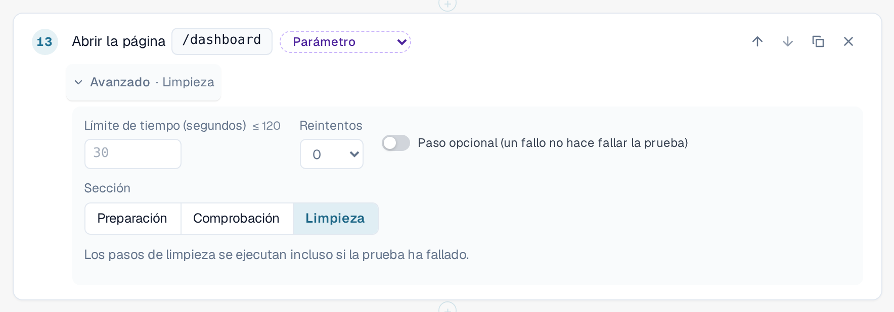
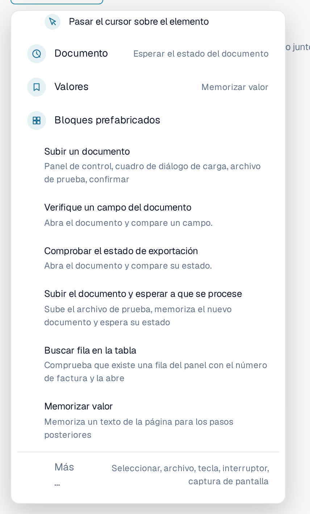
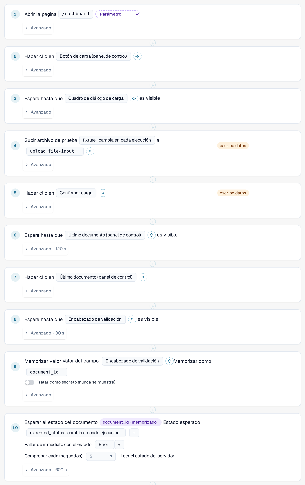
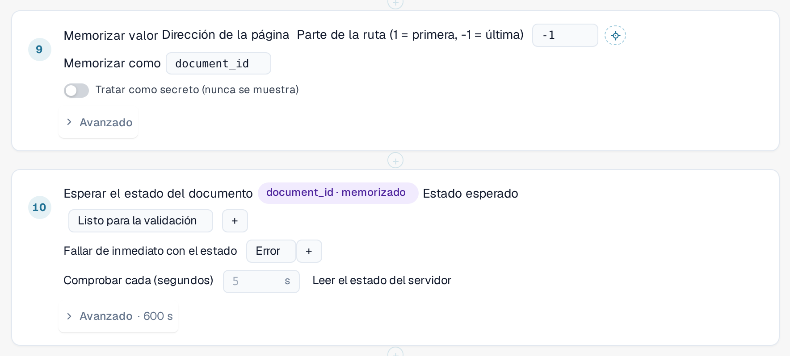
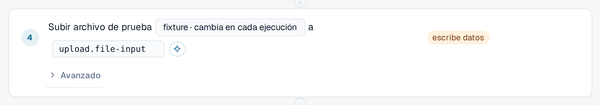

# Pasos y bloques prefabricados

Esta página explica cómo crear una plantilla en el editor ([Plantillas](templates.md)): los grupos de pasos, los
ajustes **Avanzado** de un paso, los bloques prefabricados y cómo una prueba transfiere valores de un paso al siguiente.

## Agregar un paso

En el editor de plantillas, seleccione **+ Agregar paso**. El menú **¿Qué debería suceder a continuación?** enumera los pasos. Los cinco
pasos básicos son **Abrir página**, **Hacer clic**, **Introduce algo**, **Espera hasta que algo sea visible** y **Verificar**.
Cuatro **grupos** reúnen los pasos más especializados. Seleccione un grupo para ver sus pasos:

| Grupo | Pasos |
|---|---|
| **Tabla** | **Verificar fila de la tabla**, **Hacer clic en la fila de la tabla**, **Verificar cantidad**. Para listas como la lista de documentos del panel. |
| **Página** | **Verificar dirección de la página**, **Recargar página** (consulte [Recargar y reanudar](reload-and-resume.md)), **Pasar el cursor sobre el elemento**. |
| **Documento** | **Esperar el estado del documento**: espera hasta que un documento alcanza un estado, por ejemplo *Listo para validación*. |
| **Valores** | **Memorizar valor**: conserva un texto de la página para los pasos posteriores. |

Los **Bloques prefabricados** añaden varios pasos a la vez (véase más abajo). **Más …** ofrece otros pasos: seleccionar una opción, subir un archivo, pulsar una tecla,
cambiar un interruptor y hacer una captura de pantalla (el ejecutor del navegador omite los pasos de captura de pantalla).

<figure><figcaption>
Menú Agregar paso con los grupos Tabla, Página, Documento y Valores; el grupo Página está abierto
</figcaption></figure>

Para dirigir un paso a un elemento de la página, selecciónelo en la lista o utilice **Seleccionar en la app**
([Seleccionar un elemento en la app](pick-in-app.md)).

## Ajustes avanzados de un paso

Todos los pasos tienen una línea **Avanzado**. Selecciónela para abrir los ajustes de ese paso. La línea contraída muestra lo que
ha cambiado, por ejemplo *Avanzado · 120 s* o *Avanzado · Limpieza*.

| Ajuste | Significado |
|---|---|
| **Límite de tiempo (segundos)** | Cuánto puede durar el paso, hasta 120 segundos. Déjelo vacío para usar el valor predeterminado de 30 segundos. Los pasos que esperan a un documento tienen su propio límite, más largo. |
| **Reintentos** | Cuántas veces repite DocBits el paso si falla (de 0 a 3). |
| **Paso opcional (un fallo no hace fallar la prueba)** | Si el paso falla, el registro lo muestra como omitido junto con su error, y la prueba continúa. |
| **Sección** | **Preparación**, **Comprobación** o **Limpieza**. **Comprobación** es el valor predeterminado. |

Los pasos de **Preparación** configuran la prueba. Los pasos de **Comprobación** son la prueba en sí. Los pasos de **Limpieza** eliminan lo que la prueba ha dejado
atrás, por ejemplo un documento que ha subido. **Los pasos de limpieza se ejecutan incluso cuando la prueba ha fallado** o ha superado el tiempo de espera, y
un paso de limpieza fallido nunca cambia el resultado de la prueba. Deben ser los últimos pasos de la plantilla; el editor notifica un error si un
paso normal sigue a un paso de limpieza. No se ejecutan si detiene la prueba o cierra la pestaña.
Una plantilla con pasos de limpieza se guarda como schema 1.3 (consulte [Para desarrolladores](for-developers.md)).

<figure><figcaption>
Ajustes avanzados de un paso: límite de tiempo, reintentos, paso opcional y sección, con Limpieza seleccionada
</figcaption></figure>

## Bloques prefabricados

Seleccione **+ Agregar paso** y, a continuación, **Bloques prefabricados**. Un bloque añade los pasos de una secuencia habitual junto con los
parámetros que necesita. Después puede modificar cada paso.

| Bloque | Qué añade |
|---|---|
| **Subir un documento** | Abre el panel, abre el cuadro de diálogo de carga, selecciona el archivo de prueba y confirma. |
| **Verifique un campo del documento** | Abre un documento y compara un campo con un valor esperado. |
| **Comprobar el estado de exportación** | Abre un documento y compara su estado. |
| **Subir el documento y esperar a que se procese** | Sube el archivo de prueba, memoriza el documento nuevo y espera a su estado. |
| **Buscar fila en la tabla** | Comprueba que existe una fila de la lista del panel con un número de factura determinado y la abre. |
| **Memorizar valor** | Memoriza un texto de la página para los pasos posteriores. |

<figure><figcaption>
Bloques prefabricados en el menú Agregar paso
</figcaption></figure>

### Subir el documento y esperar a que se procese

Utilice este bloque cuando un paso posterior necesite el documento que la prueba acaba de subir. Reconoce el documento nuevo
por sí mismo, no por la fila superior de la lista, de modo que nunca se elige un documento anterior por error. A continuación lee el
ID del documento de la dirección de la página y espera hasta que el documento alcanza el estado esperado
(por defecto *Listo para validación*, hasta 10 minutos; se detiene de inmediato si el documento pasa al estado *Error*).
Añade los valores de entrada **fixture** (el archivo de prueba) y **expected_status**, y eleva el tiempo de toda la prueba a un mínimo de 15 minutos.

<figure><figcaption>
Pasos del bloque Subir el documento y esperar a que se procese
</figcaption></figure>


**Adónde van las cargas:** si su organización tiene suborganizaciones y el panel las muestra todas, el cuadro de diálogo
de carga suele preguntar a qué suborganización pertenece el documento. Una prueba no puede responder a esa pregunta. Mientras una
prueba se ejecuta en la pestaña, la carga se dirige a la **primera suborganización que ofrece el cuadro de diálogo**, sin preguntar.
Fuera de una prueba no cambia nada. Para subir a una suborganización concreta, inicie la prueba desde la vista de esa
suborganización.


### Buscar fila en la tabla

El bloque comprueba que la lista del panel tiene una fila con el número de factura indicado (el valor de entrada **row_value**)
y la abre. Para buscar por otra columna, cambie la columna y el valor en el paso. Ambos pasos pertenecen al grupo
**Tabla**; **Verificar cantidad** cuenta filas o cualquier otro elemento.

## Memorizar un valor y utilizarlo después

Una prueba suele necesitar un valor que solo existe mientras se ejecuta, por ejemplo el ID de un documento que acaba de subir.

1. Agregue **Memorizar valor** (grupo **Valores**). Elija de dónde procede el valor: un texto de la página, la dirección de la
   página (una parte de la ruta o un parámetro de consulta) o una celda de una fila de tabla. Introduzca un nombre en **Memorizar como**,
   por ejemplo `document_id`. Active **Tratar como secreto (nunca se muestra)** para los valores que no deben aparecer en ningún sitio.
2. En un paso posterior, elija el valor memorizado en lugar de escribir uno. El paso muestra un indicador como
   *document_id · memorizado*. En el JSON de la plantilla se escribe `{{vars.document_id}}`.

En un paso se pueden utilizar dos tipos de valores:

| Tipo | Se escribe como | Procede de | Ejemplo |
|---|---|---|---|
| **Entrada** | `{{params.name}}` | La [entrada](inputs.md) guardada: es la misma en cada ejecución de esa entrada. Se crea con el botón de parámetro situado junto a un valor. | *fixture · cambia en cada ejecución* |
| **Valor memorizado** | `{{vars.name}}` | Un paso **Memorizar valor** anterior de la misma ejecución. | *document_id · memorizado* |

<figure><figcaption>
Memorizar valor almacena el ID del documento; el paso siguiente espera a ese documento
</figcaption></figure>

<figure><figcaption>
Un paso que utiliza el valor de entrada fixture
</figcaption></figure>

Un valor memorizado existe solo durante la ejecución actual y nunca se guarda en la plantilla ni en el registro. Los valores memorizados
se conservan tras una [recarga de la página](reload-and-resume.md) dentro de la prueba, a menos que estén marcados como secretos.
