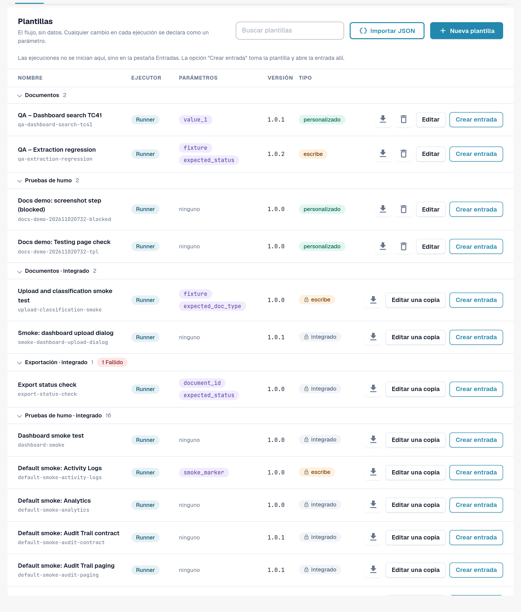
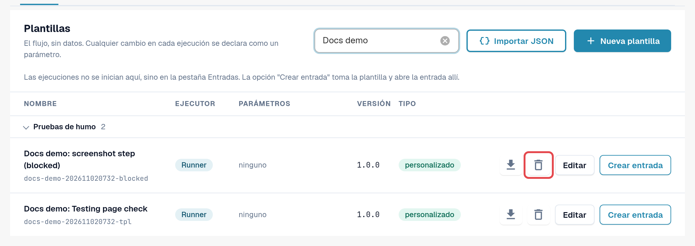
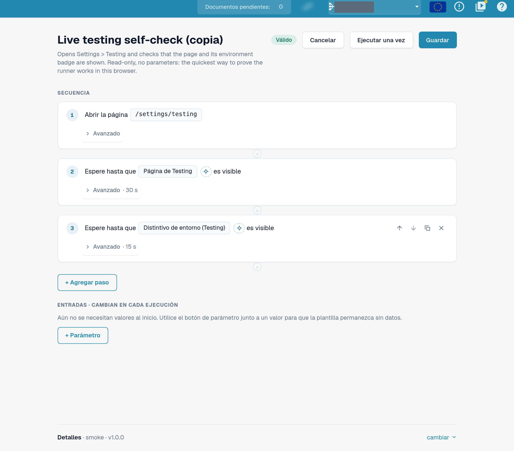
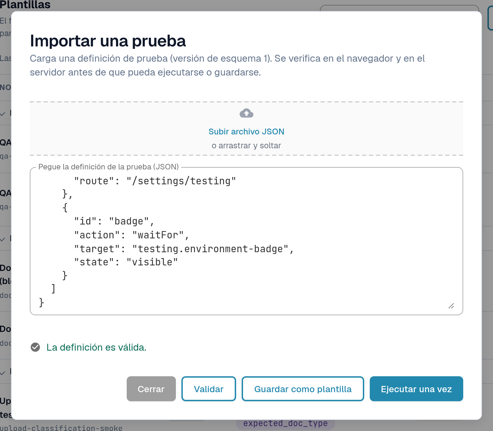
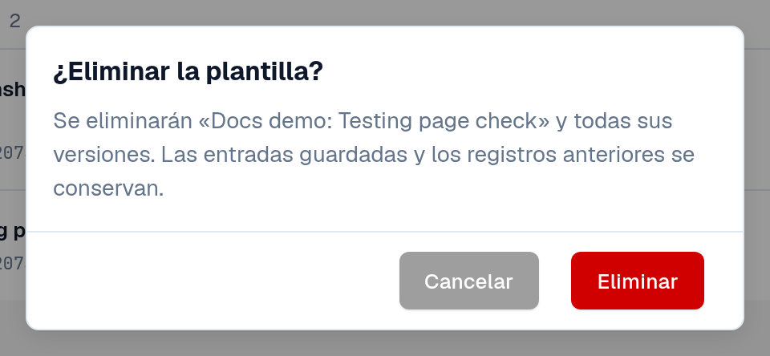

# Plantillas

Una plantilla describe **qué** se comprueba: qué página se abre, en qué se hace clic o qué se rellena, y qué debe ser
visible o cierto al final. No contiene datos de su organización. Los valores que difieren según la organización o la
ejecución, como el ID de un documento, se declaran como **parámetros** y los completa una [entrada](inputs.md).

Abra **Configuración → Testing**, pestaña **Plantillas**.

<figure><figcaption>
Pestaña Plantillas: grupos, columnas y acciones de fila.
</figcaption></figure>

## Leer la lista

Las plantillas se agrupan por categoría (por ejemplo **Pruebas de humo**, **Validación**, **Documentos**, **Exportación**).
Seleccione el nombre de un grupo para plegarlo; un indicador rojo en el grupo cuenta las plantillas cuya última ejecución falló.
**Buscar plantillas** filtra por nombre.

| Columna | Significado |
|---|---|
| **Nombre** | El nombre de la plantilla y, debajo, su ID. |
| **Ejecutor** | **Ejecutor**: se ejecuta en la pestaña de su navegador desde esta página. **Playwright**: una comprobación que ejecuta su automatización de pruebas; se puede documentar aquí, pero no iniciar desde esta página. |
| **Parámetros** | Los valores que debe aportar una entrada. *ninguno* significa que la plantilla se ejecuta tal cual. |
| **Versión** | Las versiones guardadas nunca cambian. Un cambio se guarda como una versión nueva. |
| **Tipo** | **integrado** (icono de candado): forma parte del conjunto predeterminado, es igual para todas las organizaciones y es de solo lectura. **personalizado**: plantilla propia de su organización. **escribe**: la plantilla modifica datos (por ejemplo, sube un documento) y requiere una confirmación antes de iniciarse. |

Acciones de fila:

| Acción | Qué hace |
|---|---|
| Icono de descarga (**Exportar como JSON**) | Descarga la definición de la plantilla como archivo JSON, por ejemplo para conservarla o importarla en otra organización. |
| **Editar una copia** (integrada) / **Editar** (personalizada) | Abre el editor de plantillas con una copia que puede modificar y guardar como plantilla propia. |
| **Crear entrada** | Abre la pestaña [Entradas](inputs.md) con una entrada nueva para esta plantilla. Las pruebas se inician allí, no aquí. |
| Icono de papelera (**Eliminar plantilla**) | Solo en las plantillas propias. Consulte *Eliminar una plantilla propia* más abajo. |

<figure><figcaption>
Una fila predeterminada y una fila de plantilla propia con sus acciones.
</figcaption></figure>

## Crear una plantilla propia

Necesita una plantilla propia cuando ninguna plantilla predeterminada comprueba lo que usted necesita, o cuando desea una copia modificada de una predeterminada.

**Partir de una predeterminada:** seleccione **Editar una copia** en su fila. **Partir de cero:** seleccione **Nueva plantilla**.

En el editor de plantillas:

1. Introduzca un **Nombre de la plantilla** y, si lo desea, para qué sirve.
2. Seleccione **+ Agregar paso** y elija un bloque, por ejemplo **Abrir página**, **Hacer clic**, **Rellenar**, **Seleccionar**,
   **Esperar**, **Verificar texto**, **Verificar campo** o **Verificar estado**. Los **Bloques prefabricados** añaden de una vez una secuencia habitual, por ejemplo
   **Subir un documento** o **Subir el documento y esperar a que se procese**. Consulte [Pasos y bloques prefabricados](steps-and-blocks.md)
   para ver los grupos de pasos, los ajustes **Avanzado** y los pasos de limpieza.
3. Para cada valor que difiera según la organización o la ejecución, utilice el botón de parámetro situado junto al valor. El valor
   pasa a ser un parámetro en **Entradas · cambian en cada ejecución**, con un tipo (**Texto**, **Número**, **Sí/No**,
   **Archivo de prueba del servidor**), un valor predeterminado y **Obligatorio** si debe completarse.
4. Seleccione **Guardar**. Para probar el borrador una vez sin guardarlo, seleccione **Ejecutar una vez**.

Para elegir el elemento de un paso señalándolo en la aplicación, utilice **Seleccionar en la app**
([Seleccionar un elemento en la app](pick-in-app.md)).

Los pasos que modifican datos (por ejemplo, subir un documento) se marcan como **escribe datos**. Una plantilla con estos pasos
solicita una confirmación cada vez que se inicia.

<figure><figcaption>
Editor de plantillas con dos pasos y un parámetro.
</figcaption></figure>

Si alguien ha guardado entretanto la misma versión de esta plantilla (por ejemplo, en otra pestaña), DocBits conserva su
borrador y ofrece **Guardar como la siguiente versión disponible** o **Recargar la última versión**.

## Importar una plantilla desde JSON

1. Seleccione **Importar JSON**.
2. Seleccione **Subir archivo JSON** o pegue la definición en **Pegue la definición de la prueba (JSON)**.
3. Seleccione **Validar**. DocBits comprueba la definición en el navegador y en el servidor, y enumera los problemas que encuentre.
4. Seleccione **Guardar como plantilla** para añadirla a sus plantillas, o **Ejecutar una vez** para probarla sin guardarla.

<figure><figcaption>
Cuadro de diálogo Importar una prueba con una definición validada.
</figcaption></figure>

El formato se describe en [Para desarrolladores](for-developers.md).

## Eliminar una plantilla propia

1. En la fila de su plantilla propia, seleccione el icono de papelera (**Eliminar plantilla**).
2. Lea la confirmación **¿Eliminar la plantilla?** y seleccione **Eliminar**.

Se eliminan la plantilla y **todas sus versiones**. Las entradas guardadas y los registros anteriores se conservan, de modo que el historial sigue siendo legible.
Las entradas que apuntaban a la plantilla permanecen en la lista; edítelas o elimínelas. Más adelante puede volver a guardar una plantilla con el
mismo ID. Las plantillas integradas y predeterminadas no se pueden eliminar.

<figure><figcaption>
Confirmación de Eliminar plantilla.
</figcaption></figure>
