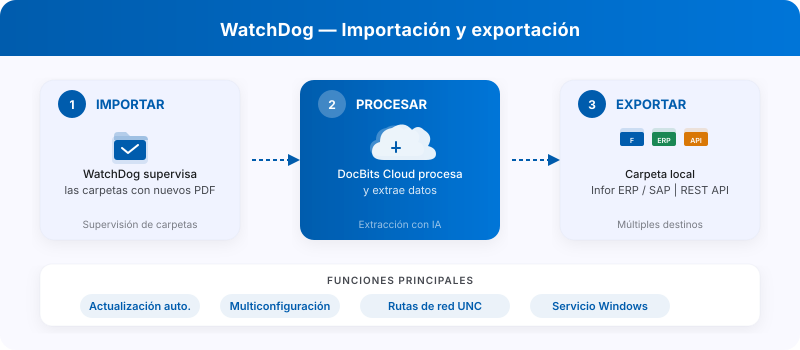

# WatchDog

<figure><figcaption><p>WatchDog: supervisión de carpetas, procesamiento en DocBits y destinos de exportación.</p></figcaption></figure>

**WatchDog** es un servicio local basado en Windows que supervisa carpetas locales en busca de documentos entrantes, los carga en la nube de DocBits para su procesamiento y exporta los documentos terminados de vuelta a carpetas locales o a sistemas ERP.

## Funciones principales

* **Supervisión automática de carpetas** — vigila rutas locales y rutas de red UNC en busca de nuevos PDF
* **Compatibilidad con varias configuraciones** — varias configuraciones de importación y exportación por instancia
* **Ejemplos de métodos de exportación** — Local Folder, Infor IDM, Infor BOD, ION API, GLS840MI, REST API
* **Actualización automática** — actualizaciones automáticas de versión con reversión en caso de fallo
* **Gestión remota** — reinicio, actualización y configuración desde la interfaz de DocBits

## Inicio rápido

<figure><figcaption><p>Vista General de WatchDog con las cuatro pestañas actuales y el estado Desconectado del entorno de prueba. Los comandos con la clave de API y la ruta de instalación están ocultos. Esta imagen no acredita una instalación ni una conexión correcta.</p></figcaption></figure>

### 1. Descargue WatchDog

Descargue `WatchDog.exe` desde **Ajustes → Procesamiento de documentos → WatchDog → General** en la aplicación DocBits.

### 2. Configure con la clave de API

Abra el **Símbolo del sistema como administrador** y ejecute:

```powershell
WatchDog.exe -api YOUR_API_KEY
```

> **Nota:** Utilice la clave de API autorizada para su organización y entorno. Si la interfaz ofrece un comando de configuración, trate su contenido como un secreto. `YOUR_API_KEY` es un marcador de posición; no copie una clave de otro entorno ni la publique.

### 3. Instale como servicio de Windows

```powershell
WatchDog.exe install
WatchDog.exe start
```

### 4. Cree configuraciones en DocBits

Todas las configuraciones de importación y exportación se crean directamente en la **aplicación DocBits**:

**Ajustes → Procesamiento de documentos → WatchDog → Configuraciones**

* **Configuraciones de importación** — definen las carpetas vigiladas y los tipos de documento
* **Configuraciones de exportación** — definen los destinos de exportación, las plantillas XSLT y los métodos de exportación

> **Importante:** Las configuraciones de exportación requieren un **tipo de documento** (`doc_type`). Las configuraciones sin tipo de documento serán rechazadas.

La vista actual tiene cuatro pestañas: **General**, **Configuraciones**, **Registros** y **Plantillas XSLT**. El estado del servicio se consulta en **General**; las exportaciones se gestionan en **Configuraciones**.

### 5. Inicio automático (opcional)

Para iniciar WatchDog automáticamente al arrancar el sistema:

1. Abra **Servicios** (`Win + R` → `services.msc`)
2. Busque **WatchDog** en la lista
3. Establezca **Tipo de inicio** en **Automático (inicio retrasado)**

## Referencia de comandos

| Comando | Descripción |
| :--- | :--- |
| `WatchDog.exe -api KEY` | Configura la clave de API y se conecta a DocBits |
| `WatchDog.exe install` | Instala como servicio de Windows |
| `WatchDog.exe start` | Inicia el servicio |
| `WatchDog.exe stop` | Detiene el servicio |
| `WatchDog.exe debug` | Se ejecuta en modo consola para la resolución de problemas |
| `WatchDog.exe --version` | Muestra la versión actual |
| `WatchDog.exe --list-folders` | Muestra las carpetas vigiladas configuradas |
| `WatchDog.exe remove` | Desinstala el servicio |

## Más recursos

* [Instalación de WatchDog](watchdog-installation.md)
* [Configuración de WatchDog](watchdog-v2-configuration.md)
* [Preguntas frecuentes de administración de WatchDog](watchdog-admin-faq.md)
