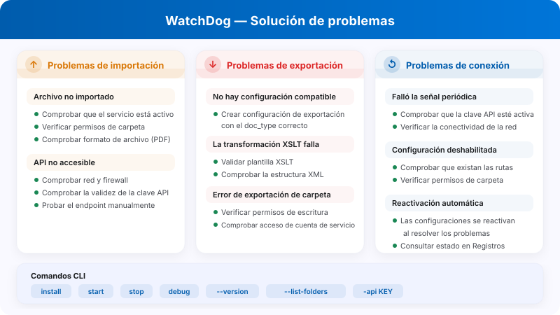

# Preguntas frecuentes de administración de WatchDog y resolución de problemas

<figure><figcaption><p>Diagnóstico de problemas de importación, exportación y conexión de WatchDog.</p></figcaption></figure>

Esta documentación ayuda a los administradores a entender los mensajes de error de WatchDog y a resolver problemas.

**Ubicación en la interfaz:** Ajustes → Procesamiento de documentos → WatchDog

---

## 1. Áreas de WatchDog en la interfaz

### 1.1 General

<figure><figcaption><p>Vista General de WatchDog con las cuatro pestañas actuales y el estado Desconectado del entorno de prueba. Los comandos con la clave de API y la ruta de instalación están ocultos. Esta imagen no acredita una instalación ni una conexión correcta.</p></figcaption></figure>

General reúne el estado de conexión, la información de versión, la descarga y las instrucciones del entorno actual. Utilice una clave de API de su organización y no comparta comandos que contengan secretos. No existe una pestaña independiente de estado.

### 1.2 Configuraciones

Las importaciones definen las carpetas vigiladas y el ámbito de los documentos. Las exportaciones definen el método y el destino; requieren un tipo de documento válido (`doc_type`). **Nueva configuración de exportación** abre el asistente de exportación, cuyos campos dependen del método elegido. Las acciones de copia e importación/exportación de configuraciones tienen su propio alcance: revise sus destinos antes de ejecutarlas.

### 1.3 Registros

<figure><figcaption><p>Pestaña Registros con Nivel de registro, Intervalo de tiempo y búsqueda. El intervalo visible pertenece a esta consulta; los datos de los registros están ocultos y no acreditan una conexión correcta del servicio.</p></figcaption></figure>

Acote la consulta mediante **Nivel de registro**, **Intervalo de tiempo** y búsqueda de texto. Los eventos pueden incluir `FILE_IMPORT_STARTED`, `FILE_IMPORT_COMPLETED`, `FILE_IMPORT_FAILED`, `EXPORT_STARTED`, `EXPORT_COMPLETED`, `EXPORT_FAILED`, `FOLDER_VALIDATION_FAILED`, `CONFIG_LOADED`, `SERVICE_RESTART_INITIATED` y `SERVICE_RESTART_COMPLETED`.

### 1.4 Plantillas XSLT

<figure><figcaption><p>Pestaña Plantillas XSLT con Nueva plantilla y una lista existente cuyos nombres están ocultos. No se abrió ningún menú de fila ni se ejecutó una transformación.</p></figcaption></figure>

Gestione las transformaciones desde **Plantillas XSLT**. **Nueva plantilla** abre el administrador; allí puede iniciar un editor vacío y usar **Validar contra** y **Validar XSLT** antes de guardar una plantilla. La configuración de exportación determina si la transformación se utiliza.

---

## 2. Mensajes de error de validación de carpetas

| Error | Significado | Solución |
| :--- | :--- | :--- |
| `not_found` | La carpeta no existe | Cree la carpeta o corrija la ruta |
| `no_read_access` | Sin permiso de lectura | Establezca permisos para la cuenta de servicio de WatchDog |
| `no_write_access` | Sin permiso de escritura | Conceda permisos de escritura a la cuenta de servicio |
| `not_configured` | Ruta de carpeta no configurada | Introduzca la ruta en la configuración |

**Carpetas afectadas:**

* **Watch Folder (Import):** donde WatchDog busca archivos nuevos
* **Success Folder:** donde se mueven los archivos importados correctamente
* **Export Folder:** donde se escriben los archivos XML/PDF exportados

---

## 3. Mensajes de error de importación

| Error | Significado | Solución |
| :--- | :--- | :--- |
| `file_not_found` | El archivo se eliminó antes de la importación | Proporcione el archivo de nuevo |
| `invalid_file_type` | Solo se admiten archivos PDF | Elimine los demás tipos de archivo |
| `api_not_accessible` | No se puede acceder a la API de DocBits | Compruebe la red y el firewall, verifique la URL de la API |
| `api_check_failed` | Falló la comprobación de estado de la API | Compruebe la clave de API y la conexión |
| `upload_failed` | Falló la carga a la API | Compruebe la clave de API, la red y el estado del servidor |

---

## 4. Mensajes de error de exportación

| Error | Significado | Solución |
| :--- | :--- | :--- |
| `transformation_error` | Falló la transformación XSLT | Revise la plantilla XSLT y valide la estructura XML |
| `folder_error` | No se puede acceder a la carpeta de exportación | Cree la carpeta y revise los permisos |
| `file_write_error` | No se pudo escribir el archivo | Revise el espacio en disco, los permisos y los bloqueos de archivo |
| `permission_denied` | Sin permiso de escritura | Establezca los permisos de la cuenta de servicio |
| `creation_failed` | No se pudo crear la carpeta | Revise los permisos de la carpeta superior |
| `no_config_match` | No hay ninguna configuración de exportación coincidente | Cree una configuración de exportación con el tipo de documento correcto |

> **Nota:** Las configuraciones de exportación requieren un `doc_type`. Si ve `no_config_match`, compruebe que existe una configuración de exportación activa para el tipo del documento.

---

## 5. Configuración desactivada: motivos

Cuando se desactiva una configuración, aparece uno de estos motivos:

| Motivo de desactivación | Significado |
| :--- | :--- |
| `Watch folder: not_found` | La carpeta de importación no existe |
| `Watch folder: no_read_access` | La carpeta de importación no se puede leer |
| `Export folder: not_found` | La carpeta de exportación no existe |
| `Export folder: no_write_access` | La carpeta de exportación no admite escritura |
| `Success folder: not_found` | La carpeta de éxito no existe |
| `Success folder: no_write_access` | La carpeta de éxito no admite escritura |

**Reactivación automática:** WatchDog vuelve a comprobar las carpetas. El intervalo y la reactivación dependen de la versión y del estado del servicio; después de reparar la ruta o los permisos, confirme en los registros que la configuración vuelve a estar activa.

---

## 6. Carpeta de errores (`_error`)

Los archivos fallidos se mueven a la carpeta `_error`:

**Ubicación:** `{import_folder}/_error/{error_type}/`

**Formato de archivo:** `{original_name}_{YYYYMMDD_HHMMSS}.pdf`

**Archivo complementario (sidecar):** cada archivo fallido tiene un archivo complementario `.error` con:

```
Error Type: transformation_error
Error Message: XSLT template not found
Timestamp: 2026-03-26 08:30:15
Original File: invoice_001.pdf
Original Path: C:\WatchDog\Import\invoice_001.pdf
```

---

## 7. Heartbeat y estado de la conexión

WatchDog comunica su estado a DocBits mediante latidos (heartbeats). Según la versión, la información comunicada puede incluir:

| Datos enviados | Descripción |
| :--- | :--- |
| Timestamp | Hora actual |
| Version | Versión de WatchDog instalada |
| Last Restart | Hora del último reinicio del servicio |
| Auto-Update Enabled | Si la actualización automática está activa |
| Latest Version | Versión más reciente disponible |
| Installation Path | Dónde está instalado WatchDog |
| Free RAM / Disk | Recursos del sistema disponibles |

### Estado de la conexión

| Estado | Significado |
| :--- | :--- |
| ✅ **Online** | WatchDog está conectado y activo |
| ⚠️ **Offline** | No se ha recibido una comunicación reciente del servicio; revise la antigüedad y los registros |
| ❌ **Not Installed** | WatchDog nunca se ha conectado |

**Errores de heartbeat:**

* `Heartbeat failed - invalid API key` → la clave de API no es válida
* `Heartbeat failed: 401` → falló la autenticación
* `Heartbeat failed: 5xx` → problema del servidor

---

## 8. Problemas frecuentes y soluciones

### Problema: WatchDog no importa archivos

1. Compruebe si el servicio se está ejecutando: `services.msc` → WatchDog
2. Revisar los registros: Ajustes → Procesamiento de documentos → WatchDog → Registros
3. Revise los permisos de carpeta de la cuenta de servicio de WatchDog
4. Pruebe la conexión con la API: `WatchDog.exe debug` en CMD
5. Verifique que el tipo de archivo sea PDF

### Problema: la exportación no funciona

1. ¿Existe una configuración de exportación con el tipo de documento correcto?
2. ¿Coincide el tipo de documento entre el documento y la configuración?
3. ¿Está vinculada la plantilla XSLT (para la exportación a carpeta)?
4. ¿Puede la cuenta de servicio escribir en la carpeta de exportación?
5. Para exportaciones a Infor: ¿están bien configuradas las credenciales de ION?

### Problema: la configuración está desactivada

1. ¿Existe la ruta de la carpeta?
2. ¿Hay permisos para `NT AUTHORITY\LOCAL SERVICE` o la cuenta de servicio?
3. ¿Se puede acceder a la unidad de red? (Revise las rutas UNC)
4. Después de recuperar el acceso a las carpetas, confirme que la configuración vuelve a estar activa

### Problema: falla la transformación XSLT

1. ¿Es válida la plantilla XSLT? (use la pestaña Plantillas XSLT → administrador → Validar XSLT)
2. ¿Corresponde la plantilla al tipo de documento?
3. Revise la estructura XML del documento
4. La exportación a carpeta V3 utiliza transformación en el servidor: compruebe la conectividad con la API

### Problema: falla la exportación por REST API

1. ¿Están configuradas las credenciales ION OAuth en la configuración de exportación?
2. ¿Se puede acceder al endpoint de la API de destino desde el servidor de WatchDog?
3. Compruebe que el formato del payload coincide con lo que espera la API de destino
4. Revise la configuración de la cadena de solicitudes en busca de errores de JSONPath

---

## 9. Comandos de línea de comandos

```bash
# Configure API connection
WatchDog.exe -api YOUR_API_KEY

# Install Service
WatchDog.exe install

# Start Service
WatchDog.exe start

# Stop Service
WatchDog.exe stop

# Run in debug mode (console output)
WatchDog.exe debug

# Uninstall Service
WatchDog.exe remove

# Show version
WatchDog.exe --version

# List watch folders
WatchDog.exe --list-folders

# Add/remove watch folder
WatchDog.exe --add-folder "C:\Import\Invoices"
WatchDog.exe --remove-folder "C:\Import\Invoices"

# Check Windows service status
sc query WatchDog
```

---

## 10. Archivos de registro

**Ubicación:** `C:\WatchDog\logs\{module}\`

**Formato de registro:**
```
INFO  - 2026-03-26 10:00:00 - module_name - Message - function=func_name - line=42
```

**Nivel de registro:** DEBUG, INFO, WARNING, ERROR

**Registros remotos:** WatchDog también envía registros a DocBits (visibles en la pestaña Registros) y, opcionalmente, al registro en la nube de Logtail.
