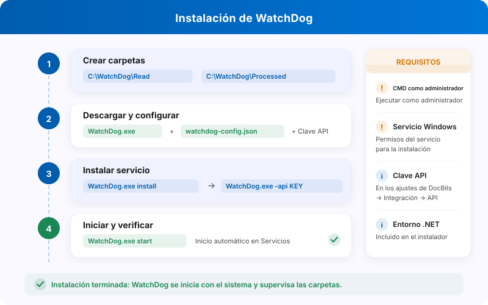

# Instalación de WatchDog

<figure><figcaption><p>Instalación de WatchDog y requisitos principales.</p></figcaption></figure>

> **Recomendado:** Utilice la configuración moderna que se describe a continuación. Las configuraciones de WatchDog ahora se crean directamente en la aplicación DocBits, sin necesidad de archivos de configuración locales.

## Requisitos previos

* Windows Server o Windows 10/11
* Acceso de administrador
* Conectividad de red con la API de DocBits
* Clave de API autorizada de la organización y del entorno de DocBits

## Pasos de instalación

### 1. Cree las carpetas necesarias

Cree un directorio principal y subcarpetas para WatchDog:

```
C:\WatchDog\              ← WatchDog executable
C:\WatchDog\Import\       ← Watch folder for incoming documents
C:\WatchDog\Processed\    ← Success folder for processed documents
C:\WatchDog\Export\        ← Export folder for exported files
```

> **Nota:** Se recomienda utilizar rutas locales. Las rutas de red UNC (por ejemplo, `\\server\share`) son compatibles, pero pueden requerir un Polling Observer para una detección fiable de archivos.

### 2. Descargue WatchDog

Descargue `WatchDog.exe` desde la aplicación DocBits:

**Ajustes → Procesamiento de documentos → WatchDog → General**

Coloque el archivo `WatchDog.exe` descargado en `C:\WatchDog\`.

### 3. Configure la conexión con la API

Abra el **Símbolo del sistema (CMD)** como **administrador** y ejecute:

```powershell
cd C:\WatchDog
WatchDog.exe -api YOUR_API_KEY
```

El comando configura la conexión con su organización. Su resultado depende de que la clave, el entorno y la conectividad sean correctos; compruébelo después en el estado del servicio y en los registros.

### 4. Instale como servicio de Windows

```powershell
WatchDog.exe install
```

### 5. Inicie el servicio

```powershell
WatchDog.exe start
```

### 6. Cree configuraciones en DocBits

Vaya a **Ajustes → Procesamiento de documentos → WatchDog → Configuraciones** en DocBits:

* Haga clic en **Nueva configuración de importación** para configurar las carpetas vigiladas
* Haga clic en **Nueva configuración de exportación** para configurar los destinos de exportación

> **Importante:** Las configuraciones de exportación requieren un **tipo de documento**. Todas las configuraciones se gestionan de forma centralizada en DocBits, no en archivos de configuración locales.

### 7. Configure el inicio automático

1. Abra **Servicios** (`Win + R` → `services.msc`)
2. Busque **WatchDog** en la lista de servicios
3. Haga doble clic para abrir las propiedades
4. Establezca **Tipo de inicio** en **Automático (inicio retrasado)**
5. Haga clic en **Aceptar**

## Verifique la instalación

Después de la instalación, compruebe el estado de WatchDog en DocBits:

**Ajustes → Procesamiento de documentos → WatchDog → General**

<figure><figcaption><p>Vista General de WatchDog con las cuatro pestañas actuales y el estado Desconectado del entorno de prueba. Los comandos con la clave de API y la ruta de instalación están ocultos. Esta imagen no acredita una instalación ni una conexión correcta.</p></figcaption></figure>

Compruebe que el servicio de Windows está iniciado y que DocBits recibe sus latidos (heartbeats). Revise el estado, la antigüedad de la última comunicación y la información de versión disponible. La captura muestra **Desconectado** en el entorno de prueba; abrir esta página no confirma que la instalación local funcione. Si no hay conexión, revise la clave, el entorno, la red y los registros.

## Referencia de comandos

| Comando | Descripción |
| :--- | :--- |
| `WatchDog.exe -api KEY` | Configura la clave de API |
| `WatchDog.exe install` | Instala como servicio de Windows |
| `WatchDog.exe start` | Inicia el servicio |
| `WatchDog.exe stop` | Detiene el servicio |
| `WatchDog.exe debug` | Se ejecuta en modo consola (para la resolución de problemas) |
| `WatchDog.exe remove` | Desinstala el servicio |
| `WatchDog.exe --version` | Muestra la versión actual |
| `WatchDog.exe --list-folders` | Muestra las carpetas vigiladas configuradas |
| `WatchDog.exe --add-folder PATH` | Añade una carpeta vigilada |
| `WatchDog.exe --remove-folder PATH` | Elimina una carpeta vigilada |

---

## Configuraciones heredadas

Si mantiene una instalación V1 basada en un archivo local, revise su versión y el procedimiento de migración antes de cambiarla. Las capturas antiguas de esa interfaz ya no describen los formularios actuales. Para una instalación nueva, siga la configuración mediante API de esta página y gestione las importaciones y exportaciones desde **Configuraciones**.
