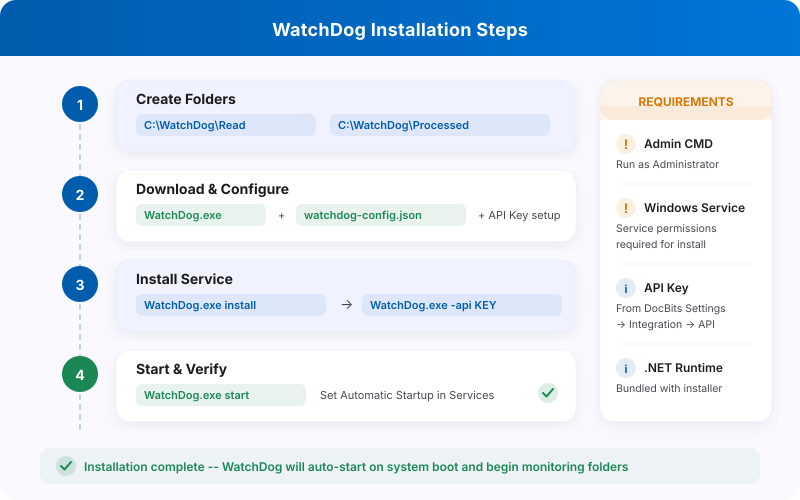

# Instalación de WatchDog

<figure><figcaption></figcaption></figure>

> **Recomendado:** Utilice la configuración moderna que se describe a continuación. Las configuraciones de WatchDog ahora se crean directamente en la aplicación DocBits, sin necesidad de archivos de configuración locales.

## Requisitos previos

* Windows Server o Windows 10/11
* Acceso de administrador
* Conectividad de red con la API de DocBits
* Clave de API de DocBits (disponible en Settings → WatchDog → General Tab)

## Pasos de instalación

### 1. Cree las carpetas necesarias

Cree un directorio principal y subcarpetas para WatchDog:

```
C:\WatchDog\              ← WatchDog executable
C:\WatchDog\Import\       ← Watch folder for incoming documents
C:\WatchDog\Processed\    ← Success folder for processed documents
C:\WatchDog\Export\        ← Export folder for exported files
```

> **Nota:** Se recomienda utilizar rutas locales. Las rutas de red UNC (por ejemplo, `\\server\share`) son compatibles, pero pueden requerir un Polling Observer para una detección fiable de archivos.

### 2. Descargue WatchDog

Descargue `WatchDog.exe` desde la aplicación DocBits:

**Settings → Document Processing → WatchDog → General Tab → Download**

Coloque el archivo `WatchDog.exe` descargado en `C:\WatchDog\`.

### 3. Configure la conexión con la API

Abra el **Símbolo del sistema (CMD)** como **administrador** y ejecute:

```powershell
cd C:\WatchDog
WatchDog.exe -api YOUR_API_KEY
```

Esto conecta WatchDog con su organización de DocBits y obtiene las configuraciones automáticamente.

### 4. Instale como servicio de Windows

```powershell
WatchDog.exe install
```

### 5. Inicie el servicio

```powershell
WatchDog.exe start
```

### 6. Cree configuraciones en DocBits

Vaya a **Settings → Document Processing → WatchDog → Configurations Tab** en DocBits:

* Haga clic en **New Import Configuration** para configurar las carpetas vigiladas
* Haga clic en **New Export Configuration** para configurar los destinos de exportación

> **Importante:** Las configuraciones de exportación requieren un **tipo de documento**. Todas las configuraciones se gestionan de forma centralizada en DocBits, no en archivos de configuración locales.

### 7. Configure el inicio automático

1. Abra **Servicios** (`Win + R` → `services.msc`)
2. Busque **WatchDog** en la lista de servicios
3. Haga doble clic para abrir las propiedades
4. Establezca **Tipo de inicio** en **Automático (inicio retrasado)**
5. Haga clic en **Aceptar**

## Verifique la instalación

Después de la instalación, compruebe el estado de WatchDog en DocBits:

**Settings → WatchDog → General Tab**

<figure><figcaption></figcaption></figure>

* ✅ **Online** — WatchDog está conectado y envía latidos (heartbeats)
* Deben ser visibles la versión, el último reinicio y la información del sistema

## Referencia de comandos

| Comando | Descripción |
| :--- | :--- |
| `WatchDog.exe -api KEY` | Configura la clave de API |
| `WatchDog.exe install` | Instala como servicio de Windows |
| `WatchDog.exe start` | Inicia el servicio |
| `WatchDog.exe stop` | Detiene el servicio |
| `WatchDog.exe debug` | Se ejecuta en modo consola (para la resolución de problemas) |
| `WatchDog.exe remove` | Desinstala el servicio |
| `WatchDog.exe --version` | Muestra la versión actual |
| `WatchDog.exe --list-folders` | Muestra las carpetas vigiladas configuradas |
| `WatchDog.exe --add-folder PATH` | Añade una carpeta vigilada |
| `WatchDog.exe --remove-folder PATH` | Elimina una carpeta vigilada |

---

## Heredado: configuración V1 (obsoleta)

El siguiente método de configuración V1, basado en archivos de configuración locales, está **obsoleto**. Utilice en su lugar la configuración moderna basada en API descrita arriba.

<details>
<summary>Configuración V1 (haga clic para expandir)</summary>

### Configuración de WatchDog en DocBits (V1)

1. **Acceda a los ajustes de WatchDog**
   * Vaya a **Settings → Document Processing → WatchDog**
2. **Ajustes de carpetas**
   * Defina las rutas: `C:/WatchDog/Read` y `C:/WatchDog/Processed`

   <figure><figcaption></figcaption></figure>

3. **Ajustes generales**
   * Seleccione los tipos de documento y configure el destino de exportación

   <figure><figcaption></figcaption></figure>

4. **Configuraciones de exportación**
   * Muestra las exportaciones configuradas para el procesamiento local

   <figure><figcaption></figcaption></figure>

5. **Descargue la configuración**
   * Descargue `watchdog-config.json` y colóquelo en `C:\WatchDog\`

   <figure><figcaption></figcaption></figure>

</details>
