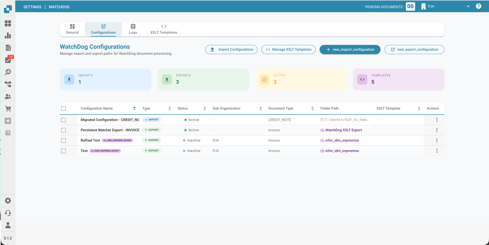

# Configuración de WatchDog

Esta guía explica cómo configurar el servicio WatchDog dentro de la aplicación DocBits. Todas las configuraciones se gestionan directamente en **Settings → Document Processing → WatchDog**.

<figure><figcaption></figcaption></figure>

---

## 1. Pestaña General

La pestaña General ofrece instrucciones de configuración, enlaces de descarga y ajustes de actualización.

<figure><figcaption></figcaption></figure>

### 1.1 Descarga y configuración

* Descargue la última versión de `WatchDog.exe` directamente desde la pestaña General
* Copie la clave de API que se muestra
* Ejecute el comando de configuración en un Símbolo del sistema de administrador:

```powershell
WatchDog.exe -api YOUR_API_KEY
```

### 1.2 Programación de actualización automática

| Opción | Intervalo |
| :--- | :--- |
| On Startup Only | Comprobar una vez al iniciar |
| Hourly | Cada 3600 segundos |
| Daily | Cada 86400 segundos |
| Weekly | Cada 604800 segundos |

---

## 2. Pestaña Configurations

Cree y gestione configuraciones de importación y exportación. Todas las configuraciones se crean directamente en DocBits, sin necesidad de archivos de configuración locales.

<figure><figcaption></figcaption></figure>

### 2.1 Configuraciones de importación

Defina dónde supervisa WatchDog la llegada de nuevos documentos.

<figure><figcaption></figcaption></figure>

| Campo | Descripción |
| :--- | :--- |
| **Name** | Nombre visible de esta configuración |
| **Watch Folder** | Directorio que se supervisa en busca de nuevos documentos (obligatorio) |
| **Success Folder** | Carpeta a la que se mueven los archivos tras una importación correcta |
| **Document Type** | INVOICE, CREDIT\_NOTE, PURCHASE\_ORDER, etc. |
| **Sub-Organisation** | Opcional: dirige los documentos a una suborganización concreta |

### 2.2 Configuraciones de exportación

Defina cómo y dónde se exportan los documentos procesados.

> **Importante:** Las configuraciones de exportación ahora **requieren un tipo de documento** (`doc_type`). El sistema rechazará las configuraciones sin tipo de documento.

| Campo | Descripción |
| :--- | :--- |
| **Name** | Nombre visible de esta configuración |
| **Document Type** | Obligatorio: INVOICE, CREDIT\_NOTE, etc. |
| **Export Method** | Cómo se exportan los documentos (véase más abajo) |
| **Export Folder** | Directorio de destino para las exportaciones a carpeta |
| **Execution Order** | Prioridad cuando coinciden varias configuraciones (por defecto: 1) |
| **XSLT Template** | Opcional: plantilla de transformación XML |

### 2.3 Métodos de exportación

| Método | Descripción |
| :--- | :--- |
| **Folder (watcher)** | Exporta PDF + XML a una carpeta local |
| **Infor IDM** | Carga en Infor Document Management |
| **Infor BOD** | Envía BOD XML a Infor ERP / SAP / M3 |
| **ION API** | Llama a los endpoints de la API de Infor ION |
| **GLS840MI** | Procesamiento por lotes de M3 (mediante REST API) |
| **REST API** | Envía a una API externa con autenticación ION OAuth |

<figure><figcaption></figcaption></figure>

### 2.4 Opciones de procesamiento

* **Barcode Divider:** divide automáticamente los documentos de varias páginas según los códigos de barras
* **DocBits Operator:** habilita tareas de automatización del navegador

---

## 3. Pestaña Status

Supervise el estado y la actividad del servicio WatchDog.

<figure><figcaption></figcaption></figure>

### Información de estado

| Campo | Descripción |
| :--- | :--- |
| **Online/Offline** | Estado actual de la conexión (umbral de heartbeat de 30 s) |
| **Version** | Versión de WatchDog instalada |
| **Version First Seen** | Cuándo se notificó por primera vez esta versión |
| **Last Restart** | Marca de tiempo del último reinicio del servicio |
| **Auto-Update Enabled** | Si las actualizaciones automáticas están activas |
| **Latest Version** | Versión más reciente disponible |
| **Latest Version Checked At** | Cuándo se comprobó por última vez la versión más reciente |
| **System Info** | Ruta de instalación, RAM libre, espacio libre en disco |

### Indicador de estado

| Estado | Significado |
| :--- | :--- |
| ✅ **Online** | WatchDog está conectado y activo |
| ⚠️ **Offline** | No se ha recibido ningún heartbeat desde hace más de 30 segundos |
| ❌ **Not Installed** | WatchDog nunca se ha conectado a esta organización |

---

## 4. Pestaña Logs

Consulte todos los eventos de WatchDog almacenados en OpenSearch.

<figure><figcaption></figcaption></figure>

* Filtre por fecha, tipo de evento o palabras clave
* Tipos de evento: `FILE_IMPORT_STARTED`, `FILE_IMPORT_COMPLETED`, `FILE_IMPORT_FAILED`, `EXPORT_STARTED`, `EXPORT_COMPLETED`, `EXPORT_FAILED`, `FOLDER_VALIDATION_FAILED`, `CONFIG_LOADED`, `SERVICE_RESTART_INITIATED`, `SERVICE_RESTART_COMPLETED`

---

## 5. Pestaña XSLT Templates

Gestione las plantillas de transformación XSLT utilizadas para las exportaciones XML.

<figure><figcaption></figcaption></figure>

* Cargue y edite plantillas XSLT
* **Validación en vivo**: pruebe las plantillas con un XML de muestra y análisis de campos
* Vincule plantillas a configuraciones de exportación
* Consulte el recuento de uso (qué configuraciones utilizan cada plantilla)

<figure><figcaption></figcaption></figure>

---

## 6. Pestaña Export Configurations

Resumen de todas las configuraciones de exportación activas con su estado de conexión.

* Supervise la marca de tiempo de la última conexión correcta
* Gestione las configuraciones en línea (editar, copiar, eliminar)
* Copie configuraciones en bloque entre suborganizaciones
