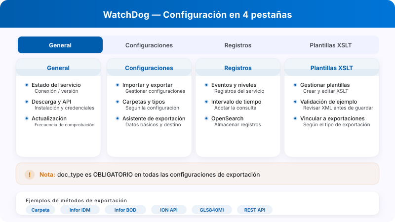
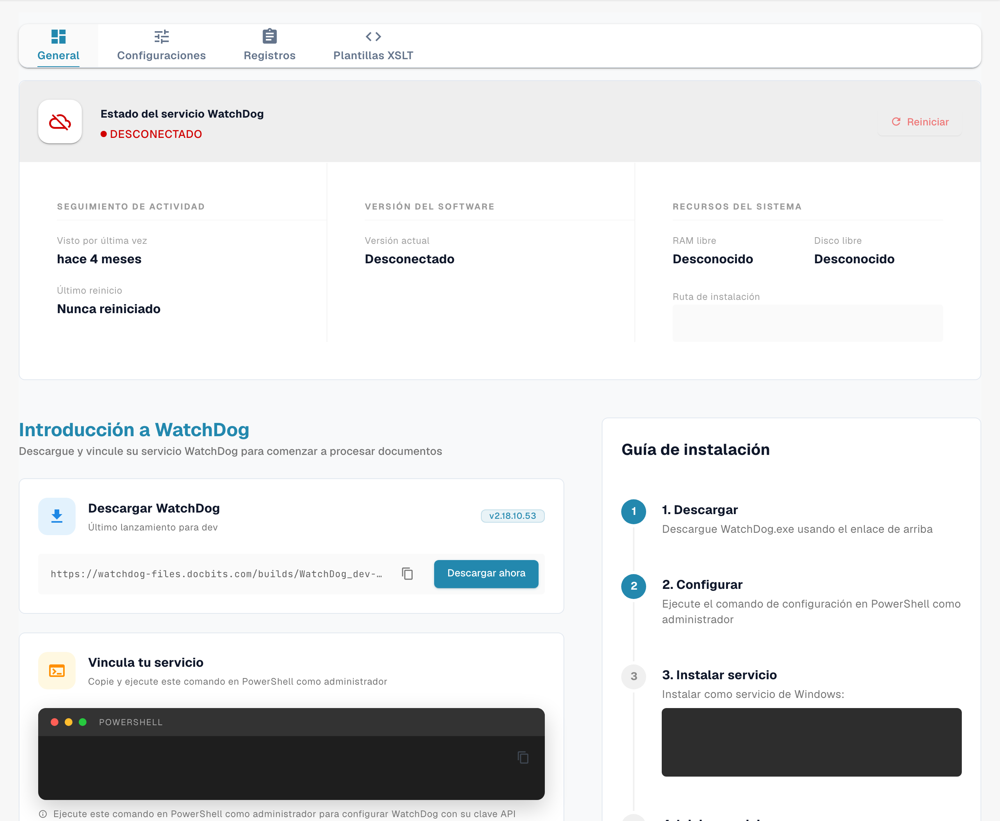
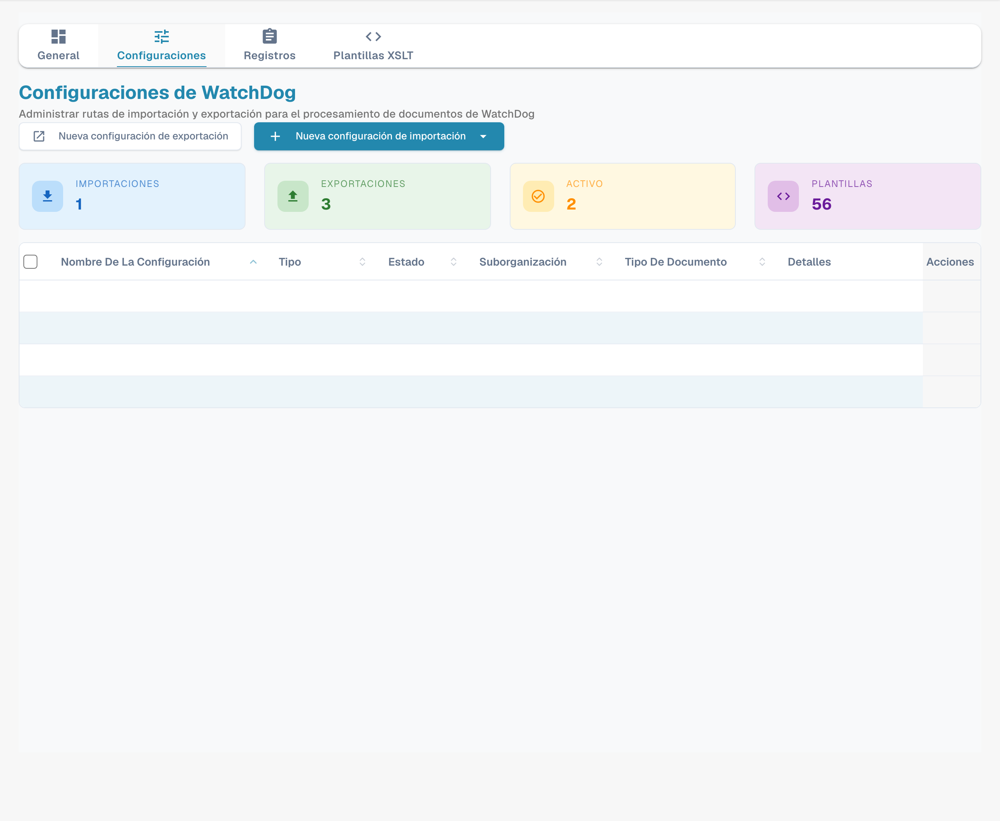
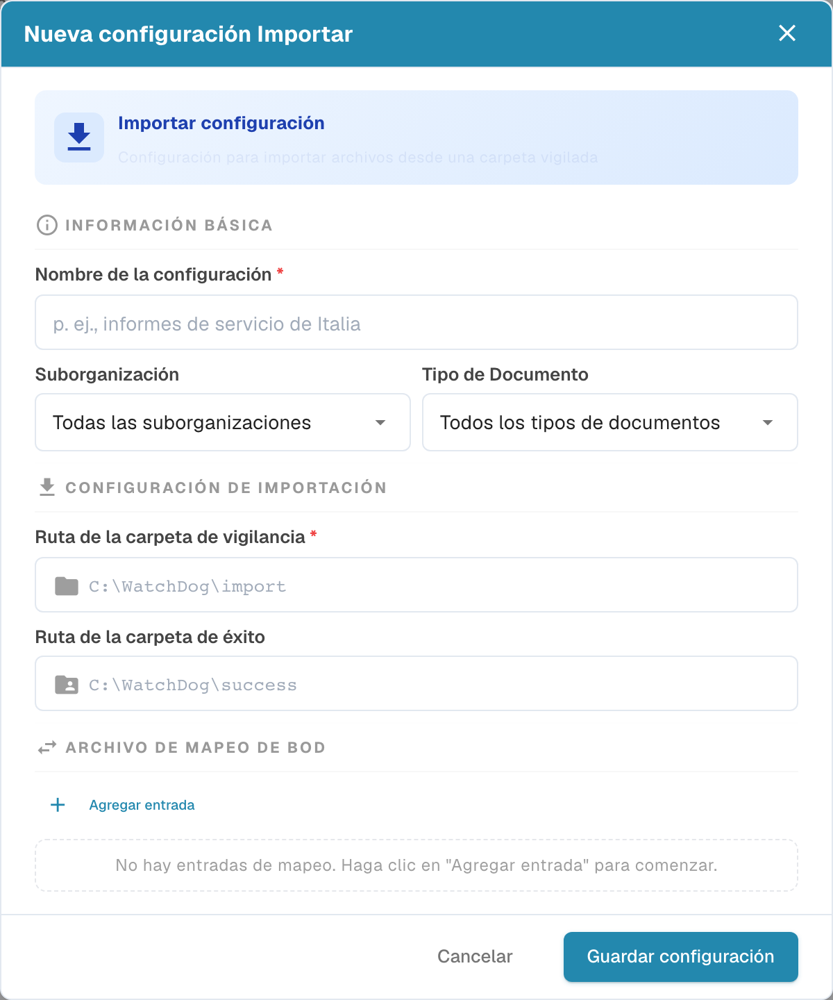
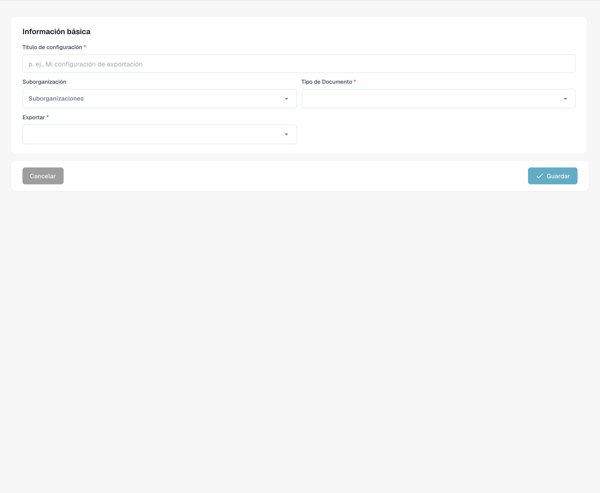
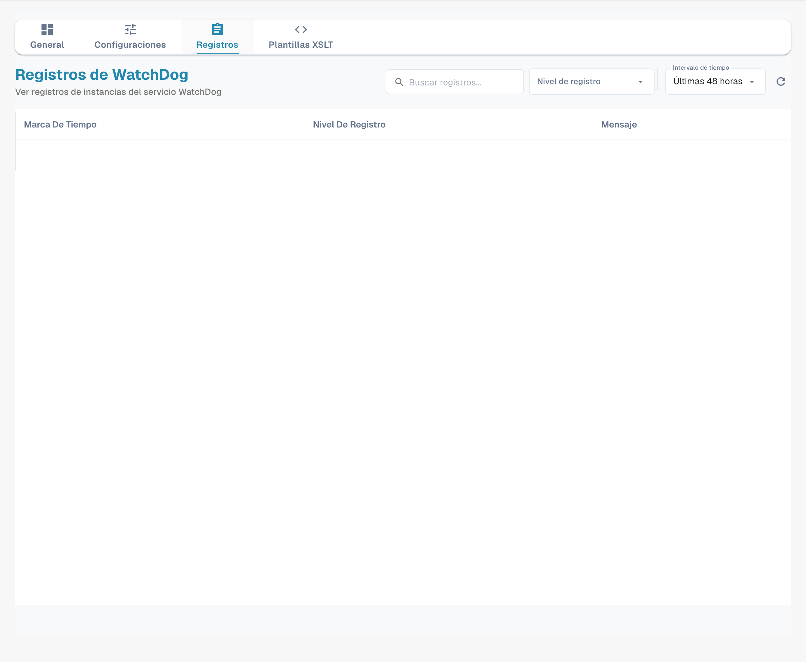
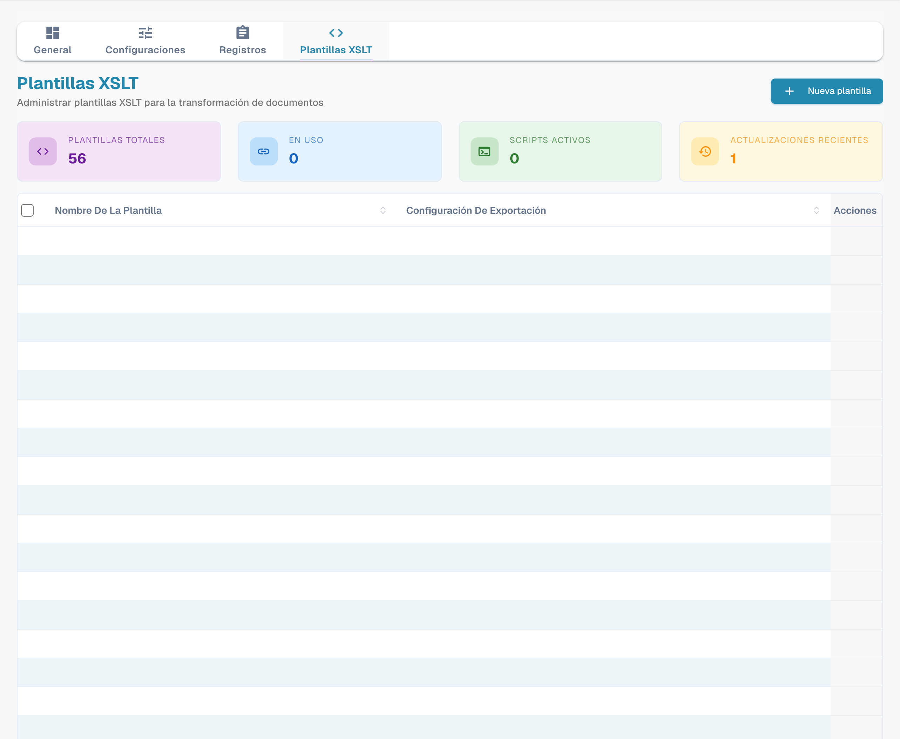
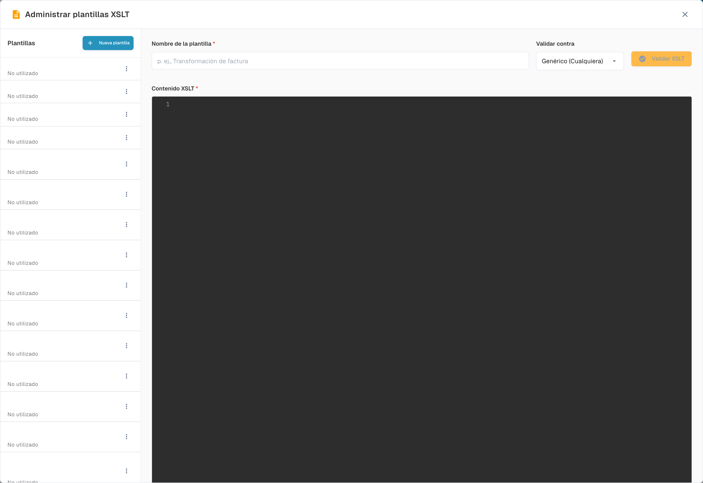

# Configuración de WatchDog

Abra **Ajustes → Procesamiento de documentos → WatchDog**. La interfaz actual tiene cuatro pestañas: **General**, **Configuraciones**, **Registros** y **Plantillas XSLT**. El estado del servicio está en General y las exportaciones se gestionan desde Configuraciones.

<figure><figcaption><p>Configuración de WatchDog: funciones de las cuatro pestañas.</p></figcaption></figure>

## 1. General: servicio, descarga y conexión

Consulte el estado de conexión y la información de versión disponible. Esta pestaña también ofrece la descarga y las instrucciones de configuración para el entorno actual. Un estado **Desconectado** no acredita una instalación correcta.

<figure><figcaption><p>Vista General de WatchDog con las cuatro pestañas actuales y el estado Desconectado del entorno de prueba. Los comandos con la clave de API y la ruta de instalación están ocultos. Esta imagen no acredita una instalación ni una conexión correcta.</p></figcaption></figure>

Descargue el ejecutable correspondiente a su entorno y utilice una clave de API autorizada de su organización. Ejecute el comando en un Símbolo del sistema de administrador, sustituyendo el marcador de posición:

```powershell
WatchDog.exe -api YOUR_API_KEY
```

No publique claves ni comandos que las contengan. La programación de actualización se ajusta en General; revise las opciones de su versión antes de elegir la frecuencia.

## 2. Configuraciones: importación y exportación

La pestaña reúne las configuraciones de importación y exportación. Los recuentos y estados que aparecen corresponden a su organización; no son valores predeterminados del producto.

<figure><figcaption><p>Pestaña Configuraciones con las acciones Nueva configuración de importación y Nueva configuración de exportación. Las listas contienen configuraciones existentes; sus nombres y valores están ocultos.</p></figcaption></figure>

### 2.1 Nueva configuración de importación

Abra **Nueva configuración de importación** y elija la acción para crear una configuración nueva. El formulario inicial permite indicar el nombre, la suborganización, el tipo de documento y las rutas de vigilancia y éxito. Las opciones globales de los selectores tienen un alcance distinto de seleccionar una suborganización o un tipo concreto: compruebe ese alcance antes de guardar.

<figure><figcaption><p>Formulario inicial de importación con Nombre de la configuración y las rutas de vigilancia y éxito. El título Nueva configuración Importar es la redacción actual de la interfaz. Las rutas visibles son ejemplos del formulario; no se guardó una configuración.</p></figcaption></figure>

| Campo | Uso |
| --- | --- |
| Nombre de la configuración | Identifica esta configuración en la lista. |
| Suborganización | Limita el ámbito cuando se selecciona una suborganización. |
| Tipo de Documento | Define qué tipo de documento corresponde a la importación. |
| Ruta de la carpeta de vigilancia | Carpeta donde WatchDog busca los archivos entrantes. |
| Ruta de la carpeta de éxito | Destino de los archivos importados correctamente. |

Las rutas `C:\WatchDog\import` y `C:\WatchDog\success` del formulario son ejemplos. Las carpetas deben existir y la cuenta del servicio debe tener los permisos adecuados. El título **Nueva configuración Importar** es la redacción que muestra actualmente la interfaz; se refiere al formulario de importación.

### 2.2 Nueva configuración de exportación

**Nueva configuración de exportación** abre el asistente de ajustes de exportación. Empiece por **Información básica**: título, ámbito de suborganización, **Tipo de Documento** y método del selector **Exportar**.

<figure><figcaption><p>Primer paso de una nueva exportación: Información básica, Título de configuración, Tipo de Documento y selector Exportar. Los campos posteriores dependen del método elegido. No se seleccionó un método ni se guardó el borrador.</p></figcaption></figure>

El tipo de documento (`doc_type`) es obligatorio para una configuración de exportación. Los campos siguientes dependen del método elegido; la carpeta de destino, la transformación XSLT o las credenciales no se introducen necesariamente en este primer paso. Revise el destino y el ámbito antes de guardar.

Entre los métodos de integración se encuentran la carpeta local (`Folder`/`watcher`), Infor IDM, Infor BOD, ION API, GLS840MI y REST API. Son nombres técnicos. Su disponibilidad y sus campos dependen de la configuración y versión del entorno. Infor BOD requiere un BOD y un flujo adecuados para el sistema de destino; elegirlo no convierte automáticamente un documento para cualquier ERP. En una integración REST, compruebe el contrato de la API y su autenticación específica.

Opciones como **Barcode Divider** o **DocBits Operator** pertenecen a su configuración correspondiente; no son pestañas adicionales de WatchDog.

## 3. Registros: diagnóstico

Use **Nivel de registro**, **Intervalo de tiempo** y la búsqueda para acotar los registros disponibles. El intervalo seleccionado se aplica a esta consulta, no establece una regla universal de retención.

<figure><figcaption><p>Pestaña Registros con Nivel de registro, Intervalo de tiempo y búsqueda. El intervalo visible pertenece a esta consulta; los datos de los registros están ocultos y no acreditan una conexión correcta del servicio.</p></figcaption></figure>

Los identificadores técnicos de eventos pueden aparecer en los mensajes: `FILE_IMPORT_STARTED`, `FILE_IMPORT_COMPLETED`, `FILE_IMPORT_FAILED`, `EXPORT_STARTED`, `EXPORT_COMPLETED`, `EXPORT_FAILED`, `FOLDER_VALIDATION_FAILED`, `CONFIG_LOADED`, `SERVICE_RESTART_INITIATED` y `SERVICE_RESTART_COMPLETED`. Su presencia en esta referencia no significa que se haya ejecutado cada evento en su entorno. No confunda la búsqueda de texto con un selector independiente de tipo de evento.

## 4. Plantillas XSLT: gestión y editor

La pestaña **Plantillas XSLT** muestra las plantillas disponibles. **Nueva plantilla** abre el administrador; dentro del administrador, **Nueva plantilla** permite iniciar un editor vacío.

<figure><figcaption><p>Pestaña Plantillas XSLT con Nueva plantilla y una lista existente cuyos nombres están ocultos. No se abrió ningún menú de fila ni se ejecutó una transformación.</p></figcaption></figure>

Indique **Nombre de la plantilla** y **Contenido XSLT**. **Validar contra** selecciona el contexto para **Validar XSLT**. La validación debe evaluarse con datos y una estructura compatibles; abrir el editor o ver un botón no demuestra una transformación correcta.

<figure><figcaption><p>Editor inicial sin guardar de Administrar plantillas XSLT, con Nombre de la plantilla, Contenido XSLT y Validar contra. Los nombres de las plantillas existentes están ocultos; el editor está vacío y no se ejecutó una validación.</p></figcaption></figure>

Vincule la plantilla desde la configuración de exportación cuando el método lo requiera. Revise su uso antes de modificar una plantilla compartida. Las imágenes muestran los formularios iniciales; no representan una configuración guardada ni una exportación realizada.
