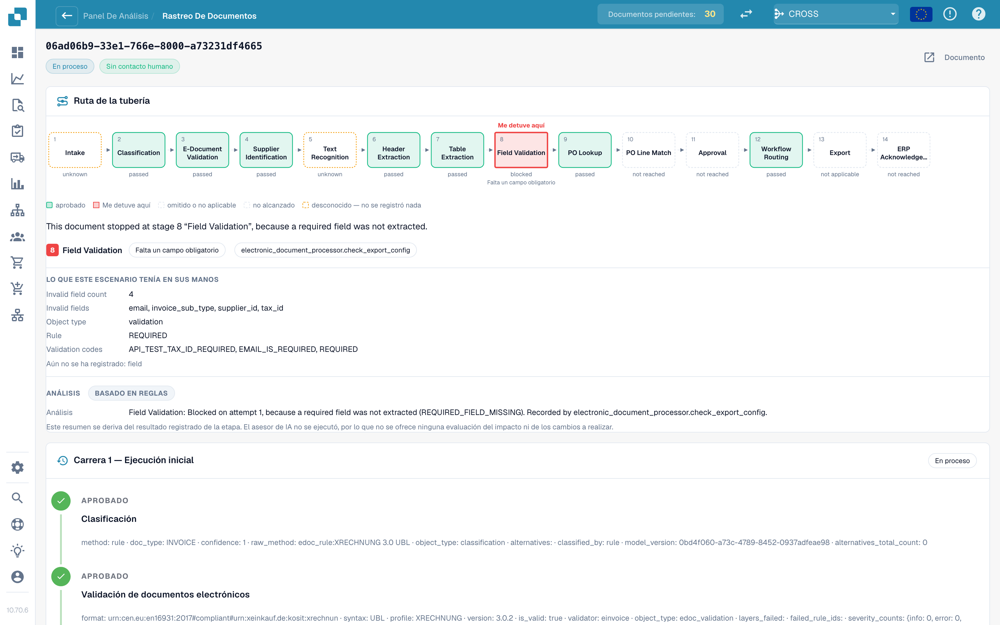

# Touchless Intelligence: Seguimiento del documento

Introduzca un ID de documento en **Document ID**, o abra un documento de muestra de un clúster, para ver **qué le ocurrió a este documento**.

<figure><figcaption>
El Document Trace: la ruta del pipeline con la etapa en la que se detuvo el documento, lo que esa etapa tenía a su disposición y, debajo, el historial de ejecuciones.
</figcaption></figure>

La parte superior muestra la **ruta del pipeline** con 14 etapas: Intake, Classification, E-Document Validation, Supplier Identification, Text Recognition, Header Extraction, Table Extraction, Field Validation, PO Lookup, PO Line Match, Approval, Workflow Routing, Export, ERP Acknowledgement. Cada casilla tiene un estado:

| Estado | Significado |
| --- | --- |
| **passed** (verde) | La etapa se ejecutó correctamente |
| **stopped here** (rojo) | La etapa bloqueó el documento |
| **skipped or not applicable** | La etapa no se aplica a este documento |
| **not reached** | El documento nunca llegó hasta aquí |
| **unknown** (línea discontinua) | No se registró nada para esta etapa |

Debajo de la ruta, una frase nombra la causa. En la captura de pantalla: *This document stopped at stage 8 "Field Validation", because a required field was not extracted.* (Este documento se detuvo en la etapa 8 "Field Validation" porque no se extrajo un campo obligatorio). El bloque **What this stage had in its hands** enumera los hechos: **Invalid field count 5** y los campos (`delivery_date`, `email`, `invoice_sub_type`, `payment_terms`, `supplier_id`), la regla (**REQUIRED**) y los códigos de validación. El bloque **Analysis** indica si es **Rule-based** o está escrito por IA.

El **historial de ejecuciones** de debajo enumera cada ejecución (**Run 1 · Initial run**, y después cada reinicio) con todas las etapas y sus hechos registrados. Si el documento se corrigió y se reinició, una nota le recuerda que **sigue contando como tocado**.

**Ejemplo.** Los documentos de un proveedor se detienen todos en la etapa 8. En el trace ve siempre los mismos cinco campos no válidos. Eso no es un problema de extracción de documentos individuales, sino un valor predeterminado que falta en la configuración de sus campos: corríjalo una vez y todo el clúster será recuperable.

## Páginas relacionadas

* [Touchless Intelligence](touchless-intelligence.md)
* [Diagnóstico de proveedores y clústeres de problemas](touchless-supplier-diagnosis.md)
* [Diagnóstico de la coincidencia con la OC](touchless-po-matching-diagnosis.md)
