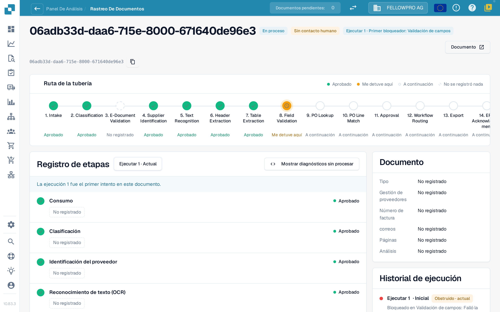
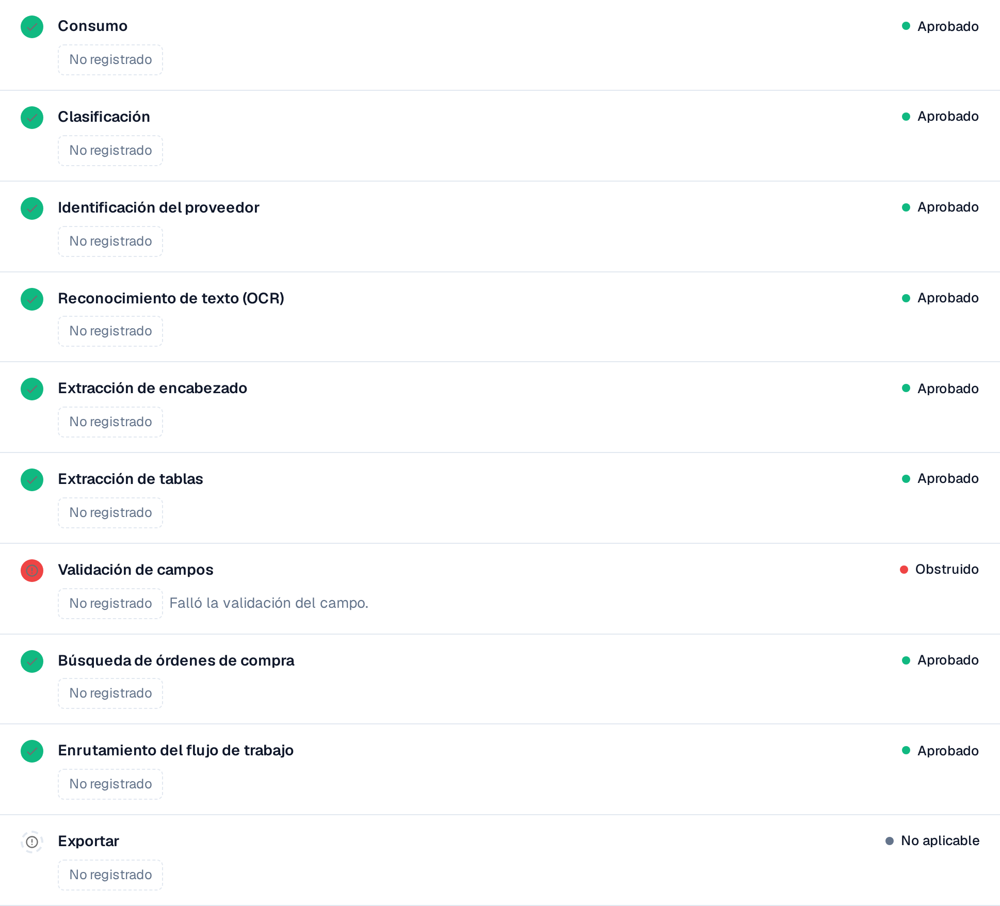

# Touchless Intelligence: Seguimiento del documento

Introduzca un ID de documento en **Document ID**, o abra un documento de muestra de un clúster, para ver **qué le ocurrió a este documento**.

La cabecera muestra el archivo, su estado (por ejemplo **En proceso**), la ejecución que está consultando y su primer bloqueador, además de un botón **Documento** con el ID del documento.

<figure><figcaption>
El seguimiento del documento: la ruta de la tubería con todas las etapas y el registro de etapas con lo que cada una registró.
</figcaption></figure>

La **Ruta de la tubería** muestra 14 etapas: Intake, Classification, E-Document Validation, Supplier Identification, Text Recognition, Header Extraction, Table Extraction, Field Validation, PO Lookup, PO Line Match, Approval, Workflow Routing, Export, ERP Acknowledgement. Cada etapa lleva un solo estado:

| Estado | Significado |
| --- | --- |
| **Aprobado** (verde) | La etapa se ejecutó sin problemas |
| **Me detuve aquí** (naranja) | La etapa bloqueó el documento |
| **A continuación** | El documento nunca llegó tan lejos |
| **No se registró nada** (discontinuo) | No se registraron datos para esta etapa |
| **No aplicable** | La etapa no se aplica a este documento |

### Registro de etapas

El **registro de etapas** bajo la ruta enumera las mismas etapas con lo que cada una registró. Un punto de estado y la palabra de estado aparecen a izquierda y derecha de cada fila.

* Cada valor es una **etiqueta de valor**: un número con su unidad, por ejemplo **Confianza 100 %**, **Umbral 60 %**, **Reglas fallidas 0**, **8 campos faltantes** o **0 brechas de asignación**. Los porcentajes se muestran como `97 %`, nunca como `0.97`.
* **Detalles** abre la lista completa de valores que registró una etapa, incluidas las alternativas que consideró.
* La etapa que bloqueó el documento indica el motivo, por ejemplo **Validación de campos fallida**.
* Un valor que ninguna etapa registró se muestra como **No registrado**, nunca como un valor inventado. Los valores son números y términos fijos, nunca texto del documento.
* **Mostrar diagnósticos sin procesar** activa los datos en bruto cuando el soporte los solicita.

<figure><figcaption>
Cada etapa muestra lo que registró; la etapa bloqueada indica su causa.
</figcaption></figure>

### Ejecuciones y cambios

El selector de ejecución en la parte superior del registro de etapas (**Ejecutar 1 · Actual**) cambia entre las ejecuciones del documento. El **historial de ejecuciones** a la derecha enumera cada ejecución con su resultado y el punto en el que se detuvo. Cuando un documento se ha ejecutado más de una vez, elija una ejecución en el selector para compararla con la actual: los valores modificados llevan entonces una insignia con la diferencia y su unidad, por ejemplo **−2 campos** o **+3 %**.

La tarjeta **Documento** junto al registro de etapas indica el tipo de documento, el proveedor, el número de factura, la orden de compra, el número de páginas y si el análisis se basa en **reglas** o lo escribió una IA.

**Ejemplo.** Los documentos de un proveedor se detienen todos en la etapa 8. En el seguimiento ve cada vez los mismos campos faltantes. No es un problema de extracción de documentos sueltos, sino un valor predeterminado que falta en su configuración de campos: corríjalo una vez y todo el clúster será recuperable.

## Páginas relacionadas

* [Touchless Intelligence](touchless-intelligence.md)
* [Diagnóstico de proveedores y clústeres de problemas](touchless-supplier-diagnosis.md)
* [Diagnóstico de la coincidencia con la OC](touchless-po-matching-diagnosis.md)

Las capturas de pantalla de esta página muestran la interfaz en español.
