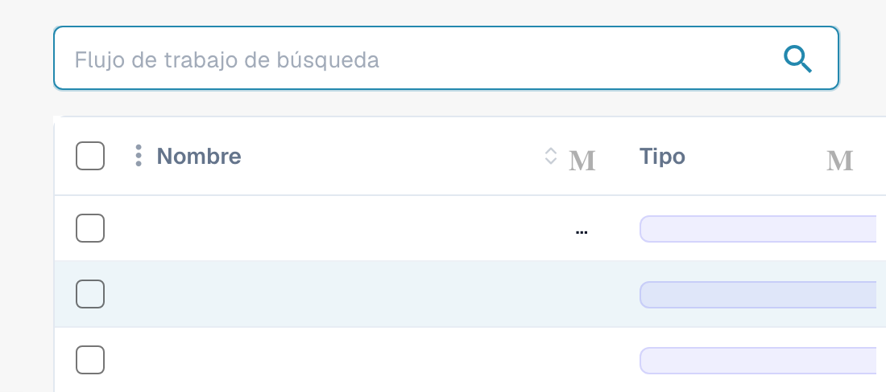

# Flujo de trabajo

<figure><figcaption>
Vista parcial de la búsqueda y de las columnas Nombre y Tipo de la lista de flujos de trabajo. Los valores privados están ocultos; algunos controles de la cabecera se muestran como «M» en esta versión.
</figcaption></figure>

## Motor de Flujo de Trabajo DocBits: Simplificación de la Automatización de Procesos

### Introducción

### Entender y preparar los workflows 

Recorra la cuenta de prueba real de DocBits: ocho ejecuciones en el panel, dos workflows guardados con un orden de ejecución de 100/200 y tres escenarios de prueba superados. El tutorial también explica los workflows Standard y Advanced, las licencias, las plantillas y el Card SDK.



[Ver con subtítulos](https://docbits-videos.fra1.cdn.digitaloceanspaces.com/settings-assistant/workflow-orientation-admin/v1/es.html) · [Abrir vídeo](https://docbits-videos.fra1.cdn.digitaloceanspaces.com/settings-assistant/workflow-orientation-admin/v1/es.mp4) · [Subtítulos (WebVTT)](https://docbits-videos.fra1.cdn.digitaloceanspaces.com/settings-assistant/workflow-orientation-admin/v1/es.vtt) · [Transcripción](https://docbits-videos.fra1.cdn.digitaloceanspaces.com/settings-assistant/workflow-orientation-admin/v1/es.txt) · 2:59

Capítulos y transcripción

| Capítulo | Inicio |
| --- | --- |
| Conocer al administrador | [0:00](https://docbits-videos.fra1.cdn.digitaloceanspaces.com/settings-assistant/workflow-orientation-admin/v1/es.mp4#t=0.000) |
| Organización y acceso | [0:01](https://docbits-videos.fra1.cdn.digitaloceanspaces.com/settings-assistant/workflow-orientation-admin/v1/es.mp4#t=1.750) |
| Panel y filtros | [0:14](https://docbits-videos.fra1.cdn.digitaloceanspaces.com/settings-assistant/workflow-orientation-admin/v1/es.mp4#t=14.333) |
| Lista de workflows | [0:51](https://docbits-videos.fra1.cdn.digitaloceanspaces.com/settings-assistant/workflow-orientation-admin/v1/es.mp4#t=51.542) |
| Orden de ejecución | [1:05](https://docbits-videos.fra1.cdn.digitaloceanspaces.com/settings-assistant/workflow-orientation-admin/v1/es.mp4#t=65.458) |
| Standard Workflow | [1:22](https://docbits-videos.fra1.cdn.digitaloceanspaces.com/settings-assistant/workflow-orientation-admin/v1/es.mp4#t=82.208) |
| Advanced Workflow | [1:34](https://docbits-videos.fra1.cdn.digitaloceanspaces.com/settings-assistant/workflow-orientation-admin/v1/es.mp4#t=94.458) |
| Licencias | [1:50](https://docbits-videos.fra1.cdn.digitaloceanspaces.com/settings-assistant/workflow-orientation-admin/v1/es.mp4#t=110.583) |
| Plantillas | [2:05](https://docbits-videos.fra1.cdn.digitaloceanspaces.com/settings-assistant/workflow-orientation-admin/v1/es.mp4#t=125.875) |
| Test Manager | [2:18](https://docbits-videos.fra1.cdn.digitaloceanspaces.com/settings-assistant/workflow-orientation-admin/v1/es.mp4#t=138.250) |
| Card SDK | [2:31](https://docbits-videos.fra1.cdn.digitaloceanspaces.com/settings-assistant/workflow-orientation-admin/v1/es.mp4#t=151.167) |
| Comprobar la preparación | [2:44](https://docbits-videos.fra1.cdn.digitaloceanspaces.com/settings-assistant/workflow-orientation-admin/v1/es.mp4#t=164.583) |

**Conocer al administrador**

Administro DocBits.

**Organización y acceso**

Bueno, primero compruebo la organización que aparece arriba. Estos ajustes de workflow pertenecen a la organización seleccionada. En esta demostración uso nuestra cuenta de pruebas de documentación.

**Panel y filtros**

El panel de workflows ofrece una visión general. Para esta vista, he ejecutado manualmente dos workflows de formación ocho veces con una factura de ejemplo. Aquí veo ocho ejecuciones en total y seis ejecuciones correctas. En dos ejecuciones no se cumplió la condición del importe. La tasa de éxito también incluye estas comprobaciones finalizadas correctamente. Filtro por nombre de workflow y compruebo el intervalo de fechas. Los contadores y el gráfico cambian con la selección. A la derecha alterno entre workflows guardados y escenarios de prueba. Las ejecuciones del Test Manager se cuentan por separado.

**Lista de workflows**

En la lista administro cada workflow. Reviso el nombre, el tipo Standard o Advanced, el orden de ejecución, el desencadenante y las acciones disponibles. Busco un workflow existente antes de crear otro.

**Orden de ejecución**

El orden de ejecución importa cuando varios workflows modifican el mismo documento. Compruebo cuál debe ejecutarse primero y qué datos necesita el siguiente. Aquí la revisión de factura tiene el orden cien y la siguiente comprobación doscientos. Los valores menores se ejecutan primero.

**Standard Workflow**

Para una regla lineal elijo Standard Workflow. Cuando define el desencadenante, Y añade condiciones, y Entonces ejecuta las acciones. La biblioteca ofrece las tarjetas disponibles.

**Advanced Workflow**

Para rutas alternativas uso Advanced Workflow. Esta vista previa muestra Start y conexiones explícitas. El éxito, una condición no cumplida y un error pueden seguir rutas diferentes. La posición de las tarjetas no define el orden.

**Licencias**

En Licencia reviso por separado Workflow y Advanced Workflow. Aquí ambos están inactivos. El diálogo muestra las suscripciones disponibles. Cierro esta consulta sin cambiar la suscripción. Abrir el diseñador no activa el motor.

**Plantillas**

Las plantillas permiten reutilizar un punto de partida. Abro su biblioteca y la opción de plantillas predeterminadas. Siempre reviso los campos, destinatarios y acciones para mi propio proceso.

**Test Manager**

Test Manager guarda escenarios de prueba para workflows Standard y Advanced. Tras configurar el workflow, añado entradas representativas y resultados esperados. Ejecutar todas las pruebas permite comprobar los cambios.

**Card SDK**

Card SDK sirve para extensiones propias. Los desarrolladores pueden usar una plantilla, subir un paquete o importar desde GitHub. Para la administración habitual empiezo con la biblioteca de tarjetas existente.

**Comprobar la preparación**

Antes de empezar confirmo la organización, el acceso, la licencia necesaria, los campos del documento y el resultado deseado. Decido si basta una regla lineal. En el siguiente vídeo creamos un Standard Workflow paso a paso.

En el ámbito de la automatización de procesos, el Motor de Flujo de Trabajo DocBits destaca por su enfoque sencillo e intuitivo. Este motor optimiza la creación y gestión de flujos de trabajo a través de una estructura basada en reglas clara y simple. El principio fundamental detrás de su diseño es la regla "Easy When-And-Then" (Fácil Cuando-Y-Entonces), que descompone el proceso de automatización en tres componentes fundamentales: Disparador, Condición y Acción. Esta guía explica cómo funciona cada componente dentro del sistema y cómo trabajan juntos para facilitar una automatización fluida.

### La Regla "Easy When-And-Then" Explicada

El Motor de Flujo de Trabajo DocBits opera sobre un principio básico pero potente que hace que la automatización de flujos de trabajo sea accesible para usuarios de todos los niveles de habilidad. Este principio está encapsulado en la regla "Easy When-And-Then", que puede desglosarse de la siguiente manera:

#### [When](./#when-trigger) (Disparador)

* **Definición**: El componente "When" (Cuando) representa el _Disparador_ del flujo de trabajo. Este es el evento o condición que inicia la ejecución del flujo de trabajo. Los disparadores pueden ser una variedad de ocurrencias tales como la llegada de un nuevo correo electrónico, una fecha y hora específicas, o la creación de un nuevo documento.
* **Ejemplo**: "Cuando se envía un nuevo formulario de cliente..."

#### [And](./#and-condition) (Condición)

* **Definición**: El componente "And" (Y) introduce la _Condición_ que debe cumplirse para que la acción proceda. Las condiciones sirven como filtros o criterios que refinan el disparador, asegurando que el flujo de trabajo se ejecute solo bajo ciertas circunstancias.
* **Ejemplo**: "...y el cliente es del segmento 'Enterprise'..."

#### [Then](./#then-action) (Acción)

* **Definición**: Finalmente, la parte "Then" (Entonces) especifica la _Acción_ a realizar una vez que ocurre el disparador y se satisface la condición. Las acciones son las tareas u operaciones ejecutadas por el flujo de trabajo, como enviar un correo electrónico, actualizar una base de datos o crear una tarea en una herramienta de gestión de proyectos.
* **Ejemplo**: "...entonces asignar el lead al equipo de ventas empresariales y enviar un correo electrónico de bienvenida."

### Combinación de Componentes para Automatizaciones Potentes

Al ensamblar estos tres componentes—Disparador, Condición y Acción—el Motor de Flujo de Trabajo DocBits permite a los usuarios crear flujos de trabajo altamente personalizados y eficientes. Este enfoque modular no solo simplifica el proceso de configuración de automatizaciones, sino que también ofrece la flexibilidad para crear flujos de trabajo complejos capaces de manejar una amplia gama de tareas y procesos.

### Conclusión

La regla "Easy When-And-Then" del Motor de Flujo de Trabajo DocBits ejemplifica el compromiso del motor de proporcionar una plataforma fácil de usar para automatizar procesos. Esta regla sencilla, al descomponer la automatización en los elementos esenciales de Disparador, Condición y Acción, facilita que los usuarios conceptualicen, creen y gestionen flujos de trabajo. Ya sea que sea nuevo en la automatización de flujos de trabajo o un profesional experimentado, el Motor de Flujo de Trabajo DocBits ofrece una herramienta eficiente y accesible para mejorar la productividad y optimizar las operaciones.

## Aprendizaje desde principiante hasta experto

[Aprendizaje desde principiante hasta experto](workflow-learning-path.md). Recorra los niveles en orden. Leer no basta: cada nivel termina con una configuración propia, una expectativa verificable y pruebas. P0 evita errores básicos de ejecución; P1 profundiza en datos, decisiones de negocio e integraciones.
