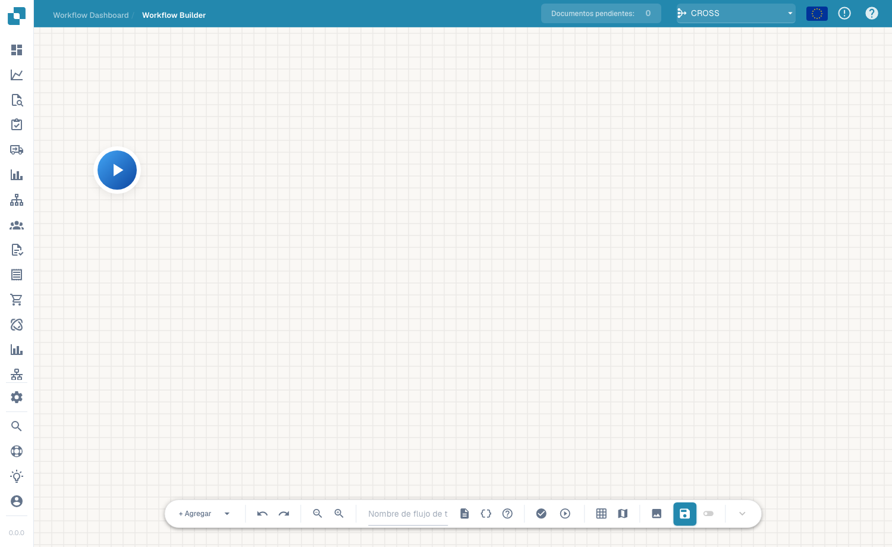

# Advanced Workflow

El constructor **Advanced Workflow** es un editor de grafos de nodos para flujos de trabajo que necesitan ramificaciones, rutas paralelas y control de flujo, más allá del modelo lineal When/And/Then del constructor Standard. Usted dispone los nodos en un lienzo y los conecta para definir el flujo de ejecución.

## Vídeo: rutas de facturas en DocBits

Conoce a Javier y sigue su explicación en la interfaz real de DocBits en español. Revisa el panel de workflows, la lista y la licencia antes de abrir un borrador sin guardar en el diseñador. Paso a paso, nombra el workflow, configura la comprobación del importe y dos acciones, organiza las tarjetas y conecta ambas rutas. Después muestra cómo preparar pruebas con un documento o datos personalizados. La cuenta de demostración no tiene una suscripción de Advanced Workflow y bloquea la validación; el borrador permanece sin guardar e inactivo.



[Abrir vídeo](https://docbits-videos.fra1.cdn.digitaloceanspaces.com/settings-assistant/advanced_workflows_canvas-admin/v7/es.mp4) · [Subtítulos (WebVTT)](https://docbits-videos.fra1.cdn.digitaloceanspaces.com/settings-assistant/advanced_workflows_canvas-admin/v7/es.vtt) · [Transcripción (texto)](https://docbits-videos.fra1.cdn.digitaloceanspaces.com/settings-assistant/advanced_workflows_canvas-admin/v7/es.txt) · 3:04

| En este vídeo | Inicio |
| --- | --- |
| Conozca al administrador | [0:00](https://docbits-videos.fra1.cdn.digitaloceanspaces.com/settings-assistant/advanced_workflows_canvas-admin/v7/es.mp4#t=0) |
| Comprobar el acceso | [0:04](https://docbits-videos.fra1.cdn.digitaloceanspaces.com/settings-assistant/advanced_workflows_canvas-admin/v7/es.mp4#t=4) |
| Nombrar el workflow | [0:25](https://docbits-videos.fra1.cdn.digitaloceanspaces.com/settings-assistant/advanced_workflows_canvas-admin/v7/es.mp4#t=25) |
| Configurar el importe | [0:37](https://docbits-videos.fra1.cdn.digitaloceanspaces.com/settings-assistant/advanced_workflows_canvas-admin/v7/es.mp4#t=37) |
| Añadir la acción Approval | [0:59](https://docbits-videos.fra1.cdn.digitaloceanspaces.com/settings-assistant/advanced_workflows_canvas-admin/v7/es.mp4#t=59) |
| Añadir la acción Standard | [1:18](https://docbits-videos.fra1.cdn.digitaloceanspaces.com/settings-assistant/advanced_workflows_canvas-admin/v7/es.mp4#t=78) |
| Organizar las tarjetas | [1:37](https://docbits-videos.fra1.cdn.digitaloceanspaces.com/settings-assistant/advanced_workflows_canvas-admin/v7/es.mp4#t=97) |
| Conectar las rutas | [1:52](https://docbits-videos.fra1.cdn.digitaloceanspaces.com/settings-assistant/advanced_workflows_canvas-admin/v7/es.mp4#t=112) |
| Preparar las pruebas | [2:15](https://docbits-videos.fra1.cdn.digitaloceanspaces.com/settings-assistant/advanced_workflows_canvas-admin/v7/es.mp4#t=135) |
| Validar, guardar y activar | [2:38](https://docbits-videos.fra1.cdn.digitaloceanspaces.com/settings-assistant/advanced_workflows_canvas-admin/v7/es.mp4#t=158) |

Transcripción

**Conozca al administrador**

Administro DocBits. Creamos un control de facturas.

**Comprobar el acceso**

Empiezo en el panel de workflows y abro la lista. Después compruebo la licencia. Workflow y Advanced Workflow necesitan acceso activo. Con ambos accesos habilitados, Nuevo workflow ofrece Advanced Workflow. Esta cuenta de documentación no tiene una licencia de workflow activa. Por eso continúo con una vista previa sin guardar en el diseñador.

**Nombrar el workflow**

Estoy en el diseñador real de DocBits. Primero doy un nombre claro al borrador. Comprobaremos el importe de una factura y usaremos dos acciones sencillas para mostrar las rutas posibles. Esta demostración queda sin guardar.

**Configurar el importe**

Abro el menú para añadir y elijo una tarjeta de condición. En Campo del documento selecciono la condición Docfield. Introduzco el campo total_amount. Después elijo la comparación mayor que. E introduzco mil. Utilice la clave de campo de su propio documento. Exactamente mil no cumple esta comparación.

**Añadir la acción Approval**

Ahora añado una tarjeta de acción de la categoría Campo del documento. La acción establece un campo del documento. Uso la clave de demostración approval_route. E introduzco el valor Approval. Esto identifica la ruta. Un proceso de aprobación real necesita sus propias acciones de negocio.

**Añadir la acción Standard**

Añado una segunda tarjeta con la misma acción. La acción establece un campo del documento. Uso la clave de demostración approval_route. Esta vez, el campo de demostración recibe el valor Standard. Las dos tarjetas están configuradas. Todavía necesitan conexiones para determinar qué acción se ejecuta.

**Organizar las tarjetas**

Arrastro las tarjetas hasta conseguir una disposición legible. Las dos acciones van a la derecha. La condición queda en el centro y Start a la izquierda. Mover una tarjeta cambia su posición. No crea una conexión.

**Conectar las rutas**

Arrastro desde la salida de Start hasta la entrada de la condición. La ruta de éxito lleva a Approval mediante una conexión azul. La ruta naranja de condición no cumplida lleva a Standard. La salida roja de error es una salida distinta para errores de evaluación. Aquí queda sin conectar. En un workflow de producción, decida cómo gestionar esos errores.

**Preparar las pruebas**

El botón de prueba de la barra abre la selección de un documento de prueba. Puedo elegir un documento de demostración o preparar datos personalizados completos. Pruebe importes superiores, inferiores e iguales a mil. Compruebe también un importe ausente. Esta cuenta no tiene licencia Advanced Workflow. Muestro la preparación de la prueba, no un resultado ejecutado.

**Validar, guardar y activar**

La validación comprueba conexiones y ajustes de las tarjetas. En esta cuenta, la falta de licencia bloquea la validación. Con una cuenta habilitada, guardaría explícitamente en el servidor. Después comprobaría la activación por separado. El interruptor está deshabilitado antes del primer guardado. El indicador de borrador automático se refiere a una copia local del navegador. No significa que el workflow esté guardado ni activado.

## Cómo acceder

Abra el diseñador Advanced Workflow desde el área de flujos de trabajo (el lienzo del constructor avanzado). Comienza desde un nodo **Start** y construye el flujo añadiendo nodos.

<figure><figcaption>
El lienzo de Advanced Workflow — un grafo de nodos con controles de zoom, ejecución, cuadrícula y guardado. Asigne un nombre al flujo de trabajo en la barra de herramientas.
</figcaption></figure>

## Añadir nodos

Haga clic en **+ Add** para abrir el menú de nodos. Además de las conocidas tarjetas **When**, **And** y **Then**, el constructor avanzado añade nodos de control de flujo:

<figure><figcaption>
El menú de nodos <strong>+ Add</strong>: When / And / Then más Wait ALL, Wait ANY, OR y Note.
</figcaption></figure>

- **When / And / Then** — las mismas tarjetas de condición y de acción que en el constructor Standard.
- **Wait ALL** — espera hasta que *todas* las ramas entrantes se completen antes de continuar.
- **Wait ANY** — continúa en cuanto *cualquiera* de las ramas entrantes se complete.
- **OR** — ramifica el flujo por rutas alternativas.
- **Note** — una anotación de texto libre en el lienzo (no afecta a la ejecución).

Ejecute el flujo con el control de reproducción, valídelo y guárdelo con el botón de guardar de la barra de herramientas.

## Próximos pasos

- Vea qué hace cada tarjeta en la sección **Cards**.
- Para automatizaciones lineales sencillas, el constructor **Standard Workflow** es más rápido de configurar.

[Ver los cinco capítulos](advanced-workflow-videos.md)
