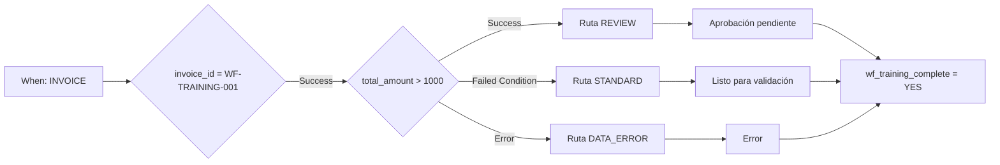

# Caso Advanced: enrutamiento de facturas

Una factura de formación superior a 1000 EUR necesita revisión. Hasta 1000 EUR inclusive sigue la ruta estándar. Un importe ausente o numéricamente inválido sigue la ruta de corrección de datos. Las tres rutas llegan a una acción de finalización común.

## Requisitos y diseño

Utilice una organización de prueba con Advanced habilitado y el [paquete de formación](workflow-training-kit.md). Importe `advanced-workflow.json` mediante **Import Workflow**, manténgalo desactivado y abra el gráfico. When comprueba Factura; la primera tarjeta And limita el ejercicio a `invoice_id = WF-TRAINING-001`. No contiene destinatarios ni exportación.

La comprobación inicial utiliza `invoice_id`, `eq` y `WF-TRAINING-001`; otro número omite todas las acciones posteriores. El importe se comprueba con **Docfield is**, versión 2, y `total_amount`, `gt`, `1000`. Las acciones de texto escriben `wf_training_route`. Las tarjetas de estado utilizan la versión 3 y **Trigger Workflows = false**.

**v2:** La tarjeta de estado de la ruta elegida conecta directamente con Then `complete`, que escribe `wf_training_complete = YES`. No hay un OR en espera. V1 solo demostraba el modo de prueba: con predecesores no alcanzados, el planificador puede omitir una unión que el test evalúa. La [guía P0](masterclass/control-nodes.md) explica la diferencia. Una Then común directa no sustituye una barrera para varias acciones obligatorias simultáneas.

## Construir y verificar

1. Valide el gráfico completo.
2. Prepare los archivos para su organización siguiendo las instrucciones del paquete.
3. Abra **Test → Custom Data** y utilice el archivo completo de cada caso. Un objeto que solo contenga `total_amount` es insuficiente.
4. Ejecute desde la entrada completa. Inspeccione la salida de `amount`, la ruta alcanzada, el mensaje de estado y `complete`.
5. Compare con las expectativas independientes. Las respuestas guardadas muestran los resultados realmente observados.

| Caso | Importe | Salida de amount | Ruta / estado | Resultado global |
| --- | --- | --- | --- | --- |
| above | 1785,00 | Success | REVIEW / validated_pending_approval | success |
| below | 999,00 | Failed Condition | STANDARD / ready_for_validation | success |
| boundary | 1000,00 | Failed Condition | STANDARD / ready_for_validation | success |
| just-above | 1000,01 | Success | REVIEW / validated_pending_approval | success |
| missing | ausente | Error | DATA_ERROR / error | error |
| invalid-number | invalid | Error | DATA_ERROR / error | error |
| other-invoice | 1785,00 | no ejecutado | otro número; ninguna acción | failed_condition |

En un caso de error, `data_error` y `complete` pueden completarse mientras el resultado global sigue siendo **error**. Tratar el error no elimina la evaluación fallida original.

## Ampliar el proceso

Las pruebas se realizaron el 21 de octubre de 2026 contra el servicio Dev desplegado DocFlow **2.10.38**. El paquete contiene respuestas reales de prueba; los cambios de campos y estados fueron simulados. No contiene Workflow Logs documentales persistidos ni demuestra aprobación personal o entrega real de una exportación.

Sustituya los marcadores por asignaciones y acciones de aprobación configuradas. Conecte la exportación únicamente a una condición explícita de aprobación. Confirme una ejecución real en el documento y la entrega en el receptor, usando un documento propio de formación y un destino de prueba previsto. Consulte la [guía de diagnóstico](workflow-troubleshooting.md).

## WF-02: Ejercicio y aceptación

Ejecute los siete casos y registre salida de amount, ruta, estado, complete y resultado global. Acepte test y ejecución real por separado. Un error tratado no equivale a ejecución sin errores aunque complete tenga éxito.

[Ruta de aprendizaje](workflow-learning-path.md)
