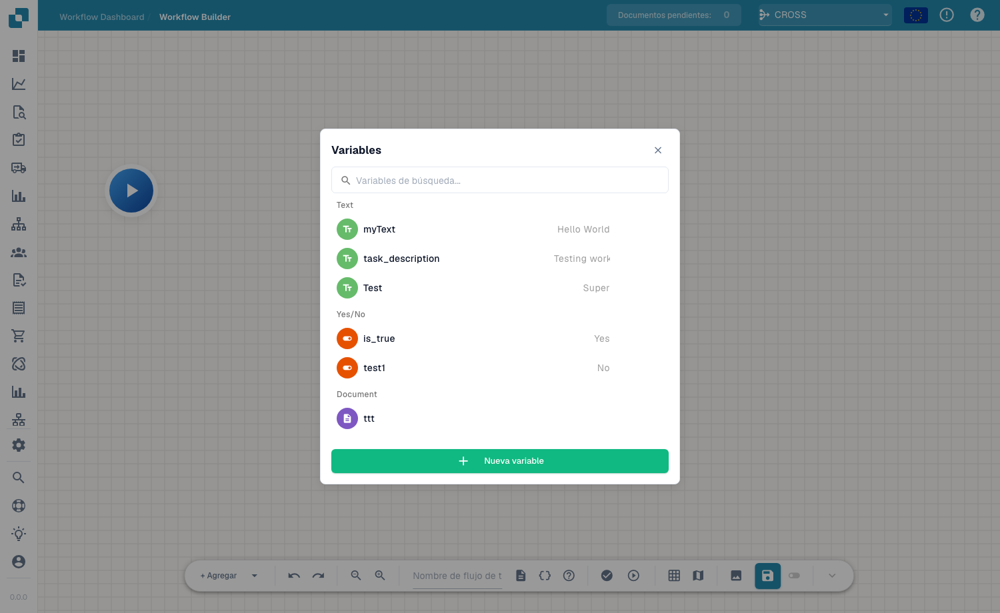

# Variables

## Vídeo: Variables, pruebas y activación



[Subtítulos (WebVTT)](https://docbits-videos.fra1.cdn.digitaloceanspaces.com/settings-assistant/advanced_workflows_testing/v2/es.vtt) · 1:53

Transcripción

**Elija el tipo de variable**

Abra Variables con las llaves. Elija texto, número, sí o no, o documento. Busque nombres. Document guarda una referencia mediante una acción específica; este formulario no admite valores de documento.

**Variables de la organización**

Elija nombre único, tipo y valor inicial. Crear, editar o eliminar se guarda inmediatamente para la organización. Otros workflows comparten estos valores. Guardar o descartar el lienzo no deshace cambios de variables.

**Valide primero la estructura**

Pulse Validar. Revise errores y advertencias sobre el lienzo. Pulse un mensaje para enfocar su nodo. Compruebe acciones, entradas, salidas, ciclos y uniones. Una estructura válida no garantiza datos correctos.

**Elija el contexto de prueba**

Reproducir en la barra abre la selección del documento. Elija documento, datos personalizados o prueba sin documento para tarjetas independientes. Start ejecuta directamente. Las pruebas incluyen cambios sin guardar y simulan acciones destructivas.

**Revise los resultados**

Revise mensajes y tiempos: verde, éxito; naranja, condición falsa; rojo, error; gris, omitido. Corrija y repita. Use el gestor de pruebas para escenarios repetibles con éxito, alternativas, datos ausentes y errores.

**Guarde antes de activar**

El guardado automático conserva un borrador local aproximadamente cada treinta segundos tras cambios. Guarde explícitamente en el servidor. Active después del primer guardado. Compruebe el estado en la lista antes de esperar ejecución automática.

[Ver los cinco capítulos](../advanced-workflow-videos.md)

Las **Variables** te permiten almacenar valores una sola vez y reutilizarlos en los nodos de un Advanced Workflow — por ejemplo, un umbral, un destinatario fijo o un valor que lees del documento y pasas a un nodo posterior. Abre el panel de variables desde el botón **Variables** (el icono `{ }`) en la barra de herramientas.

<figure><figcaption>
El panel de Variables — variables agrupadas por tipo, con búsqueda y <strong>New Variable</strong>.
</figcaption></figure>

## Tipos de variable

Las variables se agrupan por su tipo:

- **Text** — un valor de texto (p. ej. una descripción o una etiqueta fija).
- **Yes/No** — una marca booleana (Yes / No).
- **Document** — una referencia a un documento o a un campo de documento.

Usa el cuadro de búsqueda para encontrar una variable rápidamente cuando la lista crezca.

## Crear una variable

Haz clic en **New Variable**, asígnale un nombre y un tipo, y establece su valor. La variable queda entonces disponible para referenciarla desde las tarjetas de tus nodos, de modo que puedas mantener la configuración en un solo lugar y cambiarla sin editar cada nodo.

## Próximos pasos

- Mira cómo los nodos usan estos valores en [Nodos](nodes.md).
- Valida y ejecuta el flujo de trabajo en [Validación y pruebas](validation-and-testing.md).
