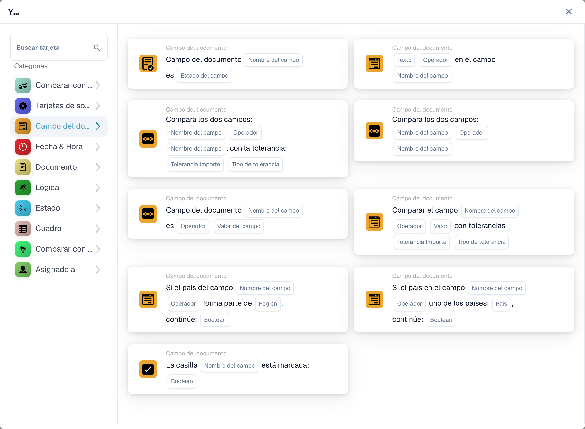
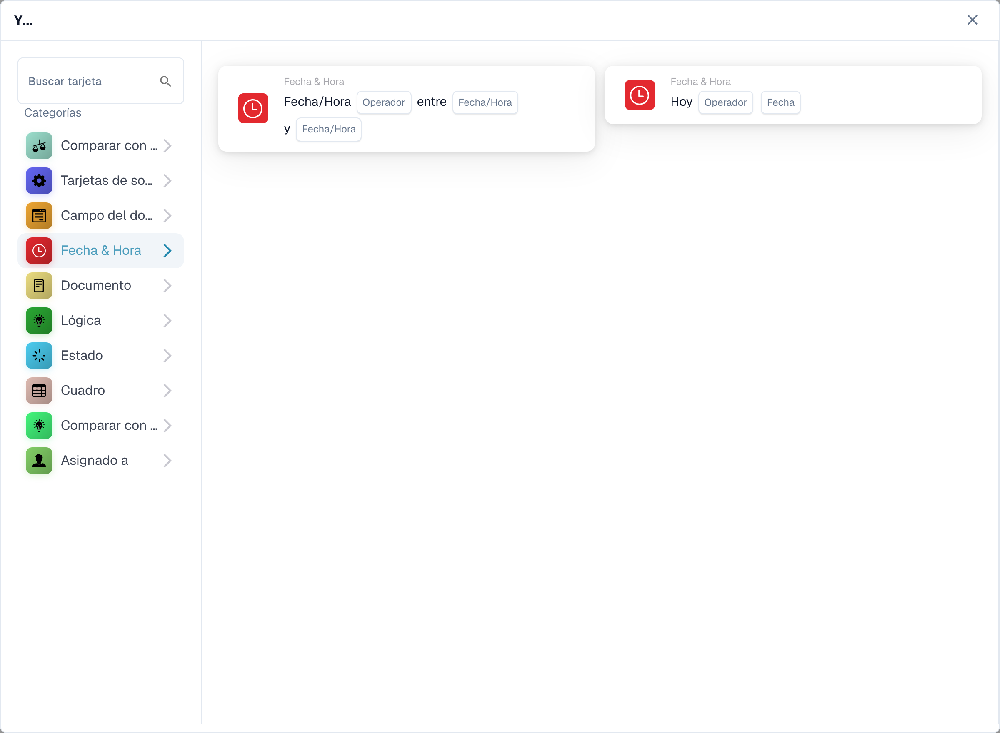
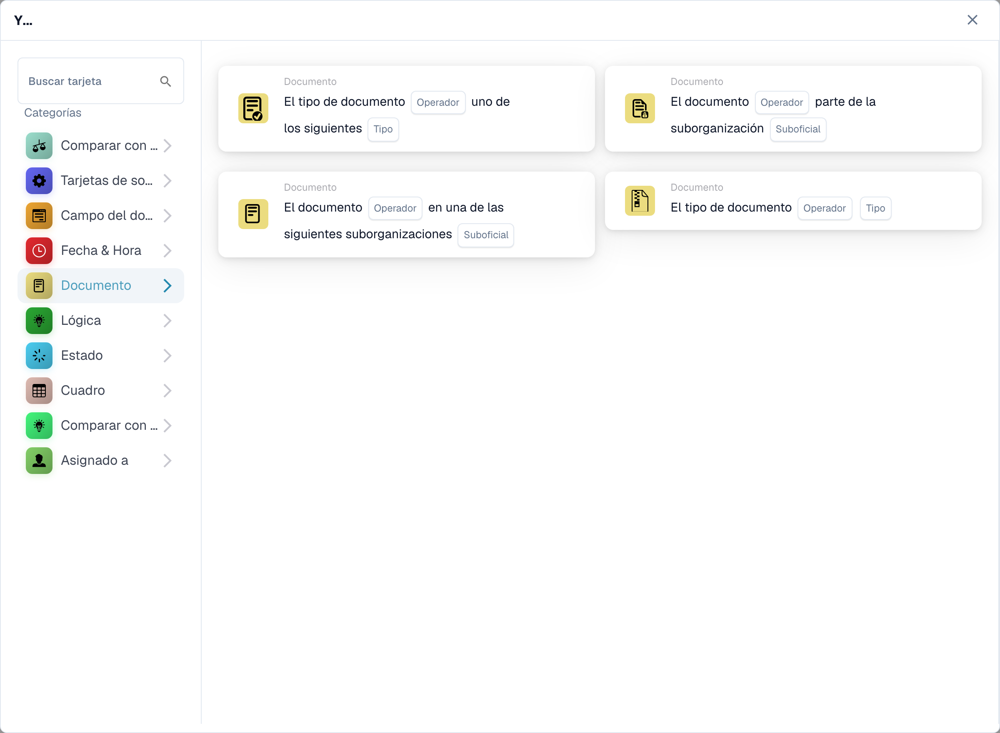
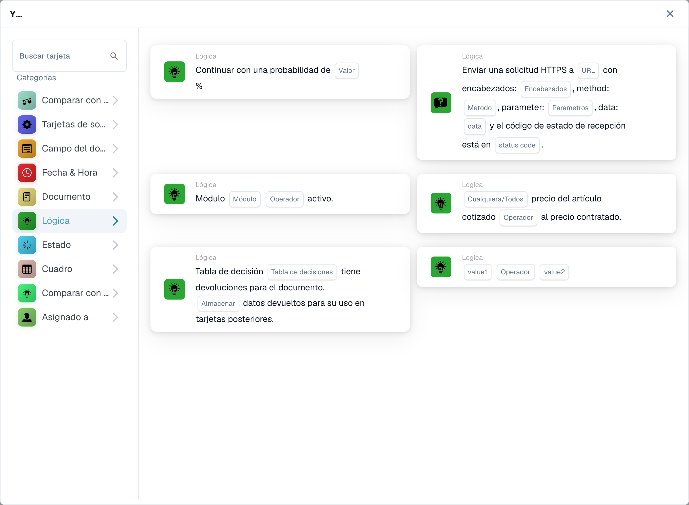
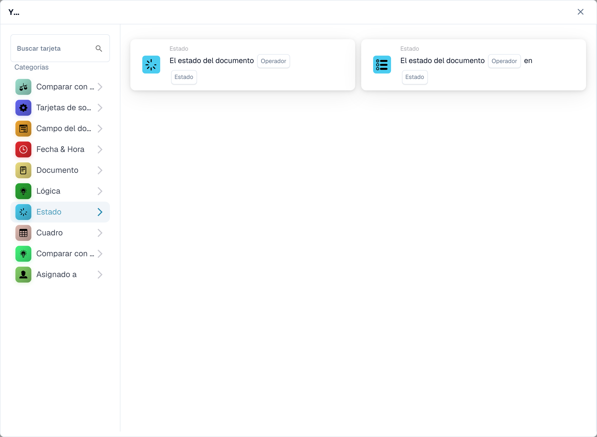
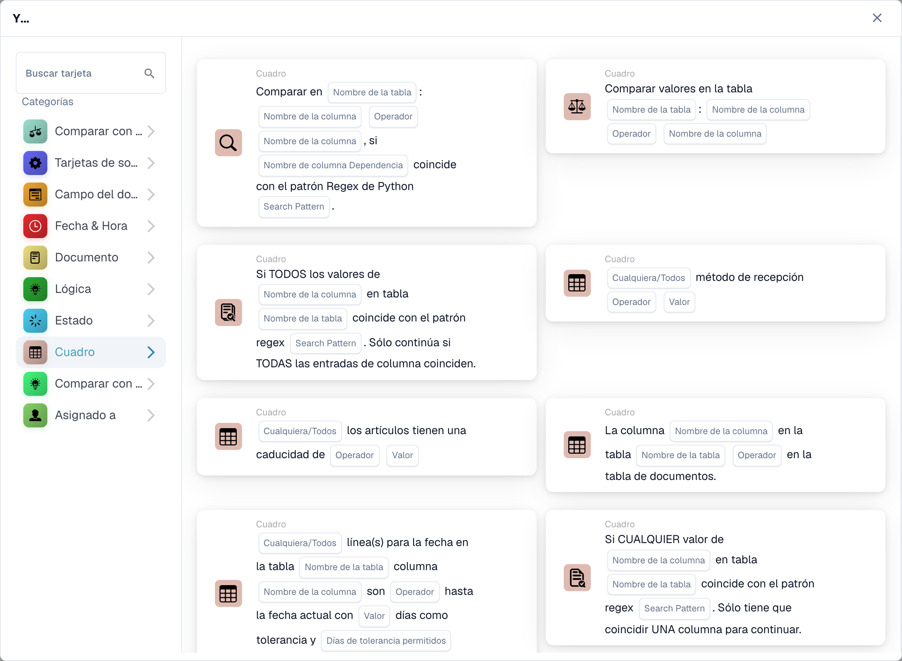
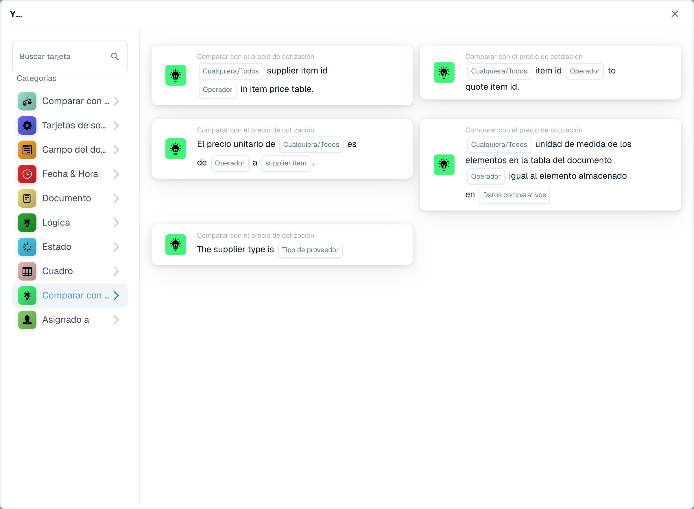
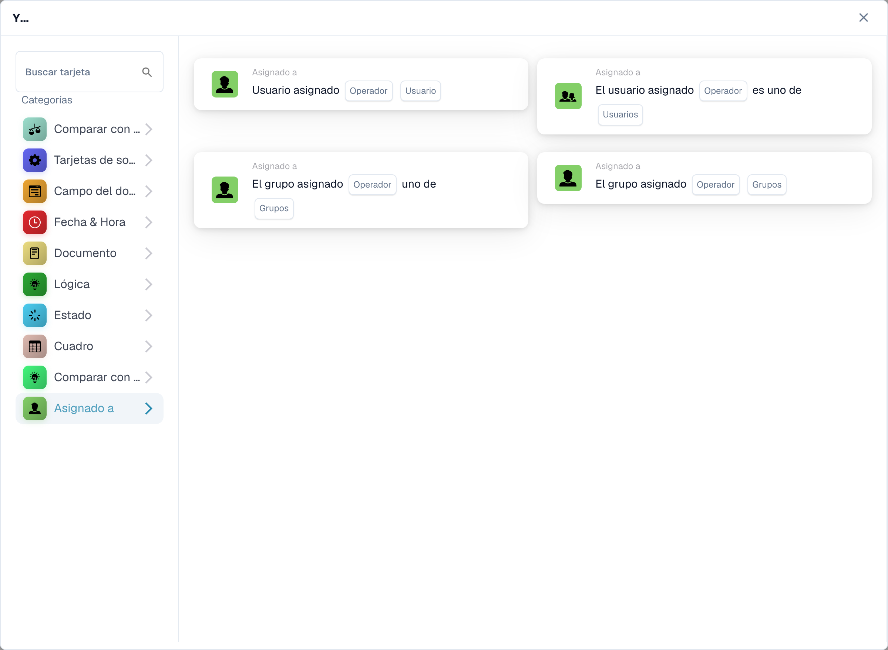

# Y

Algunas etiquetas del producto siguen en inglés o tienen traducciones incorrectas. Las categorías de tablas se refieren a tablas de datos; los valores devueltos no son devoluciones comerciales. Los identificadores técnicos permanecen sin traducir.

Utilice una tarjeta **Y** para decidir si un flujo de trabajo debe continuar después de su activación **Cuando**. Agregue las comprobaciones que necesita antes de la acción **Entonces**. Cada tarjeta muestra campos para completar, como **Operador**, **Nombre de campo** o **Valor**; las capturas de pantalla muestran las plantillas de tarjetas disponibles, no las reglas completadas.

En **Generador de flujo de trabajo**, seleccione **Añadir tarjeta** en **Y...**. Elija una categoría a la izquierda o escriba el nombre de una tarjeta en **Buscar tarjeta**. Seleccione una vista previa de la tarjeta para agregarla al flujo de trabajo. Puede desplazarse por la lista de vista previa para ver más tarjetas. Utilice **×** para cerrar el selector sin elegir otra tarjeta. Después de configurar las tarjetas, guarde el flujo de trabajo. Consulte [Flujo de trabajo](..) para conocer los pasos circundantes **Cuando**, **Y** y **Entonces**.

## Comparar con orden de compra

Utilice estas tarjetas para comparar datos de pedidos o facturas con una orden de compra, como precio unitario, fecha de entrega prometida, cargos o cantidad. Elija los campos, operador y cualquier tolerancia que solicite la tarjeta seleccionada. Consulte [Comparar con orden de compra](compare-with-purchase-order) para las tarjetas individuales.

<figure><figcaption>
Categoría de condiciones para comparar con pedidos.
</figcaption></figure>

## Campo de documento

Elija esta categoría para comprobar si una casilla de verificación está marcada o consultar el estado de un campo, comparar un campo con un valor o comparar dos campos. Complete los marcadores de posición **Nombre de campo** y **Operador** en la tarjeta elegida. Algunas comparaciones también piden tolerancia. Consulte [Campo del documento](document-field).

<figure><figcaption>
Categoría de condiciones sobre campos del documento.
</figcaption></figure>

## Fecha y hora

Utilice **Fecha y hora** para comparar una fecha u hora con un rango, o compare **Hoy** con una fecha elegida. Seleccione el **Operador** y los valores de fecha en la tarjeta. Consulte [Fecha y hora](date-and-time).

<figure><figcaption>
Categoría de condiciones de fecha y hora.
</figcaption></figure>

## Documento

Utilice estas tarjetas cuando un flujo de trabajo deba depender del **tipo de documento** o **suborganización**. Elija el tipo u organización mencionada en la tarjeta. Consulte el [Documento](document).

<figure><figcaption>
Categoría de condiciones sobre documentos.
</figcaption></figure>

## Lógica

Esta categoría incluye comprobaciones utilizando una tabla de decisiones, una respuesta HTTPS, disponibilidad del módulo, el precio de un artículo cotizado, un valor de probabilidad o dos valores. Abra la tarjeta específica y complete los marcadores de posición con su nombre; por ejemplo, la tarjeta HTTPS solicita una URL, un método y un código de estado aceptado. Consulte [Lógica](logic).

<figure><figcaption>
Categoría de condiciones lógicas.
</figcaption></figure>

## Estado

Utilice **Estado** para comprobar si un documento tiene un estado elegido o si su estado está en un conjunto seleccionado. Elija **Operador** y **Estado** en la tarjeta. Consulte [Estado](status).

<figure><figcaption>
Categoría de condiciones de estado.
</figcaption></figure>

## Tabla

Estas tarjetas examinan las filas de la tabla de documentos. Las opciones visibles incluyen verificaciones de fechas, patrones de texto, vida útil y comparaciones entre columnas. Seleccione **Nombre de tabla** y **Nombre de columna** antes de elegir un operador o patrón. Consulte la [Tabla](table).

<figure><figcaption>
Categoría de condiciones sobre tablas de datos.
</figcaption></figure>

## Comparar con el precio de cotización

Utilice estas tarjetas para comparar un artículo con los datos de precios cotizados. Las opciones visibles cubren el ID del artículo, el tipo de proveedor, el ID del artículo del proveedor, el precio unitario y la unidad de medida. El **Operador** y los marcadores de posición de datos dependen de la tarjeta que seleccione.

<figure><figcaption>
Categoría de condiciones sobre precios de ofertas.
</figcaption></figure>

## Responsable

Utilice **Responsable** cuando la condición dependa del usuario o grupo asignado. Elija si comparar con un usuario o grupo o un conjunto seleccionado. Consulte [Responsable](assignee).

<figure><figcaption>
Categoría de condiciones sobre asignaciones.
</figcaption></figure>

[Tarjetas de comparación de cotizaciones detalladas y comportamiento Cualquiera/Todos](../cards-overview/quote-comparison-guide.md).
