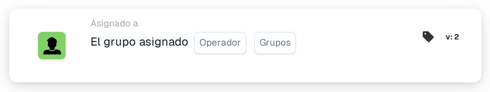

# Condición de grupo asignado único

<figure><figcaption>
Versión 2
</figcaption></figure>

**Propósito:**\
Esta tarjeta de flujo de trabajo ejecuta operaciones en función de si una tarea o documento está asignado a un grupo en particular. Utiliza una condición sencilla para disparar o impedir acciones según la asignación de grupo.

**Componentes de la tarjeta:**

1. **Operador**
   * **Descripción:** Define la condición lógica que se aplica a la asignación de grupo.
   * **Opciones:**
     * **IS:** Dispara la operación si el grupo asignado del documento o tarea coincide con el grupo especificado.
     * **NO ES:** Dispara la operación si el grupo asignado del documento o tarea no coincide con el grupo especificado.
2. **Grupo**
   * **Descripción:** Especifica el grupo con el que comparar el grupo asignado.
   * **Detalle:** Este campo le permite seleccionar un único grupo para comparar la asignación.

**Funcionalidad:**

* **Identificación de la asignación de grupo:** Identifica automáticamente el grupo asignado a una tarea o documento concreto.
* **Evaluación de la condición:**
  * Con el operador **IS**, la tarjeta comprueba si el grupo asignado coincide con el grupo especificado.
  * Con el operador **NO ES**, la tarjeta garantiza que el grupo asignado no coincida con el grupo especificado.
* **Ejecución de la acción:**
  * **Condición verdadera:** Si la asignación de grupo cumple la condición (ya sea **IS** o **NO ES**), se disparan las acciones pertinentes, como notificaciones, inicios de tareas, aprobaciones u otros pasos del flujo de trabajo.
  * **Condición falsa:** Si la condición no se cumple, el documento o tarea puede seguir un enrutamiento diferente, o pueden especificarse acciones alternativas.

**Interacciones del usuario:**

* **Configuración:**\
  Los usuarios configuran la tarjeta seleccionando un operador y especificando el grupo pertinente. La configuración debe ser sencilla e intuitiva.
* **Supervisión e informes:**\
  El sistema debe ofrecer funcionalidad para supervisar e informar sobre las operaciones disparadas por esta tarjeta, proporcionando información sobre la precisión de las asignaciones y la eficiencia del proceso.
* **Gestión de errores y notificaciones:**\
  Los usuarios deben tener opciones para recibir alertas o notificaciones si hay problemas con las asignaciones, como tareas sin asignar o errores en la selección de grupos.

**Conclusión:**\
La tarjeta de flujo de trabajo "Assigned Group Condition" es esencial para gestionar flujos de trabajo de documentos y tareas basados en asignaciones de grupo. Al permitir condiciones basadas en si una tarea o documento está asignado a un grupo específico, garantiza que los flujos de trabajo solo se disparen por las interacciones de grupo adecuadas, mejorando la gestión de tareas y la eficiencia del flujo de trabajo.

<!-- workflow-card-practical-example-20261021 -->

## Ejemplo práctico

**Cuándo utilizar:** Aplicar una regla a la cola de revisión financiera.

**Configuración:** Seleccione el operador igual y el grupo `Demo Finance`.

**Resultado esperado y contraejemplo:** Se aprueba un documento asignado a `Demo Finance`. La asignación a un usuario individual por sí sola no establece la membresía de este grupo de asignación de documentos seleccionado.

Esta es una configuración ilustrativa y un resultado esperado. Utilice campos, usuarios y grupos configurados en su organización de prueba; no es una afirmación de que este ejemplo haya sido ejecutado.
